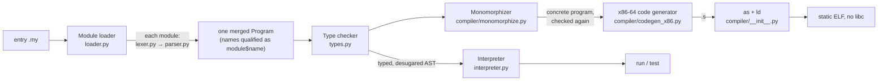

# Architecture

How the toolchains are built. The Python toolchain in `src/myla/` is described first: it is the bootstrap compiler and the reference every other implementation is tested against.

[SUBPAGES]

## The Python toolchain

| Module | Lines | Role | Page |
| --- | --- | --- | --- |
| `cli.py` | 250 | Commands `run`, `test`, `build`, `check`, `tokenize`, `parse`, `lsp` | [[Getting started]] |
| `tokens.py`, `lexer.py` | 760 | Source → tokens; f-strings lowered here | [[Architecture/Lexer-and-parser]] |
| `ast.py`, `parser.py` | 1770 | Tokens → AST; `|>` and `return a, b` lowered here | [[Architecture/Lexer-and-parser]] |
| `loader.py` | 710 | Import graph → one program with qualified names | [[Architecture/Module-loader]] |
| `types.py` | 4160 | Type representation, the checker, desugaring, float formatting | [[Architecture/Type-checker]] |
| `interpreter.py` | 1000 | Tree-walking evaluator and `#test` runner | [[Architecture/Interpreter]] |
| `compiler/monomorphize.py` | 420 | Generic → concrete copies | [[Architecture/Monomorphization]] |
| `compiler/codegen_x86.py` | 5210 | AST → GAS/AT&T assembly plus the runtime | [[Architecture/Native-backend]] |
| `compiler/__init__.py` | 70 | Writes the `.s`, runs `as` and `ld` | [[Architecture/Native-backend]] |
| `canon.py` | 320 | Canonical token and AST dumps for differential tests | [[Architecture/Self-hosted-compiler]] |
| `errors.py` | 100 | `MylaError` and its subclasses, caret rendering | below |
| `std/*.my` | 200 | The standard library, in Myla | [[Language/Standard-library]] |
| `lsp/` | 1350 | Language server | [[Architecture/Editor-tooling]] |

The whole toolchain uses only the Python standard library (the language server is an optional extra).

## Principles

- **One front end, two back ends.** The interpreter and the compiler consume the same checked AST, and the checker records everything they need on the nodes (`resolved_type`, `enum_ctor`, `method_func`, `func_ref`, `type_args`, …), so neither back end infers anything again.
- **Desugar early.** Sugar disappears before the back ends: f-strings in the lexer; `|>` and `return a, b` in the parser; `?`, `>>` composition, `_` partial application, operator overloading and `#derive(Eq)` in the checker (each node gets a `desugared` replacement that a final pass splices in: `types._desugar`).
- **The interpreter is the semantics.** Every example's native output is compared with the interpreter's; a difference is a bug in one of them.
- **Simple over clever.** No IR, no register allocator, no optimiser; every value lives in a stack slot (D1, D2).

## Diagnostics

All errors derive from `MylaError(message, line, column)` with a `kind` used as the prefix: `lex error`, `parse error`, `type error`, `module error`, `runtime error` ([[src/myla/errors.py]]). Each stage stops at its first error. The CLI renders the error with the offending source line and a caret. Errors don't record their file, so an error in an imported module is shown against the entry file ([[MYLA-10]]).

## The other implementations

- [[Architecture/Self-hosted-compiler]]: the same pipeline in Myla.
- [[Architecture/Rust-edition]]: a separate dialect and toolchain.
- [[Architecture/Editor-tooling]]: language server, VS Code extension, tree-sitter grammar.

The original v0.0 design sketch of this architecture is [[Archive/architecture]].
