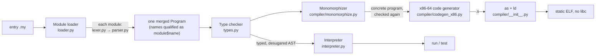

# Architecture

How the toolchains are built. The Python toolchain in `src/myla/` is described first: it is the bootstrap compiler and the reference every other implementation is tested against.

[SUBPAGES]

## The Python toolchain



| Module | Lines | Role | Page |
| --- | --- | --- | --- |
| `cli.py` | 240 | Commands `run`, `test`, `build`, `check`, `tokenize`, `parse` (and `repl`, which points to the self-hosted one) | [[Getting started]] |
| `tokens.py`, `lexer.py` | 760 | Source → tokens; f-strings lowered here | [[Architecture/Lexer-and-parser]] |
| `ast.py`, `parser.py` | 1770 | Tokens → AST; `|>` and `return a, b` lowered here | [[Architecture/Lexer-and-parser]] |
| `loader.py` | 710 | Import graph → one program with qualified names | [[Architecture/Module-loader]] |
| `types.py` | 4160 | Type representation, the checker, desugaring, float formatting | [[Architecture/Type-checker]] |
| `interpreter.py` | 1000 | Tree-walking evaluator and `#test` runner | [[Architecture/Interpreter]] |
| `compiler/monomorphize.py` | 420 | Generic → concrete copies | [[Architecture/Monomorphization]] |
| `compiler/codegen_x86.py` | 5210 | AST → GAS/AT&T assembly plus the runtime | [[Architecture/Native-backend]] |
| `compiler/__init__.py` | 70 | Writes the `.s`, runs `as` and `ld` | [[Architecture/Native-backend]] |
| `canon.py` | 320 | Canonical token and AST dumps for differential tests | [[Architecture/Self-hosted-compiler]] |
| `errors.py` | 130 | `MylaError` and its subclasses, rendering with the error's range underlined | below |
| `std/*.my` | 200 | The standard library, in Myla | [[Language/Standard-library]] |

The whole toolchain uses only the Python standard library. The tools beyond the compiler (the language server, the grammar generator) are written in Myla, in `tools/` (D71).

## Principles

- **One front end, two back ends.** The interpreter and the compiler consume the same checked AST, and the checker records everything they need on the nodes (`resolved_type`, `enum_ctor`, `method_func`, `func_ref`, `type_args`, …), so neither back end infers anything again.
- **Desugar early.** Sugar disappears before the back ends: f-strings in the lexer; `|>` and `return a, b` in the parser; `?`, `>>` composition, `_` partial application, operator overloading and `#derive(Eq)` in the checker (each node gets a `desugared` replacement that a final pass splices in: `types._desugar`).
- **The interpreter is the semantics.** Every example's native output is compared with the interpreter's; a difference is a bug in one of them.
- **Simple over clever.** No IR, no register allocator, no optimiser; every value lives in a stack slot (D1, D2).

## Diagnostics

All errors derive from `MylaError(message, line, column, span)` with a `kind` used as the prefix: `lex error`, `parse error`, `type error`, `module error`, `runtime error` ([[src/myla/errors.py]]). Each stage stops at its first error. An error records the file its position refers to (`path`, MYLA-10): the loader stamps lex, parse and module errors with the module being loaded and every declaration with its file (`source_path`), and `errors.in_file` stamps checker and runtime errors with the declaration, function or lambda they come from. The CLI renders the error with that file's source line and carets under the error's range; the language server publishes it for that file.

The range (`span`: start line and column, and the position just past the end) comes from what the error is about (D74, [[MYLA-65]]). Errors are raised with `at=` a token or a syntax node, which know their range: a token from the lexer, a node from the parser, which records the tokens it consumed for it, from the first to the last (so `f(1, 2)` and `a + b` include their left operand, and the parentheses around an operand belong to the enclosing expression, not to the operand). A lex error runs from its position to where the lexer stopped (`"oops` for an unterminated string, `10i9` for a bad suffix). The carets cover the range's part on the error's line, to the end of the line when the range goes on (a declaration shows its first line), and always the error's column, which stays where it was: for `a + b` the operator, for a call its `(`. Nodes the checker synthesizes have no range and get one caret.

```
type error: unknown function 'nope'
  --> x.my:2:17
  |
2 |     let x = nope(1)
  |             ^^^^^^^
```

## The other implementations

- [[Architecture/Self-hosted-compiler]]: the same pipeline in Myla.
- [[Architecture/Rust-edition]]: a separate dialect and toolchain in Rust, removed in October 2026 (history note).
- [[Architecture/Editor-tooling]]: language server, VS Code extension, the grammar description and the tree-sitter grammar generated from it.

## Designs not built yet

- [[Architecture/Project-tool]]: `myla` as a project tool like cargo, with a manifest (`myla.toml`), path and Git dependencies and the commands `new`, `build`, `run`, `test`, `check`, `fetch` and `clean` (D73, [[MYLA-64]]); waiting for approval.

The original v0.0 design sketch of this architecture is [[Archive/architecture]].
