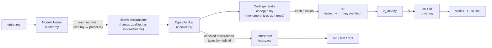

# Architecture

How the toolchain is built. It is written in Myla, in `selfhost/` (the compiler, the interpreter, the CLI) and `tools/` (the language server, the grammar generator), with the standard library in `lib/std/`; it bootstraps from a committed seed, its own assembly ([[Development/Bootstrap]], D101).

Until November 2026 a Python toolchain in `src/myla/` was the bootstrap and the reference the self-hosted one was tested against, and the self-hosted stages were ported from it nearly line for line ([[Architecture/Self-hosted-compiler]]). It was retired by D101 ([[MYLA-219]]); the branch `backup/python-toolchain-final` keeps it. The pages on the lexer and parser, the module loader, the type checker, the interpreter, monomorphization and the native backend were written for it: the design they describe is the self-hosted toolchain's too, but where they name functions and modules of the Python implementation, that code is gone.

[SUBPAGES]

## The pipeline



| Module | Role | Page |
| --- | --- | --- |
| `main.my`, `driver.my` | The CLI `build/myla`: commands `run`, `test`, `build`, `check`, `repl` and the project commands; what they do with one entry file | [[Getting started]] |
| `tokens.my`, `lexer.my` | Source → tokens; f-strings lowered here | [[Architecture/Lexer-and-parser]] |
| `ast.my`, `parser.my` | Tokens → AST; `|>` and `return a, b` lowered here | [[Architecture/Lexer-and-parser]] |
| `loader.my` | Import graph → one program with qualified names | [[Architecture/Module-loader]] |
| `checker.my` | Type representation, the checker, the types of every expression | [[Architecture/Type-checker]] |
| `interp.my`, `anf.my` | Tree-walking interpreter and `#test` runner; async bodies normalized for its async evaluator | [[Architecture/Interpreter]] |
| `codegen.my` | The code generator: the worklist of functions and their concrete copies, layouts, the runtime as assembly, debug information | [[Architecture/Monomorphization]], [[Architecture/Native-backend]] |
| `lower.my`, `ir.my`, `ir_x86.my` | Every function through the IR: lowering, verifier, emission | [[Architecture/IR]] |
| `dwarf.my` | The fixed parts of the `-g` debug information | [[Development/Debugging]] |
| `diag.my` | Rendering an error with its source line and carets | below |
| `repl.my` | `myla repl` | [[Architecture/Self-hosted-compiler]] |
| `project.my`, `project_cmd.my`, `fetch.my` | The project tool | [[Architecture/Project-tool]] |
| `lib/std/*.my` | The standard library, in Myla | [[Language/Standard-library]] |
| `lib/debug/myla_gdb.py` | gdb pretty-printers, embedded in `-g` binaries (D82) | [[Development/Debugging]] |

The toolchain needs only `as` and `ld`. The tools beyond the compiler (the language server, the grammar generator) are written in Myla too, in `tools/`.

## Principles

- **One front end, two ways to run.** The interpreter and the code generator consume the same checked declarations, and the checker records what they need in side tables keyed by node id (`resolved`, the type of every expression, and others), so neither infers anything again.
- **Desugar early where no types are needed.** f-strings disappear in the lexer, `|>` and `return a, b` in the parser. `?`, `>>` composition, `_` partial application, operator overloading and `#derive(Eq)` are checked by the checker and carried out by the interpreter and the lowering from its records. (The Python checker replaced them with desugared nodes instead.)
- **The interpreter and native code agree.** Every example's native output is compared with the interpreter's; a difference is a bug in one of them ([[Development/Conventions]]).
- **Simple over clever.** No register allocator, no optimiser; every value lives in a stack slot (D1, D2). The IR (D79) makes frame layout and ownership explicit data that can be printed and verified.

## Diagnostics

The lexer and the parser report a `Diag` (`kind`, position, range `sp`, message; [[selfhost/tokens.my]]), the checker a `CheckErr`, the declaration it comes from naming its file; the CLI turns them into a `Report` ([[selfhost/diag.my]]): `kind` used as the prefix (`lex error`, `parse error`, `type error`, `module error`, `runtime error`), message, file, position and range, the errors found after it (`more`) and its notes. The parser and the checker report up to 20 errors per run (`MAX_ERRORS`, D80): the parser resumes at the next statement, impl member or declaration, the checker checks every function on its own once its tables are built; the lexer, the loader and the interpreter stop at their first error. A stage gives the first error it found, the one a single-error run reported, with the others in its `more` in the order they were found. An error records the file its position refers to (MYLA-10). `diag.render` prints each error with that file's source line and carets under the error's range, a blank line apart, and after several errors a summary line, `error: aborting due to 3 previous errors`; the language server publishes each error for its file.

The range (`span`: start line and column, and the position just past the end) comes from what the error is about (D74, [[MYLA-65]]). An error takes its range from a token or a syntax node: a token from the lexer, a node from the parser, which records the range of the tokens it consumed for it, from the first to the last (so `f(1, 2)` and `a + b` include their left operand, and the parentheses around an operand belong to the enclosing expression, not to the operand). A lex error runs from its position to where the lexer stopped (`"oops` for an unterminated string, `10i9` for a bad suffix). The carets cover the range's part on the error's line, to the end of the line when the range goes on (a declaration shows its first line), and always the error's column, which stays where it was: for `a + b` the operator, for a call its `(`. Nodes the checker synthesizes have no range and get one caret.

```
type error: unknown function 'nope'
  --> x.my:2:17
  |
2 |     let x = nope(1)
  |             ^^^^^^^
```

## More

- [[Architecture/Self-hosted-compiler]]: the files, how a compiler is written in Myla, how it was brought up against the Python toolchain.
- [[Architecture/Rust-edition]]: a separate dialect and toolchain in Rust, removed in October 2026 (history note).
- [[Architecture/Editor-tooling]]: language server, VS Code extension and its debugger, the grammar description and the tree-sitter grammar generated from it.

## Built since the first design

- [[Architecture/Project-tool]]: `myla` as a project tool like cargo, with a manifest (`myla.toml`), path and Git dependencies and the commands `new`, `build`, `run`, `test`, `check`, `fetch` and `clean` (D73, [[MYLA-64]]).
- [[Architecture/IR]]: the mid-level IR between the checker and the self-hosted backend: three-address code on basic blocks with explicit reference counting and a verifier; every function goes through it since [[MYLA-107]] (D79, D85).

Not built yet: an LLVM backend and other platforms ([[MYLA-62]]).

The original v0.0 design sketch of this architecture is [[Archive/architecture]].
