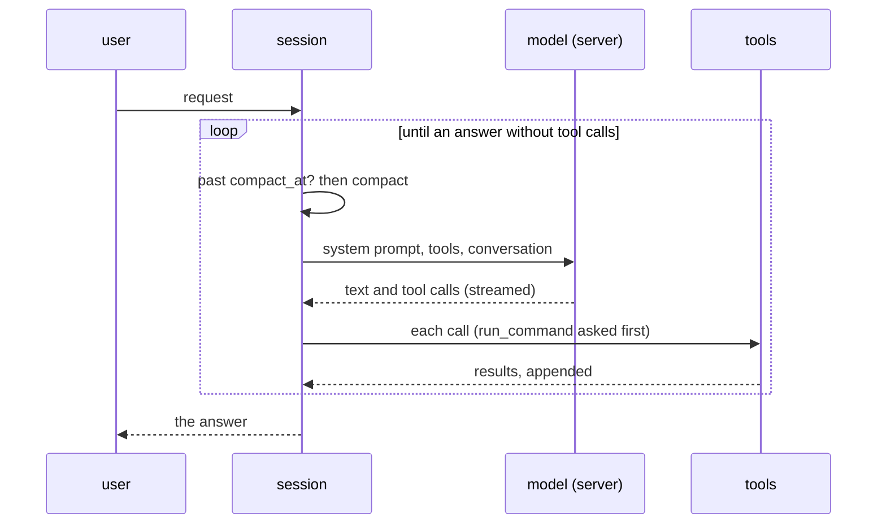

# Agent harness

`examples/agent/` is an agentic AI harness written in Myla: a language model works in a directory through tools, in a loop. The harness sends the conversation to the model, runs the tools the model asks for, sends back their results, and stops when the model answers without a tool call. It talks to any server with the OpenAI-style chat completions API (vLLM, llama.cpp's server, Ollama) over plain HTTP. It started as the single file `examples/agent.my` and became a project with [[MYLA-758]]; the epic is `tasks/Agent harness/`.

[TOC]

## Running it

```bash
cd examples/agent
build/myla run --demo                      # offline: a stand-in for the server plays one conversation
../../build/myla build                     # build/agent, a native binary
build/agent -C ~/notes "Summarise the notes into summary.md"
build/agent                                # no task: a conversation (the REPL)
```

The options are `-C DIR` (the workspace), `--config FILE`, `--server URL`, `--model NAME`, `--no-stream`, `-y`/`--yes` (run commands without asking) and `--demo`. vLLM calls tools only when started with `--enable-auto-tool-choice --tool-call-parser <the model's parser>`, and reports cached tokens only with `--enable-prompt-tokens-details`.

The configuration comes from the defaults in `config.my`, then the user's `$XDG_CONFIG_HOME/myla-agent/config.toml` (or `~/.config/…`, or `--config FILE`), then `MYLA_AGENT_SERVER`, `MYLA_AGENT_MODEL` and `MYLA_AGENT_API_KEY`, then the command line. Its keys are `Config`'s fields: `server`, `model`, `api_key`, `context_tokens`, `max_tokens`, `max_turns`, `max_read_bytes`, `stream`, `commands` (`ask`, `allow`, `deny`), `command_timeout_ms`, `compact_at`, `cache_prompt`, `memory_dir`, `skill_dirs` and `system`. A key the file misspells is ignored. The workspace has no configuration of its own, because a file in it could allow the agent to run commands there.

## Modules

| Module | What it does |
| --- | --- |
| `main.my` | The command line (std.args), the workspace and the system prompt, the REPL and its commands (`/help`, `/exit`, `/clear`, `/compact`, `/stats`, `/skills`, `/memory`) |
| `session.my` | One conversation: the loop of [`ask`](#the-loop), asking before a command runs, compaction, the statistics; `Input` reads lines with std.term's editor on a terminal and plainly from a pipe |
| `chat.my` | The API's messages, the request body, a reply read with its `usage` |
| `client.my` | The requests: a plain one through std.http, a streamed one over std.net (std.http gives a response only once it is whole) |
| `stream.my` | A streamed reply, pure: the server-sent events, chunked transfer decoding, the events folded into a reply (tool calls come in pieces by their index) |
| `tools.my` | The tools' schemas and the tools: `list_files`, `read_file`, `write_file`, `edit_file`, `grep`, `run_command`, `load_skill`, `remember`, `recall`, `forget`, `done` |
| `skills.my` | Skills: their discovery, the system prompt's list of them, loading one |
| `memory.my` | Instruction files (with `@` includes) and the agent's own memory |
| `context.my` | The conversation's size, compaction, dropping old results, the statistics |
| `text.my` | Cutting text to size: pages of a file, a command's output |
| `mock.my` | The stand-in for the server: `--demo` and the end-to-end tests |

## The loop



The model ends a request by answering without a tool call, or with the `done` tool. `max_turns` (50) replies to one request are the most it gets.

## Skills

A skill is a directory with a `SKILL.md` whose frontmatter has a `name` and a `description`, which is the format of `.agents/skills/` in this repository. The harness looks in the workspace's `.agents/skills/` and `.claude/skills/`, in the user's `~/.config/myla-agent/skills/` and in `skill_dirs`, and the first skill of a name wins. The system prompt lists each skill's name and description; `load_skill(name, file?, start?)` reads its `SKILL.md`, or a file of its directory that the skill names, a page at a time. A skill costs context only once it is loaded.

## Memory

- **Instruction files.** The user's `~/.config/myla-agent/AGENTS.md` and the workspace's `AGENTS.md` and `CLAUDE.md` go into the system prompt. A line `@path` includes another file, relative to the file it is in and only from inside the workspace or the configuration directory. Each file is included once (this repository's `CLAUDE.md` is `@AGENTS.md`).
- **The agent's memory.** `remember(name, description, content)` writes one Markdown file per fact into the memory directory (`memory_dir`, by default `~/.local/share/myla-agent/<the workspace's path with dashes>/`) and a line into its index `MEMORY.md`. `recall` and `forget` read and remove a fact. The index goes into the system prompt when a session starts.

## The context window and the prompt cache

The servers cache a prompt by its prefix: vLLM's automatic prefix caching, and llama.cpp's server with `cache_prompt`, which the harness sends. So the harness keeps the prefix the same from one request to the next:

- The system prompt and the tools are built once per session. They carry no time and no counts, and a memory saved during a session appears in the index only from the next one.
- The conversation is only appended to. A message is kept as the JSON text it was sent as. The model's reasoning (`<think>…</think>`) is left out of what goes back, as Qwen3's chat template does anyway.
- The one rewrite is a compaction. Once the conversation passes `compact_at` percent (75) of the window less the reply's `max_tokens`, the model writes a summary, without tools. The conversation then becomes the system prompt, the first request, the summary and the newest turn, kept as it is because the model hasn't read its results yet. Summing that turn up too made the model read it again (measured on 2026-11-17: 9 requests instead of 7).
- The size is the last reply's `usage` (its prompt and completion tokens) plus an estimate of what came after it, at 3 bytes a token. A request against this repository's sources measured 3.3. If the summary fails, old tool results the model has answered are replaced by a note, oldest first ([[MYLA-757]]).
- `read_file` and `load_skill` give at most `max_read_bytes` (12,000) at a time and say where the next page starts, and `grep`'s and `run_command`'s results are cut to that size too.

`/stats` and the end of a run show the requests, the prompt tokens, how many of them came from the server's cache, the reply tokens and the compactions.

## Commands

`run_command` runs `sh -c` in the workspace with a time limit (`command_timeout_ms`, two minutes). By default (`commands = "ask"`) the user is asked first on the terminal. Without a terminal the answer is no, and the tool result says how to allow it. `--yes` or `commands = "allow"` runs commands without asking, and `deny` refuses them all. The file tools keep paths inside the workspace by their text: an absolute path inside it is accepted, but a symbolic link inside could still point out, and a command isn't confined at all.

## Tests

`myla test` in `examples/agent/` runs every module's `#test` cases. Among them are the tools on a temporary workspace (with a real command), the memory's round trip, the instruction files' includes, the demo end to end (streamed and not, with a cache share above zero) and a compaction against the stand-in. `tests/burn/test_agent.py` runs them and `--demo`. The examples' suites don't see the project, since they run the files of `examples/` itself.
