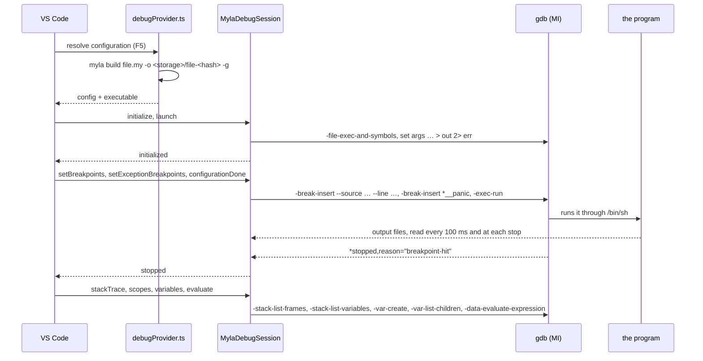

# Editor tooling

[TOC]

## Language server

The language server is written in Myla ([[MYLA-80]]). A Python one built on pygls (`src/myla/lsp/`, `myla lsp`) preceded it and served as its parity reference until it was retired ([[MYLA-83]], D71); it went by name only, with no scopes or types, and its open findings ([[MYLA-49]], [[MYLA-50]], [[MYLA-51]]) were requirements for this one. Git history has its code.

`tools/lsp/` is a language server written in Myla on the self-hosted front end; `scripts/bootstrap.sh` builds it with the stage 3 compiler as `build/myla-lsp` (`--stdlib <dir>` overrides the standard library root it finds next to `build/`). It publishes diagnostics, answers document symbols, definition, hover, references and completion, resolving names by scope, imports and the receiver's type, and provides semantic tokens; the VS Code extension starts it.

| Module | Role |
| --- | --- |
| `main.my` | Arguments, then the server loop |
| `protocol.my` | JSON-RPC with Content-Length framing over `std.io`'s `Reader` and `std.json` |
| `server.my` | Document store, debounce, checks, publishing |
| `text.my` | Lines, UTF-16 positions, the squiggle's width for a diagnostic without a range, `file://` URIs (the rules of `positions.py`) |
| `symbols.my` | The outline of one parsed file (`symbols.py`); selection ranges are name tokens (MYLA-48) |
| `features.my` | The identifier under the cursor and its occurrences from the compiler's tokens, hover text, the member-completion context |
| `semantic.my` | Semantic tokens from the compiler's lexer (D68) |
| `resolve.my` | What each identifier of a document refers to, by scope, imports and type (D69, D70); what completes at a position |
| `types.my` | Types as written, taken apart: elements, type arguments, results, substitution, unification (D70) |
| `workspace.my` | The declarations, identifiers and locals of every `.my` file under the workspace roots, listed with `find` (Myla has no directory listing) and cached by file content |

- **Sync and checks.** Documents are synced in full. Opening or saving checks a document as soon as no other message is waiting; a change waits until nothing has arrived for 0.4 s, using `Reader.ready`, which polls stdin with a timeout (`__poll`, D67), so there are no threads. A check runs the self-hosted loader and checker with the text of every open document as overrides (`load_program_with`), so unsaved imports count ([[MYLA-49]]); the error is published for the file it is in and cleared there when a later check no longer finds it ([[MYLA-10]]).
- **Protocol.** `initialize`, `initialized`, `shutdown`, `exit` (status 0 after `shutdown`, else 1), `didOpen`/`didChange`/`didSave`/`didClose`; other requests get MethodNotFound, a body that isn't JSON a ParseError with a null id.
- **Requests.** Where nothing resolves (see below), declarations are found by name: in the document, then in the workspace's files, visited in sorted order. A symbol's full `range` ends at the declaration's last token (its closing brace). A declaration's selection range (the target of go-to-definition, and the token `includeDeclaration: false` drops from references) is its name token (MYLA-48); for an `impl` it is the target type. Positions from the editor are UTF-16 offsets.
- **Robustness** ([[MYLA-51]]). When a document stops parsing (an edit in progress), the outline is the last text's that did, remembered when the document was opened, checked or asked about; when it stops lexing, identifiers are looked up in that text too (positions after the edit may be off until it parses again). Semantic tokens always use the current text, so there are none while it doesn't lex. Completion triggers on `.`; workspace folders can be added and removed (`workspace/didChangeWorkspaceFolders`); a changed file is seen at the next request, since files are read again each time and their declarations and identifiers are kept only while their text is the same, so `workspace/didChangeWatchedFiles` needs no work. After the first request has built the caches, `references` on `selfhost/checker.my` with the whole repository as workspace takes about 65 ms.
- **Resolution** (D69, [[MYLA-51]]). Definition, hover and references go by what a name means where it is used: a walk over the parsed document keeps a stack of scopes (parameters, `let`/`var`, `for` variables, match bindings, lambda parameters, type parameters) over the file's own declarations and the names it imports, whose modules are found by the loader's rules (relative imports, the standard library, packages) and outlined from the open document's text or the file. Enum variants (`Color.Red`, also in patterns) and struct fields in literals and patterns resolve through their type, `module.name` through the module, and a member reached through a value (`p.x`, `ps[0].scaled(2).y`, `self.n`) through the value's type (D70): from an annotation, a literal, a function's result (type parameters bound from the arguments), a field (type arguments substituted), an element, a tuple part, `?`, an operator's operands, or the impl a method is in. Whatever stays unresolved falls back to the lookup by name. Each use is keyed by its identifier token's position, so the AST's position conventions don't matter. References to a local are its uses in the document; references to a global are the occurrences of its name, less those that resolve to something else in the document and the locals of other files. Hover shows a local with the type found for it (`let p: P`, `xs: [int]`, `type parameter T`). A resolution is kept until the document's text changes or any notification arrives, and module outlines while their text is the same: on `selfhost/checker.my` a request takes about 20 ms when cached, 190 ms after an edit (mostly lexing and parsing). `build/myla-lsp --resolve <file>…` prints a resolution, for debugging and the tests.
- **Completion** (D70). After a `.`, the receiver's members: a struct's fields and the methods of the type's impls, an enum's variants (also in a pattern), a module's declarations; elsewhere the locals in scope come first, then the keywords and the declarations of the document and the workspace. Since a half-typed line rarely parses, the server resolves a patched text: a placeholder identifier at the cursor, or else the line cut down to the receiver chain before the cursor (`ps[0].` of `print(ps[0].`); when neither parses, or the receiver's type is unknown, it offers every member as before. Completing `self.` in `selfhost/checker.my` takes about 180 ms.
- **Signatures.** Details and hovers show type parameters with bounds, `pub`, and an impl's trait (`pub fun first<T: Eq>(xs: [T]) -> T`, `pub struct Box<T>`, `impl<T> Show for Box<T>`).
- **Semantic tokens** (D68) come from the compiler's lexer, so an editor colors exactly what the compiler sees: keywords, the built-in types, numbers, strings and operators by token kind. A token counts where the source matches it (the lexer's lowering of f-strings adds `format(…)` tokens that aren't there); strings take their extent from the source, an f-string split around its holes; comments, which the lexer drops, are whatever starts with `//` or `/*` outside the tokens. Identifiers are classified by the outline (declarations carry the `declaration` modifier, constants `readonly`) and by their neighbours: calls, method calls, fields after `.`, attributes after `#`, import paths, enum variants, PascalCase types. A file that doesn't lex gets none (the editor keeps its TextMate colors). `selfhost/checker.my` (4,100 lines, 23,000 tokens) takes about 175 ms (280 ms until the derived `==` on `TokenKind` became a tag comparison, [[MYLA-87]]).
- **Tests.** `tests/burn/test_lsp.py` runs the diagnostics and request scenarios of `tests/burn/_lsp_scenarios.py` (which also ran against the Python server until MYLA-83) against the server built by each backend, and adds a malformed message, a burst of changes checked once, and memory that stays flat over 200 checks of `std/json.my`. Resolution has scenarios of its own (locals and parameters shadowing a function, variants and fields of the right type, imports through items, aliases, modules and the standard library, members through values, completion by type and in patterns, locals in scope, signatures) and corpus tests: in every source of the repository, each name a file declares resolves wherever it is used outside a member access, a local only after its declaration, and both builds print the same `--resolve` output; in the examples, every member access the server resolves is the field or method of the type the Python checker gives the receiver (78 of 79 resolved).

Writing it found four bugs, fixed in [[MYLA-80]]: a `return` from inside a `for` loop left the iterated list or map referenced (both backends), the Python backend never reused a freed cell over 4 KiB unless one of exactly its size was requested, the self-hosted backend's `?` copied the whole operand into a smaller result (overwriting the caller's frame: `build/myla build` crashed after a type error), and the self-hosted backend didn't release a map value it overwrote. A check of `selfhost/checker.my` (5,000 lines and its imports) takes about 230 ms, and the server stays at 25 MB.

## VS Code extension

`vscode-extension/myla/` contributes the `myla` language for `.my` files: a TextMate grammar, snippets, a language configuration, a language client, commands and tasks to run, test and build, and a debugger ([[MYLA-100]], [[MYLA-99]]). Its README is the user's guide.

| Module (`src/`) | Role | Needs VS Code |
| --- | --- | --- |
| `extension.ts` | Activation: the language client, the language status item, the output channel | yes |
| `tasks.ts` | *Run/Test/Build Current File* and the `myla` task provider | yes |
| `debugProvider.ts` | The `myla` debug type: configurations, the build with `-g`, the in-process adapter | yes |
| `server.ts` | `chooseServer`: the language server's command line | no |
| `toolchain.ts` | Path settings, the repository's `myla.py`, `chooseCli`, the CLI's command lines | no |
| `build.ts` | Debug builds (`debugTarget`, `debugOutputPath`, `runBuild`) and the compiler's diagnostics | no |
| `debug/` | The debug adapter: `session.ts` (DAP ↔ gdb), `gdb.ts` (the gdb process), `mi.ts` (GDB/MI), `dap.ts` (framing), `present.ts` (names, stops, values), `adapterMain.ts` (stdio) | no |

- **Language server.** The client starts `myla.serverPath`, else `build/myla-lsp` in the repository (found by its `myla.py`: setting `myla.compilerPath`, then the workspace folders), with `--stdlib <repo>/src/myla`, and registers a `**/*.my` file watcher whose changes the server takes (`workspace/didChangeWatchedFiles`). When there is no binary, it says how to build it (`scripts/bootstrap.sh`). Changing a setting restarts the server. A language status item shows whether it runs and restarts it.
- **Run, test, build.** The commands run tasks of type `myla` (`ProcessExecution` of `myla run|test|build <file>` in a terminal, so programs can read input) with the `$myla` problem matcher, which reads `<stage> error: <message>` followed by `  --> file:line:col`. The CLI is `myla.cliPath`, else `build/myla`, else `python3 myla.py`.
- **Settings:** `myla.compilerPath`, `myla.serverPath`, `myla.cliPath`, `myla.debug.gdbPath`, `myla.diagnostics.enable` (hides diagnostics through a client middleware; the server keeps running), `myla.trace.server` (the client id is `myla`). `${workspaceFolder}`, `${userHome}` and `~` are expanded in the path settings; in untrusted workspaces they come from user settings only.
- **Build.** esbuild bundles `extension.ts` (with `vscode-languageclient`) into `out/extension.js` and `debug/adapterMain.ts` into `out/debugAdapter.js`; tsc only typechecks. Imports name `.ts` files and only erasable TypeScript is used (`erasableSyntaxOnly`), so node runs sources and tests with `--experimental-strip-types`, without compiling and without `node_modules`. `npx vsce package` makes the `.vsix` (126 KB: the two bundles, the manifest, grammar, snippets, language configuration, icon, README, CHANGELOG, LICENSE; `.vscodeignore` lists them). CI builds it on every run ([[MYLA-101]], [[Development/Testing]]).
- **Tests.** `npm test` runs `test/unit/*.test.ts` (MI parsing, DAP framing, presentation, the CLI and diagnostics, the adapter against a fake gdb, the bundle activating against a stand-in `vscode`) and `test/integration/adapter.test.ts` (the adapter on stdio against real gdb, skipped without gdb or a Myla toolchain). `tests/unit/test_vscode_extension.py` checks the grammar against the lexer's keywords and the built-in type names, parses every snippet ([[MYLA-54]]) and runs the unit tests under node; `tests/burn/test_vscode_debugger.py` runs the integration test with both CLIs; `tests/burn/test_lsp.py` runs `chooseServer` under node and checks that the command it picks answers `initialize`.

### Debugger

`F5` on a `.my` file debugs it with gdb (D78, [[MYLA-99]]). The adapter is the extension's own: it speaks the Debug Adapter Protocol to VS Code and gdb's machine interface (`gdb --interpreter=mi3`) to gdb, and needs no other extension.



- **Configurations.** Without a `launch.json`, `F5` debugs the active file; the Run and Debug view also offers *Debug &lt;file&gt;* for it. `program` may be a `.my` file, a binary built with `-g`, or a project (a directory with `myla.toml`, or the manifest): a project is built by its own `myla build -g` in its directory, which passes the `--package` flags its dependencies need, and `build/<name>` is debugged (`projectBuild` in `build.ts`, [[MYLA-94]]; the Python CLI has no project commands, so that needs `build/myla`).
- **The build** goes to the extension's storage folder, named after the file and a hash of its path; dirty `.my` editors are saved first; a failed build stops the launch with the first diagnostic and *Go to Error*. The file is passed to the compiler with its absolute path, so the binary's line table names it absolutely and breakpoints match by full path (a binary built from a relative path is matched by the file's base name).
- **Program I/O.** gdb starts the program through `/bin/sh` (`SHELL` is set for gdb, and restored for the program), so `set args` ends in `< stdin > out 2> err`; the adapter forwards what is new in the files as `stdout`/`stderr` output, every 100 ms and at every stop and the exit, so output before a stop is shown before it. `stdin` defaults to `/dev/null`.
- **Breakpoints.** `-break-insert --source <file> --line <n>` with `-c` for a condition and `-i` for a hit count; the line gdb reports is the verified line (a line without code moves to the next one). Function breakpoints try `myla_<name>`, then `myla_<module>$<name>`. Breakpoints can be set while the program runs (gdb runs in async mode).
- **Stops.** `stopReason` in `present.ts` maps `*stopped` records: a hit on the `__panic` breakpoint is an `exception` (the *Runtime errors* filter, on by default) whose message the adapter reads from `%rdi` and position from `%rsi` (D75); the `stopOnEntry` breakpoint on `myla_main` is `entry`; `SIGINT` after *pause* is `pause`; other signals are exceptions; exits report the code (gdb writes it in octal). Frames without Myla source (`__panic`, `_start`, runtime helpers) are `subtle`, so VS Code shows the Myla frame below them; a step that ends in `_start` continues to the exit.
- **Values.** Scopes are *Locals* and *Arguments* from `-stack-list-variables` (types from `--simple-values`, gdb's printed values from `--all-values`; a shadowed name is marked). Expanding a value creates its gdb variable object; `present.ts` decides what expands, hides an enum's `<tag>` and shows the active variant's fields, shows a list cell's items, and gives each child its expression in gdb's Rust syntax (`s.0`, `xs[2]`, `(*bag.items).items[0]`), used for *Copy as Expression* and to print a child gdb's variable object only summarizes (`{...}`). Heap strings inside aggregates are read from memory and shown as text, list cells as their items. Variable objects are deleted before the program resumes.
- **Evaluate** passes the expression to `-data-evaluate-expression` in the selected frame (hover, watch and the Debug Console alike); a value with children gets a variable object. `-exec <command>` (or a leading backquote) in the Debug Console runs a gdb command and shows what it printed.
- **Run Without Debugging** (`noDebug`) runs the built program directly, with its output in the Debug Console and its exit code.

## tree-sitter grammar

`editor/tree-sitter-myla/` is a tree-sitter grammar (with bindings for C, Go, Node, Python, Rust and Swift, and highlight, fold, indent and injection queries), **generated** from [[grammar/myla.ebnf]] since [[MYLA-77]].

### The grammar description

[[grammar/myla.ebnf]] is the machine-readable syntax of Myla: the EBNF of [[Language/Grammar]] plus annotations for the generators (its header documents them). `tests/burn/test_grammar.py` compares the wiki page and the file in the canonical form `grammar canon` prints (annotations dropped, spacing and redundant groups normalised), so a change goes into both.

Rules in capitals whose bodies use only terminals, classes and lowercase helpers are tokens (`IDENT`, `INT`, `NL` …); other capitalised rules (`SEP`, `ARM_SEP`) are syntactic but make no node. Newlines are a token (`NL`) and every place that allows a line break says so, as the parser does; that is what lets the editor grammar work without an external scanner.

### The generator

The grammar tool [[tools/grammar/main.my]] is written in Myla and built natively (`scripts/gen_treesitter.sh` builds it, writes `grammar.js` and `queries/highlights.scm`, and runs `tree-sitter generate --abi 14` for `src/`):

| Module | Role |
| --- | --- |
| `ebnf.my` | Reads the grammar file (and the ```ebnf blocks of a Markdown page) into rules and directives; the canonical form |
| `treesitter.my` | `grammar.js` and `highlights.scm`; the checks below |
| `sample.my` | Random programs from the grammar |
| `highlights.scm` | The hand-written, structural part of the highlight query |

How the description becomes tree-sitter:

- A token rule becomes `token(/regex/)` with its fragments inlined; `@immediate` (f-string text) makes it `token.immediate` with a lexical precedence over the extras.
- A syntactic rule keeps its name. It makes no node (`_name`) when it only chooses between other symbols and labelled alternatives (`statement`, `primary`, `type`), when it has the operator form below, or when its name is in capitals. Single-symbol rules (`expression = pipe`) are inlined.
- A labelled alternative (`… @struct_literal`) becomes a rule of that name. When several make the same node (`binary_expression`, `match_arm`), each is a hidden helper aliased to the name; identical alternatives (`"self" @self` in `place` and `primary`) share one, or the parser couldn't tell which of two equal rules to reduce.
- `R = H ( A @l | … )*` (the operator levels, `postfix`, `pattern`, `place`) becomes left-recursive: each suffix wraps what precedes it in a node `l`, so trees nest like the parser's AST. Each suffix has `prec.left(1)`, which makes an operator extend the expression before it rather than end an enclosing construct, such as a lambda's expression body: the recursive-descent parser is greedy there.
- `X*` and `X+` of a single rule share a helper `_x_rep`, so every repetition of `NL` or `SEP` shifts the same symbol; without it, `"," NL* x` next to `"," NL* "}"` was a conflict.
- `@word`, `@extras` and `@conflict` become `word`, `extras` and `conflicts`. The declared conflicts are the places where the parser uses context or scans ahead: a lambda's `( … )`, a struct literal in a condition, an assignment target, tuple versus function types, `as T <`, and a newline before `else`.

Highlights: the hand-written structural part (`tools/grammar/highlights.scm`), then generated lists of the grammar's keywords, operators and punctuation. Left to the hand-written part, so that no two patterns capture the same node: a terminal it captures itself (`"self" @…`), the terminals of a rule whose node it captures (`(prim_type)`), and a labelled terminal whose node it names (`(boolean)`).

### Checks

Before generating, the tool rejects duplicate, undefined, unused and empty-matching rules, and ties every terminal to the compiler: each must lex, with the self-hosted lexer, as one token with the same text, a word must be a keyword (`keywords()` in [[selfhost/tokens.my]]), and every keyword must occur in the grammar. The exceptions are declared: `@adjacent` (`<<`, `>>`, two touching tokens, D44), `@soft` (`_`, an identifier the parser treats specially) and `@lexical` (`fstring`, lowered by the lexer).

### Sampling

`grammar sample <grammar> <seed> <n> [parse]` prints random derivations, or checks that the self-hosted parser accepts them. `@sample` gives the tokens' lexemes, and `@restrict R X` keeps X out of R's subtree where the parser's context would read the text differently (struct literals and lambdas in conditions, parentheses in guards, named types in casts, line breaks in f-strings).

Choices are guided by coverage, counted over the whole run: an alternative or optional part produced less than a quarter as often as the others is taken while the program is small; otherwise a choice becomes cheap (fewest tokens) with growing depth and size. A few long runs therefore test more than many short ones. The burn test parses 10,000 samples with the self-hosted parser and 2,000 with tree-sitter. A mutation sweep (each required terminal made optional, one at a time) measured what that catches: of 184 mutants, 146 produce a sample the parser rejects, 29 fail the checks, and the other 9 don't change the language. Sampling also found two parser behaviours the grammar now states: struct literals are off in guards, and a lambda takes no suffix ([[Language/Grammar]]).

### Differences from the parser

The editor grammar accepts a little more than the compiler: keywords are contextual (`let if = 1` parses), a struct literal in a condition parses, and so does `_` as an ordinary expression next to a hole. Every syntax error of the error corpus still gives an ERROR or MISSING node. The grammar is a little stricter than the parser in one place: a suffix after a lambda whose body can't take it (`(x) => x as T [0]`) is rejected; no code in the repository does that.
