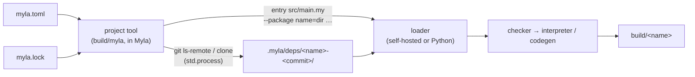

# Project tool

The design of `myla` as a project tool like cargo ([[MYLA-64]]): a manifest, dependencies from paths and Git, and the commands `new`, `build`, `run`, `test`, `check`, `fetch` and `clean` in the self-hosted CLI. The decisions behind it are D73 on [[Project/Decisions]]; this page fills in the details.

> [!NOTE]
> **Status: built.** The design and the answers to its [questions](#settled-questions) were approved on 2026-10-27 and built the same day: the file-system functions ([[MYLA-88]], [[MYLA-98]]), the TOML parser ([[MYLA-89]]), the loaders' `--package` ([[MYLA-92]]), the project model ([[MYLA-93]]), the commands ([[MYLA-94]]) and Git dependencies with `myla fetch` ([[MYLA-95]]). Still open: the language server reading projects ([[MYLA-97]]).

[TOC]

## Overview



The project tool is the only part that reads `myla.toml` and `myla.lock`. It works out where every package lives and hands the compiler an entry file and a list of packages; the compilers know nothing about manifests or Git (D73 (6)). Everything is written in Myla, in the self-hosted CLI (`selfhost/main.my` and new modules next to it), on top of `std.fs`, `std.process` and `std.toml` ([[MYLA-89]]).

## Directory layout

```
shapes/                       the package directory: holds myla.toml
├── myla.toml                 the manifest
├── myla.lock                 written by `myla fetch` when there are Git dependencies; commit it
├── .gitignore                build/ and .myla/ (written by `myla new`)
├── src/                      the project root (D57: the entry file's directory)
│   ├── main.my               the program, if the package has one
│   ├── shapes.my             the library's root module, if the package has one
│   └── circle.my             other modules
├── build/
│   └── shapes                `myla build` writes the program here
└── .myla/
    └── deps/
        └── json5-4f3c2a1e…/  a Git dependency, checked out at that commit
```

- A package has a program (`src/main.my`), a library (`src/<name>.my`), or both; `myla build` and `myla run` need the program, a dependency needs the library.
- `src/` is the project root, so the import rules of [[Language/Modules]] apply unchanged inside it: `import circle` is `src/circle.my`, `from .circle import r` works from `src/main.my`.
- A single `.my` file without a manifest works as today: `myla run hello.my`.

### How packages map onto imports

A dependency named `geo`, whose package directory is `G`, behaves as if `G/src/` were a directory `geo/` in the project root:

| Import | File |
| --- | --- |
| `import geo` | `G/src/geo.my` (the root module, like `geo/geo.my`) |
| `from geo.shapes import Circle` | `G/src/shapes.my` |
| `import geo.curves.round as round` | `G/src/curves/round.my` (or the package root `G/src/curves/round/round.my`); a file `G/src/curves.my` next to the directory would make `geo.curves` ambiguous, as in a project (D57) |

Inside a library, modules import each other relatively (`from .shapes import Circle`): an absolute `import shapes` would be looked up in the project that is being built, which is the consumer's when the library is a dependency. See [question 2](#settled-questions).

Every package is visible to every module of the build, the consumer's and the other packages' alike ([question 3](#settled-questions)).

## The manifest: `myla.toml`

```toml
# myla.toml
[package]
name = "shapes"
version = "0.1.0"
description = "Shapes and their areas"
authors = ["Ada <ada@example.org>"]
license = "MIT"

[dependencies]
geo = { path = "../geo" }
json5 = { git = "https://github.com/example/json5-myla.git", tag = "v1.2.0" }
color = { git = "https://example.org/color.git", branch = "main" }
fixed = { git = "https://example.org/fixed.git", rev = "4f3c2a1e9b0d5c6a7e8f9a0b1c2d3e4f5a6b7c8d" }

[dependencies.big]            # the same as big = { path = "vendor/big" }
path = "vendor/big"
```

### Fields

| Key | Type | Meaning |
| --- | --- | --- |
| `package.name` | string, required | The package's name: an ASCII letter, then ASCII letters, digits and `_` (`[A-Za-z][A-Za-z0-9_]*`); not a keyword, not `std`. It is the import name when the package is a dependency, the library's root module `src/<name>.my`, and the program's file name `build/<name>` |
| `package.version` | string, required | A label for people and messages, not interpreted (no semver solving, D73 (4)); `myla new` writes `"0.1.0"` |
| `package.description`, `package.license` | string | Optional, informational |
| `package.authors` | array of strings | Optional, informational |
| `dependencies.<name>` | table | One dependency; the key is the name it is imported by and must follow the rules of `package.name` |
| `….path` | string | A package directory (holding a `myla.toml`), relative to this manifest's directory, or absolute |
| `….git` | string | A Git URL, anything `git clone` accepts |
| `….tag`, `….branch`, `….rev` | string | At most one, with `git` only; `rev` is a full 40-digit commit id; none means the remote's default branch (`HEAD`) |

A dependency has exactly one of `path` and `git`. Its name must equal the `package.name` in its own manifest, so a package is imported by one name everywhere. Unknown tables and keys are errors (a misspelt `[dependecies]` would otherwise be ignored); a later version may add tables, such as build configuration (D73 (1)).

### The TOML subset

A manifest is a TOML 1.0 document restricted to the constructs below. Every document the subset accepts means the same in TOML; constructs outside it are errors that name the construct ("floats are not supported", "arrays of tables are not supported").

```ebnf
document       = { line newline } line ;
line           = ws [ ( table_header | key_value ) ws ] [ comment ] ;
table_header   = "[" ws key { ws "." ws key } ws "]" ;
key_value      = key ws "=" ws value ;
key            = bare_key | basic_string | literal_string ;
bare_key       = bare_char { bare_char } ;
bare_char      = "A"…"Z" | "a"…"z" | "0"…"9" | "_" | "-" ;
value          = basic_string | literal_string | integer | boolean | array | inline_table ;
basic_string   = '"' { basic_char | escape } '"' ;
basic_char     = any character but '"', "\" and control characters other than tab ;
escape         = "\" ( "b" | "t" | "n" | "f" | "r" | '"' | "\"
                     | "u" hex hex hex hex | "U" hex hex hex hex hex hex hex hex ) ;
literal_string = "'" { any character but "'" and control characters other than tab } "'" ;
integer        = [ "+" | "-" ] ( "0" | digit1_9 { [ "_" ] digit } ) ;
boolean        = "true" | "false" ;
array          = "[" { ws_comment_newline } [ string { ws_comment_newline } { "," { ws_comment_newline } string { ws_comment_newline } } [ "," { ws_comment_newline } ] ] "]" ;
string         = basic_string | literal_string ;
inline_table   = "{" ws [ key_value ws { "," ws key_value ws } ] "}" ;
ws             = { " " | "\t" } ;
ws_comment_newline = " " | "\t" | comment newline | newline ;
comment        = "#" { any character but control characters other than tab } ;
newline        = "\n" | "\r\n" ;
```

- **Strings** are UTF-8; a `\u`/`\U` escape must be a Unicode scalar value (not a surrogate, at most `10FFFF`). No multi-line strings (`"""`, `'''`).
- **Integers** are decimal and fit in `int64`; no leading zeros, `_` only between digits. No hexadecimal, octal or binary integers, no floats, no `inf` or `nan`.
- **Arrays** hold strings only (D73 (1)); they may span lines, with comments and a trailing comma.
- **Inline tables** stay on one line, without a trailing comma, and are complete: no header or key adds to them later. Their values may be any value, inline tables included.
- **Tables:** a key is defined once per table. `[a.b]` creates `a` if needed; a table is opened by a header at most once (`[a]` may still follow `[a.b]` once, as in TOML). A header can't name a key that holds a value or an inline table.
- **Not supported:** dotted keys on the left of `=` (`a.b = 1`), arrays of tables (`[[x]]`), dates and times. A key/value pair or header must end its line (comments aside).

`std.toml` parses this subset into a value ([[MYLA-89]]); errors carry a message, a line and a column (counting characters, from 1).

## The lock file: `myla.lock`

`myla fetch` writes `myla.lock` next to the manifest when the build has Git dependencies, its own or its dependencies'. It is TOML in the same subset, so `std.toml` reads it, and it is meant to be committed:

```toml
# Written by `myla fetch`. Commit it; don't edit it.
version = 1

[git.color]
url = "https://example.org/color.git"
branch = "main"
commit = "0b1c2d3e4f5a6b7c8d9e0f1a2b3c4d5e6f7a8b9c"

[git.json5]
url = "https://github.com/example/json5-myla.git"
tag = "v1.2.0"
commit = "4f3c2a1e9b0d5c6a7e8f9a0b1c2d3e4f5a6b7c8d"
```

- `version` is the format's version (1). A tool that reads a newer one stops with "myla.lock is from a newer myla".
- One table per Git package of the whole build, sorted by name: the URL and the reference the manifest asked for (`tag`, `branch`, `rev`, or none for the default branch), and the commit it resolved to (40 hexadecimal digits).
- Path dependencies are not locked: they are read where they are at every build.
- An entry is **current** when some manifest of the build asks for that name with the same URL and reference. `myla fetch` drops entries that aren't, and resolves the packages that have no current entry. Entries that are current keep their commit until `myla fetch --update` re-resolves them.

## Resolving the packages of a build

The project tool collects the packages before every command that compiles:

1. Read `./myla.toml` (the root package) and, for each dependency, the dependency's own manifest: a path dependency's at its path; a Git dependency's in its checkout `.myla/deps/<name>-<commit>/myla.toml`, the commit coming from the lock file. Path dependencies of a Git dependency are relative to its checkout and must stay inside it.
2. Follow the dependencies of dependencies the same way, breadth first, visiting each name once.
3. **One version per name:** two requests for one name must name the same source, the same canonical directory for paths, the same URL and reference for Git. Otherwise: `two versions of package 'json5': git https://… tag v1.2.0 (required by shapes) and path ../json5 (required by geo)`.
4. Each package's name must equal its key in the requesting manifest, and it must have a library (`src/<name>.my`).
5. The result is one `--package <name>=<dir>/src` per package, where `<dir>` is its package directory.

Cycles between packages are allowed, as import cycles are. A dependency on the root package by its own directory is the root package itself: it gets no `--package` (its `src/` is the project root, [question 2](#settled-questions)), but it must have a library.

### The project model

[[selfhost/project.my]] implements this ([[MYLA-93]], D77). It depends on `std.fs`, `std.toml`, `diag` and `tokens`, not on the loader or the CLI:

```myla
pub struct Package { name: str, version: str, dir: str, has_program: bool, has_library: bool, source: Source }
pub enum Source { Root, Path(str), Git(GitSource) }          // Path: the directory as resolved
pub struct GitSource { url: str, reference: GitRef, commit: str }
pub enum GitRef { DefaultBranch, Tag(str), Branch(str), Rev(str) }
pub struct GitPackage { name: str, git: GitSource, dir: str }
pub struct Project { manifest: str, root: Package, deps: [Package], missing: [GitPackage], unlocked: [GitPackage] }
pub struct ProjectError { msg: str, path: str, line: int32, col: int32, end_line: int32, end_col: int32 }
pub struct Lock { entries: [LockEntry] }
pub struct LockEntry { name: str, git: GitSource }

pub fun find_manifest(start: str) -> Option<str>
pub fun load_project(manifest: str) -> Result<Project, ProjectError>
pub fun resolve_project(manifest: str, lock: Lock, allow_unlocked: bool) -> Result<Project, ProjectError>
pub fun loader_packages(p: Project) -> [(str, str)]
pub fun render_project_error(e: ProjectError) -> str
pub fun load_lock(path: str) -> Result<Lock, ProjectError>
pub fun project_lock(manifest: str) -> Result<Lock, ProjectError>
pub fun parse_lock(text: str, path: str) -> Result<Lock, ProjectError>
pub fun render_lock(lock: Lock) -> str
pub fun lock_of(p: Project) -> Lock
```

- **Paths.** Every directory is absolute and lexically normalised (no `.`, `..`, `//` or trailing `/`): a relative path is taken from `std.fs.current_dir()` ([[MYLA-98]]). Two requests name the same package directory when the normalised paths are equal; symbolic links are not resolved, as neither loader resolves them. `find_manifest(start)` checks `start`, its parent and so on up to `/`, and gives the manifest's absolute path; `Project.manifest` and the paths in errors are absolute too.
- **The result.** `deps` holds every dependency of the build, sorted by name, without the root package; `loader_packages` turns it into `(name, dir + "/src")` pairs for `--package`. `has_program` and `has_library` say whether `src/main.my` and `src/<name>.my` exist, so the commands can say ``'shapes' has no program``.
- **Git dependencies.** A Git dependency is read from `<root>/.myla/deps/<name>-<commit>/` (the root package's directory, also for the Git dependencies of a Git dependency), with the commit of its current entry in the root's `myla.lock`. `load_project` reads that lock file (`project_lock`: none means no entries) and stops at a dependency without a current entry: ``dependency 'json5' is not locked: run `myla fetch` ``. A locked dependency whose checkout doesn't exist yet is no error: it is in `Project.missing`, with the commit and the directory to clone into, and its own dependencies aren't followed. So `myla build` checks out every package in `missing` and resolves again, until `missing` is empty ([question 1](#settled-questions)). `myla fetch` calls `resolve_project(manifest, lock, true)`, which lists the dependencies without a current entry in `Project.unlocked` instead of failing; it resolves their references, checks them out, and repeats, then writes `render_lock(lock_of(p))`, which keeps exactly the current entries ([[MYLA-95]]).
- **Positions.** `std.toml`'s `parse_doc` keeps where each key and value is (`key_pos`, `value_pos`). A manifest error points at what is wrong: an unknown key at the key, a bad name or a value of the wrong type at the value, a missing field at the `[package]` header, and an error about a dependency (not locked, two versions, no `myla.toml`, a name mismatch, no library, a path outside its Git checkout) at the dependency's key in the manifest that asks for it. Errors in a dependency's own manifest name that file.

| Error | Message |
| --- | --- |
| No `[package]` | `missing table [package]` |
| A missing field | `missing 'name' in [package]`, `missing 'version' in [package]` |
| A field of the wrong type | `'package.version' must be a string`, `'package.authors' must be an array of strings`, `'package' must be a table` |
| A bad name | `'1geo' is not a valid package name: it must be an ASCII letter followed by ASCII letters, digits and '_'`, `'while' is a keyword and can't be a package name`, `'std' is the standard library and can't be a package name` |
| Unknown keys | `unknown key 'nmae' in [package]`, `unknown table 'dependecies'`, `unknown key 'version' in dependency 'geo'` |
| A dependency's keys | `dependency 'geo' has both 'path' and 'git'`, `dependency 'geo' needs 'path' or 'git'`, `dependency 'geo' has both 'tag' and 'branch': give at most one of 'tag', 'branch' and 'rev'`, `'tag' of dependency 'geo' needs 'git', not 'path'`, `'rev' of dependency 'geo' must be a full commit id (40 hexadecimal digits)`, `'path' of dependency 'geo' is empty`, `dependency 'geo' must be a table, such as geo = { path = "../geo" }` |
| Resolving | `dependency 'geo' has no myla.toml in /…/geo`, `dependency 'geo' is named 'geometry' in its myla.toml`, `dependency 'geo' has no library (src/geo.my)`, `two versions of package 'util': path ../util (required by app) and path ../util2 (required by geo)` (the root package is `the root package`), `path dependency 'up' of 'json5' is outside its Git checkout`, ``dependency 'json5' is not locked: run `myla fetch` `` |
| The lock file | `myla.lock is from a newer myla`, `unknown lock file version 0`, `the lock file has no 'version'`, `unknown key 'x' in the lock file`, `unknown key 'x' in [git.json5]`, `missing 'url' in [git.json5]`, `missing 'commit' in [git.json5]`, `'commit' of [git.json5] must be 40 hexadecimal digits` |

## The loaders: `--package name=dir`

Both loaders, the Python one ([[src/myla/loader.py]]) and the self-hosted one ([[selfhost/loader.my]]), take a list of packages, each a name and a directory, on the command line as `--package name=dir` (repeatable) and in their APIs as a parameter. The Python CLI accepts the flag for `run`, `test`, `build` and `check`, the self-hosted CLI and tools (`build/myla`, `interp_main`, `gen_main`) likewise, so the toolchains can be compared on projects with dependencies as on single files. The project tool calls the self-hosted loader in-process.

### Resolution order

An import without leading dots, `import a.b.c` or `from a.b import c`, resolves its first segment `a`:

1. `std` is the standard library and nothing else (unchanged, D57).
2. The **project root** (the entry file's directory): `a.my` or the package `a/` (`a/a.my`), as today.
3. The **packages**: if `a` is a package's name, the rest of the path is looked up in its directory as if that directory were `a/`: `import a` is `dir/a.my`, `a.b.c` is `dir/b/c.my` (or `dir/b/c/c.my`).
4. Otherwise: `cannot resolve import 'a.b.c'`.

Relative imports (`.x`, `..x`) are unchanged: they are relative to the importing file, wherever it lives.

A project file or directory named like a package is a module error, as a project `std` is: `'geo' is a dependency and cannot be shadowed by a project file or directory`. A package named `std` is an error, and so is a malformed flag (`--package geo` without `=`, an empty name or directory, a name given twice).

### Module ids

A package's modules get the ids they would have if the package directory were `<name>/` in the project root: `geo$geo` for `dir/geo.my`, `geo$shapes` for `dir/shapes.my`, and so on ([[Architecture/Module-loader]]). So qualified names, assembly labels and debug information don't depend on where a dependency was fetched (no commit hashes in symbols), and they can't collide with project modules, since a project module with a package's name is an error.

## Commands

The self-hosted CLI `build/myla` runs a command in **project mode** when it is given no file: the first argument after the command doesn't end in `.my`. Project mode looks for `myla.toml` in the current directory and then in its parents, so commands work from any directory of the project ([question 7](#settled-questions)); every path is relative to the directory holding the manifest. With a file, every command works as today ([[Getting started]]). The Python CLI has no project mode (D71).

| Command | Does | Errors |
| --- | --- | --- |
| `myla new <name>` | Creates the directory `<name>` with `myla.toml` (`name`, `version = "0.1.0"`, an empty `[dependencies]`), `src/main.my` printing a greeting that a `#test` case checks, and `.gitignore` with `build/` and `.myla/` | `<name>` isn't a valid package name; `<name>` exists already; a file can't be written |
| `myla build [-g]` | Resolves the packages (fetching what the lock file names but isn't checked out yet, see `fetch`), type-checks `src/main.my` with them and compiles it to `build/<name>`; `-g` adds line tables as in file mode | No `myla.toml` here or above; a manifest error, with file, line and column; a dependency error (missing, two versions, no library, name mismatch); a Git dependency without a current lock entry (``run `myla fetch` ``, [question 1](#settled-questions)); no `src/main.my` (``'shapes' has no program (src/main.my); `myla check` checks its library``); any compile error, as in file mode |
| `myla run [args…]` | Like `build` up to the type check, then interprets `src/main.my` with `args` as in file mode ([question 6](#settled-questions)) | As for `build`; a runtime error; the program's exit status is `myla`'s |
| `myla test` | Runs the `#test` cases of every `.my` file under `src/`, in sorted order, each file's own cases once, with the packages; prints `== <file>` and the file's PASS/FAIL lines for each file that has cases, then `<passed>/<total> passed in <n> files.` (`no #test cases found.` without any) | As for `build`, per file: a file that doesn't compile prints its error and the others still run; exits with 1 if a case fails or a file doesn't compile |
| `myla check` | Type-checks every `.my` file under `src/` with the packages; prints nothing when all is well | Every file's errors (up to 20 each, D80) |
| `myla fetch [--update]` | Resolves the Git dependencies of the whole build: for each one without a current lock entry (or each one, with `--update`), asks the remote for the commit, checks it out into `.myla/deps/<name>-<commit>/` if that directory doesn't exist, and writes `myla.lock` | Git isn't installed; Git fails (its stderr is shown with the dependency's name and URL); a reference doesn't exist; a dependency error as for `build` |
| `myla clean` | Removes `build/` (with `--deps` also `.myla/`) | A file can't be removed |

`myla test` and `myla check` load each file as an entry with `src/` as the project root, so a nested file such as `src/geo/round.my` resolves absolute imports from `src/` as `src/main.my` does. The loaders therefore get a project root parameter that defaults to the entry's directory ([[MYLA-92]]). `myla test` runs only the cases declared in the file itself (its functions' names are the ones the loader doesn't qualify with a module id), while `myla test file.my` still runs every linked module's cases, as the Python CLI does. Paths in messages and the program's `argv[0]` are relative to the working directory (`src/main.my`, or `../main.my` from `src/util/`). A Git dependency whose locked commit isn't checked out yet is checked out first (printing `fetching …` on stderr); one without a current lock entry stops the command with ``run `myla fetch` ``. The commands are [[selfhost/project_cmd.my]], Git is [[selfhost/fetch.my]]; what they share with the file commands is [[selfhost/driver.my]].

### Messages

Errors are printed like compile errors, and the exit status is 1. A manifest or lock file error has a position, so it is printed with the line and carets under the key or value it is about, its kind being `manifest error` or `lock file error` (`render_project_error`):

```
manifest error: two versions of package 'util': path ../util (required by app) and path ../util2 (required by geo)
  --> /home/ada/geo/myla.toml:5:1
  |
5 | util = { path = "../util2" }
  | ^^^^
```

An error without a position is `myla: <file>: <message>` (`myla: /home/ada/app/myla.toml: missing table [package]`), or `myla: <message>` without a file. Fetching prints one line per dependency (`fetching json5 v1.2.0 (4f3c2a1)`); a build prints nothing but errors.

## Git

Git is run through `std.process`, as the CLI runs `as` and `ld` today: `run("/usr/bin/env", ["git", …])`, so `git` is found on `PATH`, and the child inherits the environment, so the user's credentials, proxy and SSH configuration apply. Myla itself reads no environment variable (D73 (5)). Path-only builds never run Git.

| Step | Command |
| --- | --- |
| A tag or branch to a commit | `git ls-remote <url> refs/tags/<tag> refs/tags/<tag>^{}` (an annotated tag's commit is the `^{}` line), `git ls-remote <url> refs/heads/<branch>`, `git ls-remote <url> HEAD` |
| A `rev` | Taken as it is (a full commit id), checked when it is checked out |
| Check out | `git clone --quiet <url> .myla/deps/<name>-<commit>.partial`, then `git -C <that> checkout --quiet --detach <commit>`, then rename it to `.myla/deps/<name>-<commit>` |

The `.partial` directory makes an interrupted fetch harmless: it is removed and cloned again next time; only complete checkouts have the final name. Checkouts are never changed after that, so the tool doesn't look into them again; a different commit gets a different directory. Old checkouts stay until `myla clean --deps`.

## Settled questions

These were open while the design was proposed; each was settled as proposed (2026-10-27).

1. **Implicit fetching.** Should `build`, `run`, `test` and `check` fetch on their own when the lock file is missing or not current (as cargo does), or stop with "run `myla fetch`"? *Settled:* they check out commits the lock file already names (so a fresh clone builds with one command), but only `myla fetch` resolves references and writes `myla.lock`; a missing or stale entry is an error that says to run it. Builds then never change files under version control.
2. **A library importing itself by name.** Inside its own project a library's `src/shapes.my` is the project module `shapes`; as a dependency it is `geo.shapes`. *Settled:* modules of a library import each other relatively, and the tool doesn't pass the root package as a `--package`. Alternative: pass it too, and let a package whose directory is the project root shadow nothing (then `geo.shapes` would also work inside `geo`, but one file could get two module ids).
3. **Visibility of packages.** Every module may import every package of the build, also packages it didn't declare (a dependency's dependencies). *Settled:* accept that for now; restricting it needs the loader to know which package a module belongs to.
4. **Removing files.** `myla clean` and the `.partial` checkouts need to remove directories, and the checkout needs a rename; `std.fs` can't do either. *Settled:* run `rm -rf` and `mv` through `std.process` as the CLI runs `rm -f` today; primitives (`unlink`, `rmdir`, `rename`) are [[MYLA-96]] if they are wanted instead.
5. **`myla new` options.** Should it run `git init`, and offer `--lib` (a `src/<name>.my` instead of `src/main.my`)? *Settled:* neither at first.
6. **`myla run`: interpret or build?** cargo builds and runs the binary. *Settled:* interpret, as `myla run file.my` does; `myla build && build/<name>` runs the binary.
7. **Finding the project.** *Settled:* the current directory and its parents, the nearest `myla.toml` wins. Alternative: the current directory only.
8. **File mode inside a project.** Should `myla run src/main.my` read the manifest to find the packages? *Settled:* no (D73 (7): commands with a file work as today); `--package` flags work there.
9. **Unknown keys.** *Settled:* errors, so typos show. Alternative: warnings, so a manifest written for a newer tool still builds.
10. **The `version` field.** *Settled:* required, any string. Alternative: optional, or checked for the `MAJOR.MINOR.PATCH` form.
11. **Tests of nested files.** `myla test` loads every file under `src/` as an entry, so it compiles shared modules once per file. *Settled:* accept it (the checker is fast, [[Architecture/Self-hosted-compiler]]); a later version can link all files into one program.
12. **Shorthand dependencies.** cargo's `geo = "1.0"` names a registry version, which Myla doesn't have. *Settled:* only tables, no shorthand.

## Implementation steps

The follow-up tasks in the epic `Project tool`:

| Task | Step |
| --- | --- |
| [[MYLA-88]] | File-system functions: `list_dir`, `make_dir`, `make_dir_all`, `exists`, `is_dir`, `is_file` (done, in review) |
| [[MYLA-89]] | `std.toml`: the subset above, tested against Python's `tomllib` (done, in review) |
| [[MYLA-92]] | Both loaders: `--package name=dir`, the resolution order, the shadowing error, package module ids, a project root parameter; parity tests between the toolchains (done, in review) |
| [[MYLA-93]] | The project model in Myla: read and check `myla.toml` and `myla.lock`, resolve path dependencies transitively, the one-version rule, the `--package` list (done, in review: [the project model](#the-project-model)) |
| [[MYLA-98]] | `std.fs.current_dir` and its primitive `__getcwd`, for finding the manifest and absolute paths (done, in review) |
| [[MYLA-94]] | The commands `new`, `build`, `run`, `test`, `check` and `clean` in `build/myla`, with path dependencies; [[Getting started]] and [[Language/Modules]] describe projects (done, in review) |
| [[MYLA-95]] | Git dependencies: `myla fetch`, `.myla/deps/`, the lock file (done, in review) |
| [[MYLA-96]] | Not needed for now (question 4 was settled for `rm -rf` and `mv` through `std.process`): `std.fs` primitives to remove and rename files and directories |
| [[MYLA-97]] | The language server: index files with `list_dir`, and find packages so definitions in dependencies resolve |

[[MYLA-64]] is done when a fresh `myla new` project with one path dependency builds, runs and tests ([[MYLA-94]]).
