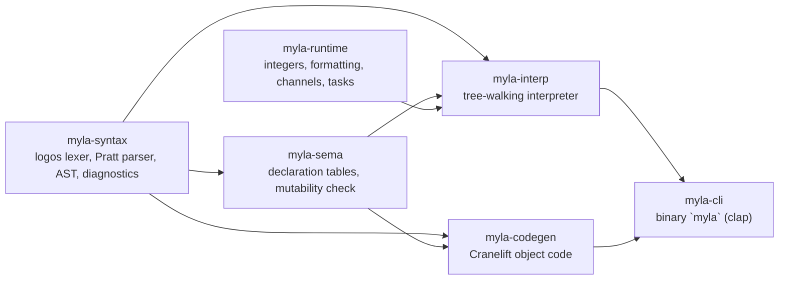

# Rust edition

`rust/` is a separate implementation in Rust (edition 2021) with a dialect of its own. It doesn't share code with the other toolchains and isn't part of the bootstrap. Its own documents are in `rust/docs/` (`language-spec.md`, `grammar.md`, `architecture.md`, `stdlib.md`, `concurrency.md`, `changes-from-original.md`).

[TOC]

## Why it exists

It began as a prototype for a faster **first bootstrap stage**: building the self-hosted compiler with the Python toolchain was too slow to iterate on ([[Project/Roadmap]]). It then also became the testbed for Swift-style actors ([[MYLA-61]]).

Two things have changed since:

- The bootstrap's slowness turned out to be two fixable hot spots in the Python toolchain ([[MYLA-60]], [[MYLA-16]]); with both fixed, the whole bootstrap takes about 10 seconds ([[Development/Bootstrap]]).
- To serve as a stage 0, the Rust edition would have to compile `selfhost/` natively, which needs the full static type system (sized integers, layouts, monomorphization) and a native backend for every construct. The dialect has neither: it doesn't type-check, and its native backend handles only scalar functions.

What role it should play now (concurrency laboratory, a future replacement, or a frozen experiment) is open; the problems below are tracked either way.

## Build and run

```bash
cd rust
cargo build                     # about a minute, no warnings
cargo test                      # 20 tests, all passing
target/debug/myla run examples/fib.my
target/debug/myla test examples/fib.my
target/debug/myla build examples/fib.my -o fib    # Cranelift + the system cc
```

## Crates



- **myla-syntax**: tokens with logos (newlines kept; `<<`/`>>` formed from adjacent tokens as in Python), a recursive-descent parser with Pratt binding powers, f-string holes parsed again, a block's last expression stored as its tail value, error recovery to the next item keyword, a custom caret renderer.
- **myla-sema**: name tables for functions, structs, enums, actors, methods, constants and aliases; maps prelude variants; resolves `#main` and collects `#test`; checks mutability. **No type checking and no name resolution.**
- **myla-interp**: values are `Value` (integers as `i128` plus a kind, floats with a width, `Arc`-shared aggregates with copy-on-write through `Arc::make_mut`, closures that copy the whole environment, channels, tasks, actors). Control flow travels as `Result<_, Control>`.
- **myla-runtime**: sized integer wrapping, float formatting (ryu), channels (crossbeam) and threads.
- **myla-codegen**: lowers a subset to Cranelift IR for the host, links with a small C runtime through `cc`.

## How the dialect differs

From `rust/docs/changes-from-original.md` and the code:

- **Lighter typing.** Annotations are parsed and ignored; unknown names fail at run time; generics run by erasure ([[MYLA-42]]).
- **`float` is `float64`** (the Python toolchain's `float` is `float32`).
- **Any value may be a map key.**
- **Optional semicolons**, with newline rules of its own.
- **Concurrency**: `async`/`await`, `spawn` and `go` (OS threads), `chan` with unbounded channels, `select`, and `actor` types whose methods run under a mutex.
- **More standard library**: `write_file`, `append_file`, `remove_file`, `run`, `env_var`, `now_millis`, `sleep_millis`, `read_line`.
- **Not supported**: modules (`import` is parsed and ignored), `typealias` and bounds (recorded, unused), `#derive` (accepted, no effect), trait declarations (skipped, so no default methods), compound assignment, exhaustiveness checking ([[MYLA-43]]).

## State

The interpreter runs every example. The native backend is a prototype: it supports integer/float/bool/str functions with basic control flow, and **silently miscompiles** common code: functions returning a block's tail value return 0, hex literals become 0, `&&`/`||` don't short-circuit ([[MYLA-36]]). Other open problems: [[MYLA-37]] … [[MYLA-41]], [[MYLA-44]] … [[MYLA-47]].

The tree-sitter grammar for editors lives in `rust/editor/tree-sitter-myla` and follows this dialect ([[Architecture/Editor-tooling]]).
