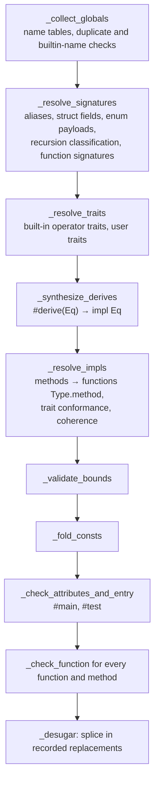

# Type checker

[[src/myla/types.py]] holds the type representation, the `Checker`, the desugaring pass and the float-formatting algorithm shared by both back ends.

[TOC]

## Types

Frozen dataclasses, so they compare and hash structurally: `IntType(width, signed)`, `FloatType(width)`, `CharType`, `BoolType`, `StrType`, `StringBuilderType`, `StructType(name, args)`, `EnumType(name, args)`, `TupleType(elems)`, `ListType(elem)`, `MapType(key, value)`, `FuncType(params, ret)`, `TypeParam(name)` and `SelfType`. Aliases never survive resolution. `type_name` renders a type for messages.

## Passes

`check(program)` prepends the prelude (`Option`, `Result`, `get`) and runs `Checker.check()`:

Declaration order never matters, because every table is built before any body is checked.

An error in the passes up to `_fold_consts` ends the check: the tables would be incomplete. After that each declaration's attributes, the entry point, each function body and then each method body is checked on its own (`_on_its_own`, from a clean state: loop depth, lambda stack, return type), and its first error is recorded; checking goes on with the next one, up to 20 errors (D80, [[MYLA-65]]). A function's errors cannot affect another's, since signatures come from the tables, so this needs no error type. `check` raises the first error found, with the others in its `more`, in that order: attribute and entry-point errors, then free functions, then methods, each in declaration order (the entry file's declarations before the modules it imports). The self-hosted checker collects them the same way (`run_all`, `check_body`, `note`).

## Notes

An error can carry notes (D83, [[MYLA-65]]): `MylaError.notes` (`errors.Note`; the self-hosted `CheckErr.notes` and `Report.notes`, `tokens.Note`), each a `note` about another place in the same file or a `help` line without one. The CLI prints them after the error's line, a note with its own `-->` and carets; the canonical line a gate compares is followed by one `<label> <line> <col> : <message>` line per note (`canon.canonical_note`, `diag.canonical_note`); the language server publishes a note as related information and appends a help line to the message; the REPL shows a note in the input against the input's lines.

| Error | Note |
| --- | --- |
| assigning to an immutable place, or calling a `var self` method on one | `'x' is declared here`, at the variable the place starts from (a `let`, a parameter, a lambda parameter, a destructured or match binding; none for a `for` variable or a method's receiver, which have no place of their own) |
| a variable declared twice in a scope, a top-level name declared twice | `'x' is first declared here` (not when the first is the prelude's) |
| a returned value of the wrong type | `the return type is declared here`, at the function's return type (not in a lambda) |
| an unknown name, function, type, field or method | `help: did you mean 'count'?` |

A suggestion is the candidate closest to the name in edits (inserting, deleting, replacing or swapping neighbouring bytes: `_edit_distance`, `edit_distance`), within a third of the name's length, so names under three bytes get none; of equally close candidates the alphabetically first. The candidates are what the name could have been: for a name, the variables in scope, constants, functions and the prelude's variants; for a call, functions, the built-in functions and variables; for a type, the primitive types, `int`, `float`, structs, enums, aliases and the type parameters in scope; for a field, the struct's fields; for a method, the type's methods. Methods' internal `Key.name` and the `__` primitives are never suggested.

## Inference

Inference is local and bidirectional: `_infer(expr, scope, expected)` returns the expression's type and records it as `expr.resolved_type`. The `expected` type is a hint, not a constraint; the caller compares the result.

- **Flexible literals.** An unsuffixed integer literal takes the expected integer type; `_unify` lets a literal operand adopt the other operand's type ([[src/myla/types.py#L3036-L3065]]). ASCII char literals may become integers the same way.
- **Generic calls** solve type parameters left to right with `_unify_param`, using each solved parameter type as the hint for the next argument, then verify every argument against the substituted parameter types (`_infer_generic_call`). Struct literals and enum constructors do the same with `_infer_type_args`, seeded by the expected type.
- **Lambdas** take parameter types from annotations or from an expected `FuncType`. Without an expected type, a block body's result type is collected from its `return`s (`_lambda_infer`).
- **Captures**: while a lambda body is checked, `_record_capture` adds every name that resolves to a scope outside the lambda's parameter scope to each enclosing lambda's capture list. Each lambda also gets a unique `lifted_name` for the native backend.
- **match** checks each arm in its own scope, then exhaustiveness and redundancy, then unifies the non-diverging arm values. Exhaustiveness and redundancy use Maranget's usefulness over pattern matrices: patterns are normalized to constructors (enum variants, `true`/`false`, the single constructor of a tuple or struct, literals) and wildcards, a match is exhaustive when a wildcard row isn't useful against the unguarded arms, and an arm is redundant when it isn't useful against the unguarded arms before it (`_useful`, [[MYLA-14]]; the same algorithm in [[selfhost/checker.my]]).

## Desugaring in the checker

| Source | Becomes | Where |
| --- | --- | --- |
| `e?` | `match e { Ok(v) => v, Err(x) => { return Result.Err(x) } }` (or the `Option` form) | `_infer_try`, `_build_try_match` |
| `f >> g` (functions) | `(__x: A) => g(f(__x))` | `_infer_compose` |
| `f(a, _)` | `(__hole0: B) => f(a, __hole0)` | `_infer_partial` |
| `a + b` on a struct/enum | `a.add(b)`; `==` → `a.eq(b)`, `!=` → `!a.eq(b)`, `<` → `a.cmp(b) < 0` | `_infer_operator_overload` |
| `#derive(Eq)` | a synthesised `impl Eq` (field-wise `&&`, or a `match` on `(self, other)`) | `_make_eq_impl` |
| `recv.m(x)` | stays a call, annotated with `method_func = "Type.m"` | `_infer_method_call` |

Synthesised lambdas get explicit parameter annotations (`_type_to_typeexpr`), so that the monomorphizer's second check doesn't depend on context. Operators on a bounded type parameter (`T: Add`) are not desugared; the interpreter dispatches at run time and the monomorphizer lowers them once `T` is concrete.

## Methods and traits

Every method becomes a function named `Type.method` (the dot can't occur in a user identifier) with a synthesised `self` parameter, registered in `functions` and in `methods[type_key]`. The key is the type's name, or the canonical name for built-in receivers (`int32`). Trait conformance substitutes `Self` (and a generic trait's parameters) and compares parameter and result types exactly. `trait_impls` records which user types implement which traits; primitives get built-in operator traits from `_primitive_default_trait`.

## Recursion classification

`_resolve_recursion` finds by-value cycles between aggregates. Every enum on a cycle is marked recursive (`recursive_enums`), which the native backend boxes; a cycle that remains once boxed enums are cut (only structs and tuples) is an "infinite size" error.

## Return analysis

`_block_returns` / `_stmt_returns` ([[src/myla/types.py#L3997-L4027]]) accept `return`, diverging calls (`panic`, `unreachable`, `__exit`) and `if`/`else` chains whose every branch returns. Loops and `match` statements don't count.

## Known gaps

None recorded; see [[Project/Known-issues]].
