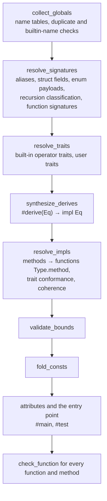

# Type checker

[[selfhost/checker.my]] holds the type representation and the `Checker`. It was ported from the Python checker (`src/myla/types.py`, retired with the Python toolchain, [[MYLA-219]]) with the same phases in the same order, so it reports the same errors in the same order with the same messages; its functions keep the Python ones' names without the leading underscore. Where this page names a Python function the self-hosted checker has no counterpart of, it says so.

[TOC]

## Types

`Type` is an enum: `TInt(width, signed)`, `TFloat(width)`, `TChar`, `TBool`, `TStr`, `TSB` (the builder), `TStruct(name, args)`, `TEnum(name, args)`, `TActor`, `TTuple`, `TList`, `TMap`, `TFunc(params, Option<ret>)`, `TAsync(TFunc)` for an async function type (D89), `TParam(name)`, `TSelf` and `TError`. Aliases never survive resolution. `type_name` renders a type for messages.

## Passes

The loader adds the prelude (`Option`, `Result`, `get`) and `build_checker_decls` makes the checker, whose `run_all` runs the passes:

Declaration order never matters, because every table is built before any body is checked.

The passes up to `fold_consts` record each declaration part's error and go on, the part taking the error type or being left out (D84, [[MYLA-110]]; see "Going on after a declaration's error" below). After that each declaration's attributes, the entry point, each function body and then each method body is checked on its own (`check_body`, from a clean state, `reset_state`: loop depth, lambda stack, return type), and its first error is recorded; checking goes on with the next one, up to 20 errors (D80, [[MYLA-65]]). A function's errors cannot affect another's, since signatures come from the tables. The first error found is reported with the others after it, in that order: the declarations' errors in the order the passes find them, then attribute and entry-point errors, then free functions, then methods, each in declaration order (the entry file's declarations before the modules it imports). They are collected by `record` and `note`.

## Going on after a declaration's error

D84, [[MYLA-110]]. A part of a declaration that fails to check takes the **error type** (`Type.TError`) or is **left out**, and the passes go on (`record`, `resolve_part`, `param_part`, `record_result`):

| Part | Failure | What remains |
| --- | --- | --- |
| a declaration | an import checked alone, a redefined builtin, a duplicate name or trait | the first one; the duplicate is left out, its body not checked (`skipped_decls`) |
| a type in a signature, field, payload, trait method, impl target, const | unknown, wrong arguments, `Self` outside a trait, … | the error type for that part |
| an alias | a bad target, a cycle | the error type for the alias and every alias that names it, one error |
| a field, variant or method | a duplicate, a method colliding with a field | the first one |
| type parameters, a recursive struct | shadowing, duplicates, infinite size | the declaration, as written |
| a `#derive` | not derivable, generic, a bad attribute, an explicit impl too | no derived impl; Eq is broken for the type (`broken_impls`) unless an explicit impl stands |
| an impl | its target type failed or can't have methods; a duplicate impl | left out; its methods' and trait's names are lost (`lost_methods`, `lost_traits`) |
| an impl | an unknown trait; the trait's arity; conformance | its methods stay; the (trait, type) pair is broken |
| a bound | an unknown trait or type parameter | the bound is left out, and the function's body isn't checked |
| a const | any error in its type or value | its declared type (or the error type), no value; consts folded from it fail silently |

Bodies are checked as before. Where one depends on what failed, its check ends without an error (`poisoned()`, which `?` carries and `note` drops), since any error there would follow from the first:

- an expression whose type contains the error type (`infer` wraps `infer_node`), an assigned place (`check_lvalue`) or a pattern (`check_pattern`) of such a type;
- a call of a generic function or method, or a partial application, whose signature contains it; a generic struct or enum literal with such a field or payload;
- `?` in a function whose return type failed; a call or method value through a field whose type failed;
- a broken (trait, type) pair, or a lost trait, asked for by an operator or a bound (`type_implements`); a method that isn't there but whose name a lost impl had;
- a call of a redefined builtin; a const folded from a failed one; a `#test` of a function whose signature failed.

Some parts are skipped rather than ending the check, since nothing else depends on them: the argument for a parameter of the error type (non-generic calls and methods), a field or payload of the error type in a literal, the value returned from a function whose return type failed, the initialiser of a `let` annotated with a failed alias (the binding has the error type), and a call statement whose result has the error type.

So no reported error follows from another, at the price of not checking the rest of a body after its first use of a failed part. The first error of a run is the one a single-error run reported, except where that one followed from a declaration error found later (an `impl Eq` for a misspelled type makes a `#derive(Eq)` that relies on it fail first; the derive is now left broken silently). `tests/burn/test_declaration_recovery.py` checked this on the Python checker, on 674 mutants of the examples, each with one declaration broken: exactly the injected error is reported (its answers are recorded, [[MYLA-219]]); the checker gate compares the self-hosted checker with them on the same mutants.

## Notes

An error can carry notes (D83, [[MYLA-65]]): `CheckErr.notes` and `Report.notes` (`tokens.Note`), each a `note` about another place in the same file or a `help` line without one. The CLI prints them after the error's line, a note with its own `-->` and carets; the canonical line a gate compares is followed by one `<label> <line> <col> : <message>` line per note (`diag.canonical_note`); the language server publishes a note as related information and appends a help line to the message; the REPL shows a note in the input against the input's lines.

| Error | Note |
| --- | --- |
| assigning to an immutable place, or calling a `var self` method on one | `'x' is declared here`, at the variable the place starts from (a `let`, a parameter, a lambda parameter, a destructured or match binding; none for a `for` variable or a method's receiver, which have no place of their own) |
| a variable declared twice in a scope, a top-level name declared twice | `'x' is first declared here` (not when the first is the prelude's) |
| a returned value of the wrong type | `the return type is declared here`, at the function's return type (not in a lambda) |
| an unknown name, function, type, field or method | `help: did you mean 'count'?` |

A suggestion is the candidate closest to the name in edits (inserting, deleting, replacing or swapping neighbouring bytes: `edit_distance`), within a third of the name's length, so names under three bytes get none; of equally close candidates the alphabetically first. The candidates are what the name could have been: for a name, the variables in scope, constants, functions and the prelude's variants; for a call, functions, the built-in functions and variables; for a type, the primitive types, `int`, `float`, structs, enums, aliases and the type parameters in scope; for a field, the struct's fields; for a method, the type's methods. Methods' internal `Key.name` and the `__` primitives are never suggested.

## Inference

Inference is local and bidirectional: `infer` takes an expression and an expected type, returns the expression's type and records it in `resolved`, keyed by the node's id. The `expected` type is a hint, not a constraint; the caller compares the result.

- **Flexible literals.** An unsuffixed integer literal takes the expected integer type; `unify` lets a literal operand adopt the other operand's type. ASCII char literals may become integers the same way.
- **Generic calls** solve type parameters left to right with `unify_param`, using each solved parameter type as the hint for the next argument, then verify every argument against the substituted parameter types (`infer_generic_call`). Struct literals and enum constructors do the same with `infer_type_args`, seeded by the expected type.
- **Lambdas** take parameter types from annotations or from an expected `TFunc`. Without an expected type, a block body's result type is collected from its `return`s (`lambda_infer`).
- **Captures**: while a lambda body is checked, every name that resolves to a scope outside the lambda's parameter scope is added to each enclosing lambda's capture list (the Python checker's `_record_capture`). Each lambda also gets a unique lifted name for the native backend.
- **match** checks each arm in its own scope, then exhaustiveness and redundancy, then unifies the non-diverging arm values. Exhaustiveness and redundancy use Maranget's usefulness over pattern matrices: patterns are normalized to constructors (enum variants, `true`/`false`, the single constructor of a tuple or struct, literals) and wildcards, a match is exhaustive when a wildcard row isn't useful against the unguarded arms, and an arm is redundant when it isn't useful against the unguarded arms before it (`useful`, [[MYLA-14]]).

## Sugar

The checker checks these forms and records what they mean (their types in `resolved`, the method or trait they call); the interpreter and the lowering carry them out from there. The Python checker replaced each with the form in the second column instead (`_desugar`), so its back ends never saw them.

| Source | Means | Where |
| --- | --- | --- |
| `e?` | `match e { Ok(v) => v, Err(x) => { return Result.Err(x) } }` (or the `Option` form) | `infer_try` |
| `f >> g` (functions) | `(__x: A) => g(f(__x))` | `infer_compose` |
| `f(a, _)` | `(__hole0: B) => f(a, __hole0)` | `infer_partial` |
| `a + b` on a struct/enum | `a.add(b)`; `==` → `a.eq(b)`, `!=` → `!a.eq(b)`, `<` → `a.cmp(b) < 0` | `infer_operator_overload` |
| `#derive(Eq)` | an `impl Eq` (field-wise `&&`, or a `match` on `(self, other)`), registered as a structural impl | `synthesize_derives` |
| `recv.m(x)` | a call of the method `Type.m` | `infer_method_call` |

Operators on a bounded type parameter (`T: Add`) are resolved once `T` is concrete: by the interpreter at run time, by the code generator under its substitution ([[Architecture/Monomorphization]]).

## Methods and traits

Every method becomes a function named `Type.method` (the dot can't occur in a user identifier) with a synthesised `self` parameter, registered in `functions` and in `methods[type_key]`. The key is the type's name, or the canonical name for built-in receivers (`int32`). Trait conformance substitutes `Self` (and a generic trait's parameters) and compares parameter and result types exactly. `trait_impls` records which user types implement which traits; primitives get built-in operator traits from `primitive_default_trait`.

## Concurrency

D89, [[MYLA-135]], [[Language/Concurrency]]. The checker keeps the actor types (`actors`), whether the function or lambda being checked is async (`in_async`), the actor whose method it is (`actor_self`, whose `self` reaches the actor's fields: `check_isolation`), and the calls under an `await` (`awaited`). After a call is inferred, `check_suspension` decides whether it may suspend (an async function, method or function value, or a method of an actor called from outside it, with the kind of call the inference recorded) and requires the `await`; `infer_await` requires such a call, or the name of an `async let` (a binding with `task` set, which reads only under `await`). The first construct of concurrency met is recorded (`conc_line`); `async let` is checked by `check_async_let`. All of this is gated on cheap tests so that a program without concurrency pays little (+0.35% instructions compiling itself, user time unchanged).

## Recursion classification

`resolve_recursion` finds by-value cycles between aggregates. Every enum on a cycle is marked recursive (`recursive_enums`), which the native backend boxes; a cycle that remains once boxed enums are cut (only structs and tuples) is an "infinite size" error.

## Return analysis

`block_returns` / `stmt_returns` accept `return`, diverging calls (`panic`, `unreachable`, `__exit`) and `if`/`else` chains whose every branch returns. Loops and `match` statements don't count.

## Known gaps

None recorded; see [[Project/Known-issues]].
