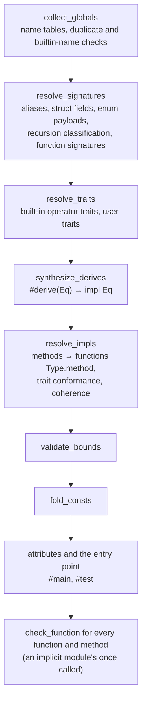

# Type checker

[[selfhost/checker.my]] holds the type representation and the `Checker`. It was ported from the Python checker (`src/myla/types.py`, retired with the Python toolchain, [[MYLA-219]]) with the same phases in the same order, so it reports the same errors in the same order with the same messages; its functions keep the Python ones' names without the leading underscore. Where this page names a Python function the self-hosted checker has no counterpart of, it says so.

[TOC]

## Types

`Type` is an enum: `TInt(width, signed)`, `TFloat(width)`, `TChar`, `TBool`, `TStr`, `TSB` (the builder), `TStruct(name, args)`, `TEnum(name, args)`, `TActor`, `TTuple`, `TList`, `TMap`, `TFunc(params, Option<ret>)`, `TAsync(TFunc)` for an async function type (D89), `TParam(name)`, `TSelf` and `TError`. Aliases never survive resolution. `type_name` renders a type for messages.

## Passes

The loader adds the prelude (`Option`, `Result`, `Format`, `Hasher` and `Hash`, `Iterator`) and `build_checker_decls` makes the checker, whose `run_all` runs the passes:

Declaration order never matters, because every table is built before any body is checked.

The passes up to `fold_consts` record each declaration part's error and go on, the part taking the error type or being left out (D84, [[MYLA-110]]; see "Going on after a declaration's error" below). After that each declaration's attributes, the entry point, each function body and then each method body is checked on its own (`check_body`, from a clean state, `reset_state`: loop depth, lambda stack, return type), and its first error is recorded; checking goes on with the next one, up to 20 errors (D80, [[MYLA-65]]). A function's errors cannot affect another's, since signatures come from the tables. The first error found is reported with the others after it, in that order: the declarations' errors in the order the passes find them, then attribute and entry-point errors, then free functions, then methods, each in declaration order (the entry file's declarations before the modules it imports). They are collected by `record` and `note`.

The functions of the modules of `std` but the entry and std.rt, and the methods of their impls of no trait (D164, D179; the loader marks them in `std_impls`, `lazy`), wait (`lazy_decls`, [[MYLA-359]], [[MYLA-413]]): their bodies are checked only once checked code calls them, which `called` records by the callee's checked name (`std$str$join`, `str.trim`) at a call (`infer_call`, `infer_method_call`, `infer_static_call`), a function used as a value and a partial application; a body checked so may call more, until none is left that is called. The functions the lowering and the back ends call by their mangled names (an f-string's `std$fmt$fmt_int`, a slice's `std$slice$take`, `std$task$cancel`, wasm32's start in std.platform, the runtime's) are on `backend_std_functions` and marked as called before any body is checked; a native build that asks for another function that waits and that nothing called (`unmarked_std`, `CodeGen.request_fn`) is an internal error, and `tests/burn/test_lazy_std.py` checks the list against the names the back ends' sources write ([[MYLA-432]]). A hello world checked 707 bodies before and 205 after. The loader leaves these modules' bodies unparsed too (`Loaded.bodies`, `LazyBodies`): `check_body` reads one the first time it checks it (`with_body`, `LazyBodies.parse`; only a body that is the marker of an unread one, `is_unread_body`, keyed by the place of its `{`, `unread_key`, [[MYLA-416]]), its lex, parse or renaming errors collected as type errors are, each with its kind; once every body is checked, `put_bodies` puts those read in place of their markers (D179), in `decls`, `functions`, `methods` and `method_decls`, which the interpreter and the code generator read. A body nothing calls is never run, compiled or interpreted (compiling one is an internal error), and its module's own `myla test` checks all of them (the entry's bodies never wait). The impls of a trait are checked as before, as an operator, a bound, a `for` or a derived impl calls them without naming them. Before they are returned, their messages and notes name a module's functions and types as a program writes them, by the module's last segment: the loader's `std$iter$sum` is `iter.sum`, `std$deque$Deque<int32>` is `deque.Deque<int32>` (`unmangled`, [[MYLA-383]]).

## Going on after a declaration's error

D84, [[MYLA-110]]. A part of a declaration that fails to check takes the **error type** (`Type.TError`) or is **left out**, and the passes go on (`record`, `resolve_part`, `param_part`, `record_result`):

| Part | Failure | What remains |
| --- | --- | --- |
| a declaration | an import checked alone, a redefined builtin, a duplicate name or trait | the first one; the duplicate is left out, its body not checked (`skipped_decls`) |
| a type in a signature, field, payload, trait method, impl target, const | unknown, wrong arguments, `Self` outside a trait, … | the error type for that part |
| an alias | a bad target, a cycle | the error type for the alias and every alias that names it, one error |
| a field, variant or method | a duplicate, a method named like a field that holds a function (D178) | the first one |
| type parameters, a recursive struct | shadowing, duplicates, infinite size | the declaration, as written |
| a `#derive` | not derivable, a bad attribute, an explicit impl too | no derived impl; Eq is broken for the type (`broken_impls`) unless an explicit impl stands |
| an impl | its target type failed or can't have methods; a duplicate impl | left out; its methods' and trait's names are lost (`lost_methods`, `lost_traits`) |
| an impl | an unknown trait; the trait's arity; conformance | its methods stay; the (trait, type) pair is broken |
| a bound | an unknown trait or type parameter | the bound is left out, and the function's body isn't checked |
| a const | any error in its type or value | its declared type (or the error type), no value; consts folded from it fail silently |

Bodies are checked as before. Where one depends on what failed, its check ends without an error (`poisoned()`, which `?` carries and `note` drops), since any error there would follow from the first:

- an expression whose type contains the error type (`infer` wraps `infer_node`), an assigned place (`check_lvalue`) or a pattern (`check_pattern`) of such a type;
- a call of a generic function or method, or a partial application, whose signature contains it; a generic struct or enum literal with such a field or payload;
- `?` in a function whose return type failed; a call or method value through a field whose type failed;
- a broken (trait, type) pair, or a lost trait, asked for by an operator or a bound (`type_implements`); a method that isn't there but whose name a lost impl had;
- a call of a redefined builtin; a const folded from a failed one; a `#test` of a function whose signature failed.

Some parts are skipped rather than ending the check, since nothing else depends on them: the argument for a parameter of the error type (non-generic calls and methods), a field or payload of the error type in a literal, the value returned from a function whose return type failed, the initialiser of a `let` annotated with a failed alias (the binding has the error type), and a call statement whose result has the error type.

So no reported error follows from another, at the price of not checking the rest of a body after its first use of a failed part. The first error of a run is the one a single-error run reported, except where that one followed from a declaration error found later (an `impl Eq` for a misspelled type makes a `#derive(Eq)` that relies on it fail first; the derive is now left broken silently). `tests/burn/test_declaration_recovery.py` checked this on the Python checker, on 674 mutants of the examples, each with one declaration broken: exactly the injected error is reported (its answers are recorded, [[MYLA-219]]); the checker gate compares the self-hosted checker with them on the same mutants.

## Notes

An error can carry notes (D83, [[MYLA-65]]): `CheckErr.notes` and `Report.notes` (`tokens.Note`), each a `note` about another place in the same file or a `help` line without one. The CLI prints them after the error's line, a note with its own `-->` and carets; the canonical line a gate compares is followed by one `<label> <line> <col> : <message>` line per note (`diag.canonical_note`); the language server publishes a note as related information and appends a help line to the message; the REPL shows a note in the input against the input's lines.

| Error | Note |
| --- | --- |
| assigning to an immutable place, or calling a `var self` method on one | `'x' is declared here`, at the variable the place starts from (a `let`, a parameter, a lambda parameter, a destructured or match binding; none for a `for` variable or a method's receiver, which have no place of their own) |
| a variable declared twice in a scope, a top-level name declared twice | `'x' is first declared here` (not when the first is the prelude's) |
| a returned value of the wrong type | `the return type is declared here`, at the function's return type (not in a lambda) |
| an unknown name, function, type, field or method | `help: did you mean 'count'?` |
| a list or map given for a bound `I: Iterator<T>` | `help: '[int32]' is not an Iterator: write 'xs.iter()'` |

A suggestion is the candidate closest to the name in edits (inserting, deleting, replacing or swapping neighbouring bytes: `edit_distance`), within a third of the name's length, so names under three bytes get none; of equally close candidates the alphabetically first. The candidates are what the name could have been: for a name, the variables in scope, constants, functions and the prelude's variants; for a call, functions, the built-in functions and variables; for a type, the primitive types, `int`, `float`, structs, enums, aliases and the type parameters in scope; for a field, the struct's fields; for a method, the type's methods. Methods' internal `Key.name` and the `__` primitives are never suggested.

## Inference

Inference is local and bidirectional: `infer` takes an expression and an expected type, returns the expression's type and records it in `resolved`, keyed by the node's id. The `expected` type is a hint, not a constraint; the caller compares the result.

- **Flexible literals.** An unsuffixed integer literal takes the expected integer type; `unify` lets a literal operand adopt the other operand's type. ASCII char literals may become integers the same way.
- **Generic calls** solve type parameters left to right with `unify_param`, using each solved parameter type as the hint for the next argument (`arg_hint`), then take those the arguments leave open from the call's expected type, its declared result unified with it (`expected_subst`, [[MYLA-315]]), and verify every argument against the substituted parameter types (`infer_generic_call`, `infer_generic_method`). Struct literals and enum constructors do the same with `infer_type_args`, seeded by the expected type. A parameter's type counts as known when the substitution solves every type parameter it names (`solved_in`), not when the substituted type has none left: in generic code it maps them to the enclosing function's, which are known types there. The native backend finds a call's instance the same way, from its arguments' types and then its own (`solve_targs`). After each argument the bounds naming a generic trait with its arguments fix what they can (`solve_bounds`, D171): `I: Iterator<T>` with `I` known gives `T` by `I`'s one impl, whose arguments `impl_args` keeps by `trait\tkey` (`trait_args_of`, `impl_trait_args`); a bound like that whose type parameter an argument has just fixed is held to its trait at once, so that its failure comes before the type parameters it would have solved go missing (`check_generic_bounds`, [[MYLA-383]]); `check_call_bounds` then holds the argument to those arguments, and `solve_targs` solves an instance's the same way.
- **Lambdas** take parameter types from annotations or from an expected `TFunc`. Without an expected type, a block body's result type is collected from its `return`s (`lambda_infer`).
- **Captures**: while a lambda body is checked, every name that resolves to a scope outside the lambda's parameter scope is added to each enclosing lambda's capture list (the Python checker's `_record_capture`). Each lambda also gets a unique lifted name for the native backend.
- **List and map literals** ([[MYLA-401]]) check their elements in order, a map's keys and values as two columns (`column_step`), each against the type the column's elements share so far. While an element is checked, `open_at` holds its node id, and a variant, a struct literal, an empty list or map, or a list, map or tuple literal that is itself such an element, may then leave type parameters open instead of failing: they become holes, `TParam("?")`, a name no program can write (`infer_type_args`, `infer_bare_variant`, `infer_field`). The column's type joins the elements' (`join_open`, a hole taking the other side's type); a hint with holes goes only to an element that can take it (`takes_partial`, else `whole_hint`). Once every element is checked (`close_column`) the elements that had holes get the joined type in `resolved`, their own open elements too (`fill_open`; a map's key type a later key fixed is checked then), so nothing is checked twice and no hole reaches the back ends. A hole no element filled is reported by checking the first open element again without `open_at`, which gives the message it gives alone.
- **match** checks each arm in its own scope, then exhaustiveness and redundancy, then unifies the non-diverging arm values. Exhaustiveness and redundancy use Maranget's usefulness over pattern matrices: patterns are normalized to constructors (enum variants, `true`/`false`, the single constructor of a tuple or struct, literals) and wildcards, a match is exhaustive when a wildcard row isn't useful against the unguarded arms, and an arm is redundant when it isn't useful against the unguarded arms before it (`useful`, [[MYLA-14]]).

## Sugar

The checker checks these forms and records what they mean (their types in `resolved`, the method or trait they call); the interpreter and the lowering carry them out from there. The Python checker replaced each with the form in the second column instead (`_desugar`), so its back ends never saw them.

| Source | Means | Where |
| --- | --- | --- |
| `e?` | `match e { Ok(v) => v, Err(x) => { return Result.Err(x) } }` (or the `Option` form) | `infer_try` |
| `f >> g` (functions) | `(__x: A) => g(f(__x))` | `infer_compose` |
| `f(a, _)` | `(__hole0: B) => f(a, __hole0)` | `infer_partial` |
| `a + b` on a struct/enum | `a.add(b)`; `==` → `a.eq(b)`, `!=` → `!a.eq(b)`, `<` → `a.cmp(b) < 0` | `infer_operator_overload` |
| `#derive(Eq)` | an `impl Eq` (field-wise `&&`, or a `match` on `(self, other)`), registered as a structural impl; on a generic type, the source of `impl<T: Eq> Eq for Box<T>` (`derived_eq_src`, [[MYLA-379]]), resolved with the other impls | `synthesize_derives` |
| `recv.m(x)` | a call of the method `Type.m` | `infer_method_call` |
| `for x in e`, `e` an iterator (D171) | `if true { var %iter<id> = e; while true { match %iter<id>.next() { Some(x) => { body }, None => { break } } } }`, built with new node ids and checked in place of the `for`; unlike the forms above, `fill_in` puts it in the program where the `for` was, after the check, so the interpreter, the lowering and every backend run that loop. It rebuilds only the bodies of the declarations holding such a loop or a call given defaults (`fill_decls`, [[MYLA-382]]) | `check_for_iterator` |

Operators on a bounded type parameter (`T: Add`) are resolved once `T` is concrete: by the interpreter at run time, by the code generator under its substitution ([[Architecture/Monomorphization]]).

A generic impl of a trait keeps its bounds (`impl_bounds`, by `trait\tkey`, with its target in its own type parameters): a type has the trait when the pair is there and its arguments, solved against the target, meet them (`type_implements` through `impl_bound_failing`, [[MYLA-379]]), so `Option<Pos>` isn't `Eq` while `Pos` isn't; the operators', the map keys' and the bounds' messages name the argument that fails (`failing_arg`). The prelude's `Option` and `Result` are `#derive(Eq, Hash)` (D182); the bodies of those four impls wait, as an implicit module's do, until checked code compares or hashes a type that holds an `Option` or a `Result` (`prelude_need`: `==`, a map's key, a generic call's type argument, a member of a derived `Eq`, a tuple's `hash`), which keeps them and the std.hash methods they call out of a hello world's check ([[MYLA-417]]). `==` types its right side by its left one, and `None == opt` (a left side of `None`, `Some(…)`, `Ok(…)` or `Err(…)`) its left by its right (`needs_other_side`, `infer_overload_known`). Natively a routine on a generic type's values (a member's `eq` or `hash` in a tuple's, a list's or a key's routine) calls the instance of its impl's method for the type's arguments (`CodeGen.type_method`), and a derived `Hash`'s key walk substitutes them in the members' types.

## Methods and traits

Every method becomes a function named `Type.method` (the dot can't occur in a user identifier) with a synthesised `self` parameter, registered in `functions` and in `methods[type_key]`. The key is the type's name, or the canonical name for built-in receivers (`int32`). Trait conformance substitutes `Self` (and a generic trait's parameters) and compares parameter and result types exactly. `trait_impls` records which user types implement which traits; primitives get built-in operator traits from `primitive_default_trait`.

## Concurrency

D89, [[MYLA-135]], [[Language/Concurrency]]. The checker keeps the actor types (`actors`), whether the function or lambda being checked is async (`in_async`), the actor whose method it is (`actor_self`, whose `self` reaches the actor's fields: `check_isolation`), and the calls under an `await` (`awaited`). After a call is inferred, `check_suspension` decides whether it may suspend (an async function, method or function value, or a method of an actor called from outside it, with the kind of call the inference recorded) and requires the `await`; `infer_await` requires such a call, or the name of an `async let` (a binding with `task` set, which reads only under `await`). The first construct of concurrency met is recorded (`conc_line`); `async let` is checked by `check_async_let`. `task.cancel(a)` is taken by what its name resolves to (`is_task_cancel`, [[MYLA-388]]): `std$task$cancel` from any other module, or std.task's own `cancel` when `lib/std/task.my` is the entry file, whose names the loader leaves unqualified but whose functions' origins it gives (`std_impls`); `fill_in` gives such a callee the qualified name, which the interpreter and the lowering know. All of this is gated on cheap tests so that a program without concurrency pays little (+0.35% instructions compiling itself, user time unchanged).

## Recursion classification

`resolve_recursion` finds by-value cycles between aggregates. Every enum on a cycle is marked recursive (`recursive_enums`), which the native backend boxes; a cycle that remains once boxed enums are cut (only structs and tuples) is an "infinite size" error.

## Return analysis

`block_returns` / `stmt_returns` accept `return`, diverging calls (`panic`, `unreachable`, `__exit`) and `if`/`else` chains whose every branch returns. Loops and `match` statements don't count.

## Known gaps

None recorded; see [[Project/Known-issues]].
