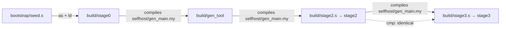

# Bootstrap

"Self-hosted" means: the compiler written in Myla, compiled by itself, produces itself again, byte for byte (D23).

[TOC]

## Stages

The bootstrap starts from a seed: `bootstrap/seed.s`, the self-hosted compiler's own assembly, committed (D101, [[MYLA-218]]). It needs only `as` and `ld`; the Python toolchain builds stage 1 only with `--from-python`, until it is retired ([[MYLA-219]]).



| Stage | What runs | Time (4 cores) |
| --- | --- | --- |
| 0 | `as` + `ld` of `bootstrap/seed.s` into `build/stage0` | 0.7 s |
| 1 | `build/stage0 selfhost/gen_main.my src/myla > build/gen_tool.s`, then `as` + `ld` | 1.1 s to compile |
| 2 | `build/gen_tool selfhost/gen_main.my src/myla > build/stage2.s`, then `as` + `ld` | 1.1 s to compile |
| 3 | `build/stage2 selfhost/gen_main.my src/myla > build/stage3.s`, then `as` + `ld` | 1.1 s to compile |
| check | `cmp build/stage2.s build/stage3.s` | |

A seed older than the sources is an older compiler, which is why the check comes after stage 3: stage 1 is the current compiler as the old one compiled it, stage 2 the first one the current compiler compiled, and `stage2.s` and `stage3.s` are both the current compiler's output. Bootstrapping today's sources from the seed of the commit before [[MYLA-237]] (a code-generation change) reaches the same fixed point, byte for byte.

The result is about 6.2 MB of assembly and a 1.5 MB static binary; the whole script, with `build/myla` and the language server, takes about 7.5 s from the seed and about 16 s with `--from-python` (measured on 2026-11-01). A fourth round produces the same output again.

## The seed

`bootstrap/seed.s` is the `stage3.s` of a fixed point, under a header that names the commit it came from and the SHA-256 of the assembly below it. `scripts/update-seed.sh` makes it: it runs the bootstrap (from the current seed, or with `--from-python`) and writes the new seed. Git shows it collapsed and without diffs (`.gitattributes`); each new seed adds about 0.6 MB to the repository's history, compressed.

- **When to update it:** with every change to the compiler's output, committed in the same pull request: `scripts/update-seed.sh` (about 8 s), then commit `bootstrap/seed.s`. CI's `bootstrap` job fails when the seed isn't the compiler of the sources (`scripts/check-seed.sh`), so a pull request carries one seed version (about 250 KB of history for a sizeable change; a seed per commit would multiply that). A bootstrap still works from an older seed, as long as it can compile the sources.
- **The optional pre-push hook:** `scripts/install-hooks.sh` sets `core.hooksPath` to `.githooks/`, whose `pre-push` runs `scripts/check-seed.sh` (about 6 s) when the commits pushed change `selfhost/`, `src/myla/std/` or the seed, and stops the push if the seed is stale (`MYLA_SKIP_SEED_CHECK=1 git push` skips it once). It checks the working tree, so commit first.
- **What it doesn't limit:** the seed only has to compile the compiler. What the compiler emits for programs (new system calls, IPC, a C FFI, LLVM output, other platforms) is the compiler's business, not the seed's.
- **Checking a seed:** run `scripts/update-seed.sh` at the commit its header names and compare; the compiler is deterministic, so the result is the same byte for byte.
- **Other hosts:** the seed is x86-64 Linux assembly; another host cross-compiles from x86-64 Linux, or gets a seed of its own later.

The burn tests bootstrap from the seed too (`tests/burn/_tools.py`, [[MYLA-235]]), and CI's `bootstrap` job runs without Python, checks that the seed is current, then bootstraps once more with `--from-python`.

## Why it used to be slow

Until October 2026 the bootstrap took about 5 minutes. Neither slow stage was slow because of Python or because the compiler is big; each had one hot spot:

| Stage | Before | Cause | After |
| --- | --- | --- | --- |
| 1 | about 60 s | 98% in `_collect_list_types`, which re-walked the type graph for every AST node ([[MYLA-60]]) | 3.4 s |
| 2 | about 4 min | the Python backend's allocator scanned one free list on every allocation ([[MYLA-16]]) | 1.3 s |

Both fixes left `stage2.s` byte-identical. A full bootstrap now takes about 8 seconds, so "change the compiler, bootstrap, compare" is an interactive loop.

## Running it

```bash
scripts/bootstrap.sh [OUT_DIR]       # default ./build, from bootstrap/seed.s
scripts/bootstrap.sh --from-python   # stage 1 by the Python toolchain; MYLA="uv run myla.py" to change its command
scripts/update-seed.sh               # a new seed from the current sources (see "The seed")
scripts/check-seed.sh [build]        # is the seed the current compiler? (CI and the pre-push hook)
scripts/install-hooks.sh             # the optional pre-push hook for this clone
just bootstrap                       # the same
```

After the fixed point, the script also builds `build/myla` (from `selfhost/main.my`), the self-hosted command-line tool with `run`, `test` and `build`. Its `build` runs `as` and `ld` itself through `std.process.run` and removes the intermediate `.s` and `.o` files; `run` passes the arguments after the file to the program:

```bash
build/myla build examples/hello.my -o build/hello && build/hello
build/myla run examples/args/main.my one two
build/myla test examples/traits.my
```

The tools find the standard library in `src/myla` next to the `build/` directory they are in, so they work from any directory; `--stdlib <dir>` overrides it ([[MYLA-31]]).

## Using the self-hosted compiler directly

```bash
build/stage3 program.my src/myla > program.s     # the second argument is the folder holding std/
as --64 -o program.o program.s && ld -o program program.o
```

Without the second argument the root is derived from the compiler's location, as for `build/myla`. `scripts/build.sh <file> [out]` wraps this and works from any directory; `build/myla run <file> [args]` interprets a program.

## The Python toolchain's last state

The branch `backup/python-toolchain-final` on GitHub (commit d94f948, 2026-11-01) keeps the last state with the whole Python toolchain as stage 1 and test oracle, before the committed seed ([[MYLA-218]]) and the Python toolchain's retirement ([[MYLA-219]], D101): all suites green, the bootstrap at its fixed point, `MYLA_TEST_BACKEND=python` running the burn tests on the Python backend. To bring the Python toolchain back, start from there (`git checkout backup/python-toolchain-final -- src/myla myla.py`, or a branch from it).

## When the fixed point breaks

The fixed point is a strong check of the self-hosted code generator: any change in `selfhost/` that changes generated code changes `stage2.s`, and stage 3 must reproduce it. If `cmp` fails, the script prints the first differences. Typical causes are output that depends on iteration order (map iteration differs between back ends) and differences between how the Python backend and the self-hosted backend compile the compiler itself.
