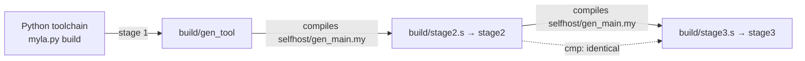

# Bootstrap

"Self-hosted" means: the compiler written in Myla, compiled by itself, produces itself again, byte for byte (D23).

[TOC]

## Stages



| Stage | What runs | Time (4 cores) |
| --- | --- | --- |
| 1 | `python3 myla.py build selfhost/gen_main.my -o build/gen_tool` | 3.4 s |
| 2 | `build/gen_tool selfhost/gen_main.my src/myla > build/stage2.s`, then `as` + `ld` | 1.3 s |
| 3 | `build/stage2 selfhost/gen_main.my src/myla > build/stage3.s`, then `as` + `ld` | 2.9 s |
| check | `cmp build/stage2.s build/stage3.s` | |

The result is about 4.4 MB of assembly (267,709 lines) and a 1 MB static binary. A fourth round produces the same output again.

## Why it used to be slow

Until October 2026 the bootstrap took about 5 minutes. Neither slow stage was slow because of Python or because the compiler is big; each had one hot spot:

| Stage | Before | Cause | After |
| --- | --- | --- | --- |
| 1 | about 60 s | 98% in `_collect_list_types`, which re-walked the type graph for every AST node ([[MYLA-60]]) | 3.4 s |
| 2 | about 4 min | the Python backend's allocator scanned one free list on every allocation ([[MYLA-16]]) | 1.3 s |

Both fixes left `stage2.s` byte-identical. A full bootstrap now takes about 8 seconds, so "change the compiler, bootstrap, compare" is an interactive loop.

## Running it

```bash
scripts/bootstrap.sh [OUT_DIR]       # default ./build; MYLA="uv run myla.py" to change the stage-1 command
just bootstrap                       # the same
```

After the fixed point, the script also builds `build/myla` (from `selfhost/main.my`), the self-hosted command-line tool with `run`, `test` and `build`. Its `build` runs `as` and `ld` itself through `std.process.run` and removes the intermediate `.s` and `.o` files; `run` passes the arguments after the file to the program:

```bash
build/myla build examples/hello.my -o build/hello && build/hello
build/myla run examples/args/main.my one two
build/myla test examples/traits.my
```

The tools find the standard library in `src/myla` next to the `build/` directory they are in, so they work from any directory; `--stdlib <dir>` overrides it ([[MYLA-31]]).

## Using the self-hosted compiler directly

```bash
build/stage3 program.my src/myla > program.s     # the second argument is the folder holding std/
as --64 -o program.o program.s && ld -o program program.o
```

Without the second argument the root is derived from the compiler's location, as for `build/myla`. `scripts/build.sh <file> [out]` and `scripts/run.sh <file> [args]` wrap this and work from any directory.

## When the fixed point breaks

The fixed point is a strong check of the self-hosted code generator: any change in `selfhost/` that changes generated code changes `stage2.s`, and stage 3 must reproduce it. If `cmp` fails, the script prints the first differences. Typical causes are output that depends on iteration order (map iteration differs between back ends) and differences between how the Python backend and the self-hosted backend compile the compiler itself.
