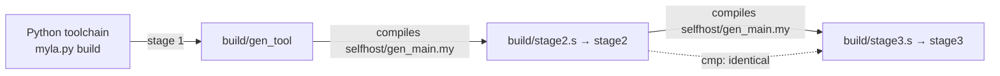

# Bootstrap

"Self-hosted" means: the compiler written in Myla, compiled by itself, produces itself again, byte for byte (D23).

[TOC]

## Stages



| Stage | What runs | Time (4 cores) |
| --- | --- | --- |
| 1 | `python3 myla.py build selfhost/gen_main.my -o build/gen_tool` | about 67 s |
| 2 | `build/gen_tool selfhost/gen_main.my src/myla > build/stage2.s`, then `as` + `ld` | about 4 min |
| 3 | `build/stage2 selfhost/gen_main.my src/myla > build/stage3.s`, then `as` + `ld` | about 2 s |
| check | `cmp build/stage2.s build/stage3.s` | |

The result is about 4.4 MB of assembly (267,709 lines) and a 1 MB static binary. A fourth round produces the same output again.

## Why it is slow, and how fast it can be

Neither slow stage is slow because of Python or because the program is big. Both have one hot spot each (measured 2026-10-25):

| Stage | Now | Cause | With the fix |
| --- | --- | --- | --- |
| 1 | about 60 s | 98% in `_collect_list_types`, which re-walks the type graph for every AST node without memoization ([[MYLA-60]]) | 3.8 s |
| 2 | about 4 min | `gen_tool`'s allocator, from the Python backend, scans one free list linearly on every allocation ([[MYLA-16]]); stage 2 itself comes from the self-hosted backend, which never frees ([[MYLA-22]]) and so never scans | 2.5 s (measured with reuse turned off) |
| 3 | about 2 s | — | 2 s |

Both fixes left the generated `stage2.s` byte-identical. With them, a full bootstrap takes about 10 seconds, which makes "change the compiler, bootstrap, compare" an interactive loop.

## Running it

```bash
scripts/bootstrap.sh [OUT_DIR]       # default ./build; MYLA="uv run myla.py" to change the stage-1 command
just bootstrap                       # the same, plus timers and stage 4: build/myla, the self-hosted CLI
```

`build/myla` (from `selfhost/main.my`) offers `run`, `test` and `build`; its `build` runs `as` and `ld` itself through `std.process.run`:

```bash
build/myla build examples/hello.my -o build/hello && build/hello
build/myla run examples/hello.my
```

## Using the self-hosted compiler directly

```bash
build/stage3 program.my src/myla > program.s     # the second argument is the folder holding std/
as --64 -o program.o program.s && ld -o program program.o
```

`scripts/build.sh` and `scripts/run.sh` wrap this, but don't pass the stdlib root yet ([[MYLA-31]]).

## When the fixed point breaks

The fixed point is a strong check of the self-hosted code generator: any change in `selfhost/` that changes generated code changes `stage2.s`, and stage 3 must reproduce it. If `cmp` fails, the script prints the first differences. Typical causes are output that depends on iteration order (map iteration differs between back ends) and differences between how the Python backend and the self-hosted backend compile the compiler itself.
