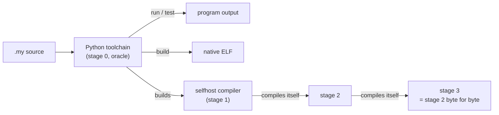

# Home

Myla is a small, statically typed programming language with sized integers, value semantics, algebraic data types, traits and closures. It is inspired by Swift, Rust and Python. It compiles to x86-64 Linux executables without libc, and it is **self-hosted**: the compiler written in Myla compiles itself to a byte-identical fixed point.

```myla
enum Shape {
    Circle(float64),
    Rect(float64, float64),
}

#test(Shape.Rect(2.0, 3.0))[6.0]
fun area(s: Shape) -> float64 {
    return match s {
        Circle(r) => 3.5 * r * r
        Rect(w, h) => w * h
    }
}

fun main() {
    let shapes = [Shape.Circle(1.0), Shape.Rect(2.0, 3.0)]
    for s in shapes {
        print(f"area: {area(s)}")
    }
}
```

`myla run` prints `area: 3.5` and `area: 6`; `myla test` runs the `#test` case; `myla build` produces a native binary that prints the same.

[TOC]

## Where to start

| You want to… | Read |
| --- | --- |
| Run your first program, build the compiler, run the tests | [[Getting started]] |
| Learn or look up the language | [[Language]] |
| Understand how the toolchains work inside | [[Architecture]] |
| Change the compiler: tests, bootstrap, conventions | [[Development]] |
| See status, plans, decisions and known problems | [[Project]] |
| Read the original design documents | [[Archive]] |

## The toolchains

The repository holds three toolchains:

| Toolchain | Where | Role |
| --- | --- | --- |
| **Python toolchain** | `src/myla/`, `myla.py` | Bootstrap compiler ("stage 0") and the reference: interpreter, `#test` runner and native x86-64 compiler. See [[Architecture/Lexer-and-parser]] onward. |
| **Self-hosted compiler** | `selfhost/` | The same pipeline written in Myla; compiles itself. See [[Architecture/Self-hosted-compiler]]. |
| **Editor tooling** | `tools/lsp/`, `vscode-extension/`, `editor/`, `grammar/`, `tools/` | Language server (written in Myla), VS Code extension (with a gdb debugger), the grammar description and the tree-sitter grammar generated from it by a tool written in Myla. See [[Architecture/Editor-tooling]]. |



## Status in one paragraph

Version 1.0 is reached and well past: every feature milestone is implemented in the Python toolchain with interpreter/native parity, and the self-hosted compiler reaches its three-stage fixed point. Since then the self-hosted backend goes through a verified mid-level IR ([[Architecture/IR]]), with guaranteed tail calls (`become`, D87); the language has Swift-style concurrency (D89 to D97: `async`/`await`, structured child tasks, actors) on a multi-threaded work-stealing native runtime ([[Language/Concurrency]]); and the tools are written in Myla: a project tool with Git dependencies ([[Architecture/Project-tool]]), a language server and a REPL, beside a VS Code extension with a debugger ([[Architecture/Editor-tooling]]). The review of October 2026 ([[Project/Review-2026-10]]) found the bugs now on the board and on [[Project/Known-issues]]; next is LLVM and other platforms ([[MYLA-62]]).

## Working in this repository

- Work is planned as Genbeya tasks in `tasks/` (IDs `MYLA-n`), grouped in epics per component. Name the task in commit messages: `MYLA-12: Encode interpreter strings with surrogateescape`.
- Durable knowledge goes into this wiki, not into private notes. See [[Development/Conventions]].
