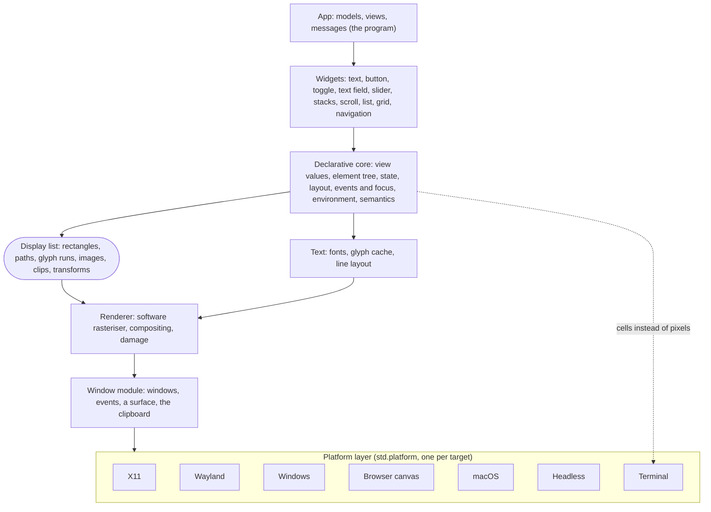
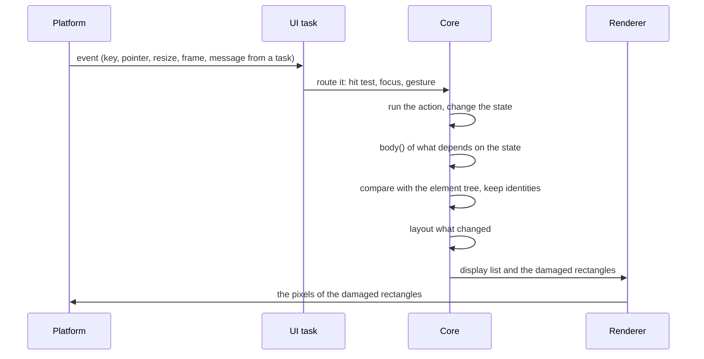

# Architecture

A proposal for the GUI system's structure ([[Project/GUI-plan]]). The names of modules and types are placeholders.

[TOC]

## Principles

1. **Views are values.** A view is a cheap description built by a function of the state. Building it has no effect; the framework compares it with the last one and changes what differs. This is SwiftUI's model, and it is what Myla's value semantics give without effort.
2. **Myla draws every pixel.** No system widgets, no system text. A window is a rectangle of pixels and a stream of events (Flutter's model). The same view gives the same pixels on every target, as a program prints the same text on every target today ([[Language/Targets]]).
3. **Everything can be tested without a display.** A headless target renders to memory; a test presses buttons by their labels and compares trees, texts or pictures.
4. **No dependency.** Linux programs stay static and without libc; Windows programs link system DLLs only (D212).
5. **The interpreter runs GUI programs.** `myla run` works; the pixel loops run compiled.

## Layers



| Layer | Holds | Lives in (recommended) | Written in |
| --- | --- | --- | --- |
| Platform | Connecting to the display, creating a window, reading events, showing a buffer; one implementation per target behind the same functions | `std.platform` and its per-target modules | Myla over primitives |
| Window | `Window`, `Event`, `Surface`, the clipboard, the cursor, scale; `await window.next_event()` | `std.window` | Myla |
| Renderer | Executes a display list into a pixel buffer; anti-aliased paths, gradients, images, clipping | `std.draw`, which exists since D313 ([[MYLA-968]]) with the paths, the rasteriser and a `Canvas`; the display list's executor and damage go on top | Myla (hot loops perhaps over two or three primitives, [[Project/GUI-plan/Gaps#r3-bulk-memory-operations]]) |
| Text | Font files, glyph outlines and their cache, measuring and breaking lines | `std.font`, which exists since D313 ([[MYLA-969]]) with all four for TrueType; `std.text` | Myla |
| Core | The view type, the element tree, state, layout, events, environment, semantics | A package, `ui` | Myla, no primitives |
| Widgets | The controls and containers | The same package | Myla, on the core's public API only |

The split between std and a package follows from two facts: the lower three layers need primitives (std-only) and compiled speed under the interpreter; the upper two need neither, change fastest, and are what a second framework (a game's immediate-mode UI, a plotting library) wouldn't want. The split is decision 1 of [[Project/GUI-plan]]. D313 has since put the renderer's and text's foundations in std as std.draw and std.font, pure Myla without primitives, and says displays and windows stay out of std; the platform and window layers' place is the part of decision 1 still open.

## A frame



- **One UI task.** The loop is one async task that awaits the next event. State is changed only there, so it needs no locks and no actor.
- **Rebuild, compare, keep.** `body` returns new view values; the core matches them with the *element tree*, the retained tree that carries what must survive a rebuild: identity, the size and position from layout, focus, scroll offsets, a text field's cursor, hover, running animations, a view's own state. Identity is the position in the tree, or a key the program gives for list items (`for_each(items, key, row)`), as in SwiftUI.
- **Layout** is SwiftUI's protocol: the parent proposes a size, the child answers with the size it takes, the parent places it. Stacks, spacers, frames, padding and alignment are built on that one call.
- **Damage.** The core knows which elements changed; only their rectangles are drawn and shown. A full 1080p repaint costs 4 to 15 ms in today's native code, a blinking cursor microseconds.
- **Frames on demand.** Nothing runs while nothing changes; an animation asks for the next frame.

### Under the interpreter

Interpreted pixel loops are about 1,200 times slower than native ones (a 1080p fill takes 4.9 s, [[Project/GUI-plan#what-was-measured-and-tried]]). So the display list is where `myla run` hands over: the core and the program are interpreted and produce a display list; one primitive passes it to the renderer compiled into the `myla` binary, as `std.net`'s primitives pass to the compiled std today. The core's own work per event (rebuild, compare, layout) stays interpreted; whether that is fast enough for a tree of a thousand elements is the first thing phase 2 measures, and it is why [[MYLA-317]] matters.

The same seam serves every other renderer: a GPU one, the browser's canvas calls, a system's text. std.draw is the natural renderer behind it, but under `myla run` it is interpreted today like any other std module ([[Project/GUI-plan/Gaps#r4-compiled-std-code-under-the-interpreter]]).

## State and effects

Three models were considered. They can coexist: the first needs nothing new and is the base.

| | Model with messages | State cells | Actor as model |
| --- | --- | --- | --- |
| What it is | A struct holds the state; `body(self, ui)` describes it; an action is a message value; `update(var self, msg)` changes the state | `let count = ui.state(0)` gives a handle the framework stores by the view's identity; an action is a closure calling `count.set(…)` | The model is an actor; actions are async closures calling its methods; `body` reads a snapshot |
| Like | Elm, iced | SwiftUI's `@State`, React's hooks | SwiftUI's `@Observable` with `@MainActor` |
| Needs | Nothing | A cell primitive ([[Project/GUI-plan/Gaps#l1-type-erased-storage]]) | Nothing, but every action is `async` and `await`s |
| A view's own state | In the model, passed down; a sub-view's messages wrapped by its parent | Natural | In the actor |
| Testing | `#test` on `update` and `body`: both are plain functions | Through the headless target | Async tests |
| SwiftUI feel | Low for state, high for views | High | Medium |

Recommended: the model with messages first, cells as the second step, the actor as the documented way to share a model between windows or with background work.

**How the first works without generics in the tree.** `View` isn't generic ([[Project/GUI-plan/Gaps#l3-inference-through-a-method-chain]]), so a button can't hold a `Msg`. It holds an `Action`, a closure the framework's typed code made: `ui.send(msg)` captures the message and the handle of the UI task's inbox, a `task.Channel`, and posts the one to the other when fired. The loop is generic in the model and the message; only the tree is erased. [[Project/GUI-plan/Concurrency]] has the probe. (The program on [[Project/GUI-plan/Syntax-without-grammar-change]] shows an earlier form, an action that returns the next root; it has the same surface and no inbox.)

**Effects.** Work that takes time is a job `update` returns: an async closure the framework runs as a task of its own, which awaits what it needs (an actor, a request, a file) and posts messages to the inbox, where they meet the model as it is then. Actors are the services jobs talk to, not the UI's state. Cancelling, subscriptions, what crosses between tasks and the gaps this shows (a task group, failure isolation) are on [[Project/GUI-plan/Concurrency]].

**Environment.** Values that flow down the tree (theme, font size, locale, the colour scheme) are a modifier, `.environment(theme)`, read during the rebuild. The tree is data, so this needs no global.

## The window module

A sketch of the interface every platform implements. It follows `std.net`'s pattern: the platform functions give numbers and cause codes, the module makes types of them.

```myla fragment
pub enum Event {
    Close
    Resize(int, int, float)          // pixels and the scale
    Frame(int64)                     // the time a frame is due, in ns
    Key(Key, Modifiers, bool)        // pressed or released
    Text(str)                        // typed characters, after the keymap
    PointerMove(float, float)
    PointerButton(Button, bool, float, float)
    Scroll(float, float)
    Focus(bool)
}

// A window, its events and its pixels.
pub fun open(title: str, width: int, height: int) -> Result<Window, WindowError>
// impl Window:
//     async fun next_event(self) -> Option<Event>
//     fun present(self, pixels: [uint32], damage: [Rect]) -> Result<(), WindowError>
//     fun request_frame(self)
//     fun set_title(self, title: str)
//     fun close(self)
```

`Unsupported` is the answer on a target without windows, as for processes on wasm (D132).

## Platforms

| Target | How a window's pixels reach the screen | Events | Needs | Order |
| --- | --- | --- | --- | --- |
| Headless | A buffer in memory; PNG output (std.png) | Injected by the test | Nothing | 1 |
| Terminal | Character cells through `std.term`; no renderer | `std.term`'s keys | Nothing ([[MYLA-760]] on Windows) | 1 |
| Linux, X11 | The core protocol over a Unix socket: `PutImage`, or the shared-memory extension | The same socket; key symbols from the server | Unix sockets; shared memory optional | 2 |
| Windows | `user32` windows, `SetDIBitsToDevice` from `gdi32` | A window procedure on a thread of the platform layer's | Two DLLs in the import table, one callback ([[Project/GUI-plan/Gaps#r1-something-that-owns-a-thread]]) | 3 |
| Browser | A canvas: the buffer handed to `putImageData`, or later canvas calls made from the display list | Imports that queue DOM events | A host-driven loop ([[Project/GUI-plan/Gaps#r2-a-host-driven-loop-on-wasm]]) | 4 |
| Linux, Wayland | `wl_shm` buffers; the program draws its own title bar where the compositor draws none | The Wayland socket; an XKB keymap to parse | Descriptor passing, shared memory, a keymap parser | 5 |
| macOS | An `NSWindow` whose layer shows the buffer | AppKit on the main thread | [[MYLA-164]], [[MYLA-166]] | 6 |

**Why X11 before Wayland.** X11 needs one stream socket and nothing else; the window manager draws the title bar; key symbols come from the server; and every Wayland desktop runs X11 programs through XWayland, so one implementation reaches every Linux desktop. Wayland needs three more platform features and a keymap parser before the first pixel. What X11 lacks under XWayland (sharp scaling on mixed-density screens) is what the Wayland target adds later.

**Why the terminal first.** It needs no platform work at all, runs on all four targets and under the interpreter, and exercises everything in the core except pixels: state, rebuild, identity, layout (in cells), focus, keys. A layout bug found there is found in seconds.

## Testing

- **`#test` on models**: `update` and `body` are functions of values.
- **The headless target**: `let app = ui.test(Counter { … })`, `app.press("+")`, `app.type_text("name", "pears")`, `app.text_of(…)`, `app.tree()` as text.
- **Golden pictures**: `app.png()` compared with a stored file, the same bytes on every target. This rests on principle 2 and on `std.math` giving the same bits everywhere.
- **The burn suites** run the same GUI programs interpreted and natively and compare trees and pictures, as they compare output today.

## Risks

| Risk | How it shows | What answers it |
| --- | --- | --- |
| The interpreter is too slow for the core's work per event | `myla run` of a real app stutters | Measure in phase 2; rebuild only what depends on the changed state; [[MYLA-317]] |
| The software renderer is too slow at 4K | A full-window animation misses frames | Damage rectangles; the hot-loop tasks; primitives for spans; later a GPU renderer behind the display list |
| Text is a project of its own | Latin text looks right, Arabic and Devanagari don't | Scope: left-to-right scripts without shaping first, said plainly in the docs; the display list allows a system's text later. std.font has that scope already (Latin, Greek and Cyrillic; shaping and bidirectional text out, D313) |
| Erasing actions by closures hides stale state | An action made before an update runs after it | Actions post messages to the inbox; every message meets the current model ([[Project/GUI-plan/Concurrency]]) |
| No task group that can be added to | Jobs run in a fixed number of slots and can't be cancelled one by one | A task group in `std.task` before the core's API settles |
| A web target that isn't WASI splits the wasm target | Two host interfaces, two test setups | Decide with [[MYLA-241]]: the GUI imports as an optional module beside WASI's |
| The framework's API is published before named arguments or private fields exist | A breaking change to every call | Decision 5 of [[Project/GUI-plan]]: tier 1 and [[MYLA-433]] first |
