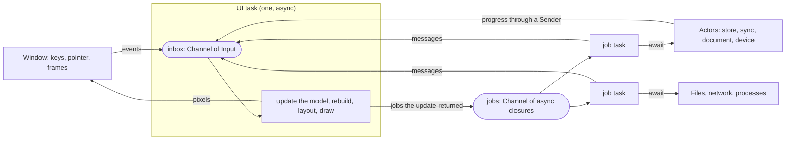

# Concurrency

How the GUI meets Myla's tasks and actors (D89 to D97, [[Language/Concurrency]]): what keeps the interface responsive while work runs, how results and progress come back, and where actors fit. Part of [[Project/GUI-plan]]; a follow-up to the owner's question of 18 November 2026.

[TOC]

## The shape



1. **One UI task owns the model.** It is the only code that changes the model, builds views, lays out and draws. It needs no lock and no actor: nothing else can reach the model, because it is a value in that task.
2. **Everything reaches it through one inbox**, a `task.Channel`: the window's events, the messages of actions, the results and progress of background work. A channel is a handle whose copies reach the same queue, so a closure, a task and an actor can each keep one.
3. **`update` never waits.** It is a plain function. Work that takes time is a *job* it returns: an async closure the framework runs as its own task. The job awaits whatever it wants (an actor, a request, a child process) and posts messages.
4. **A message is applied to the model as it is then**, not as it was when the work started. There is no stale state to merge.

Natively the jobs run in parallel on the workers (D92) while the UI task keeps taking events. Under the interpreter and on wasm32 there is one worker: the tasks take turns at every `await`.

## It runs today

A probe of 2026-11-18 at `f78f57c`, 190 lines, no language or runtime change: a generic UI loop over an inbox, actions that post messages, jobs run by `task.workers`, and an actor (`Library`) that imports four books 30 ms apart and reports progress, while a scripted user starts the import and presses a second button every 45 ms.

```myla fragment
actor Library { books: [str] }

impl Library {
    async fun import_all(var self, names: [str], progress: Sender<int>) -> int {
        var i = 0
        for n in names {
            await task.sleep(30)
            self.books.push(n)
            i += 1
            await progress.post(i * 100 / names.len())
        }
        return self.books.len()
    }
}

enum Msg { Import, Progress(int), Imported(int), Tick }

struct App { lib: Library, status: str, ticks: int, busy: bool }

impl Model<Msg> for App {
    fun update(var self, msg: Msg, ui: Ui<Msg>) -> [Job] {
        match msg {
            Import => {
                if self.busy { return [] }
                self.busy = true
                self.status = "importing"
                let lib = self.lib
                let progress = ui.sender<int>((p) => Msg.Progress(p))
                let finished = ui.sender<int>((n) => Msg.Imported(n))
                return [async () => {
                    let n = await lib.import_all(["a", "b", "c", "d"], progress)
                    await finished.post(n)
                }]
            }
            Progress(p) => { self.status = f"{p} %" }
            Imported(n) => {
                self.busy = false
                self.status = f"{n} books"
            }
            Tick => { self.ticks += 1 }
        }
        return []
    }

    fun body(self, ui: Ui<Msg>) -> View {
        return vstack([
            text(self.status),
            text(f"ticks {self.ticks}"),
            button("import", ui.send(Msg.Import)),
            button("tick", ui.send(Msg.Tick)),
        ])
    }
}
```

Native output (the interpreter's differs only in which of two near-simultaneous messages comes first, as it should):

```text
frame 1: importing ticks 0 [import] [tick]
frame 2: 25 % ticks 0 [import] [tick]
frame 3: 25 % ticks 1 [import] [tick]
frame 4: 50 % ticks 1 [import] [tick]
frame 5: 75 % ticks 1 [import] [tick]
frame 6: 75 % ticks 2 [import] [tick]
frame 7: 100 % ticks 2 [import] [tick]
frame 8: 4 books ticks 2 [import] [tick]
frame 9: 4 books ticks 3 [import] [tick]
end: 4 books, ticks 3
```

The ticks land between the progress reports: the interface stayed live during the import. The framework's side of the probe:

```myla fragment
enum Input<M> { Key(str), Msg(M), Quit }            // what reaches the UI task
struct Action { fire: async () -> () }              // what a button holds
typealias Job = async () -> ()                      // what an update asks for
struct Ui<M> { inbox: task.Channel<Input<M>> }
struct Sender<T> { post: async (T) -> () }          // a way back for a task or an actor

impl<M> Ui<M> {
    fun send(self, m: M) -> Action {
        let inbox = self.inbox
        return Action { fire: async () => {
            let r = await inbox.send(Input.Msg(m))
        } }
    }

    fun sender<T>(self, f: (T) -> M) -> Sender<T> {
        let inbox = self.inbox
        return Sender { post: async (x: T) => {
            let r = await inbox.send(Input.Msg(f(x)))
        } }
    }
}

async fun run<S: Model<M>, M>(start: S, …) -> S {
    let inbox: task.Channel<Input<M>> = task.unbounded()
    let jobs: task.Channel<Job> = task.unbounded()
    let ui: Ui<M> = Ui { inbox: inbox }
    async let pool = task.workers(4, jobs, done, run_job)     // the jobs' tasks
    let model = await run_loop<S, M>(start, ui, jobs)         // the UI task
    …
}
```

**This replaces a part of the first proposal.** The program on [[Project/GUI-plan/Syntax-without-grammar-change]] erases an action as a closure that returns the next root, which captures the model as it was when the view was built. The inbox is better: an action is a closure that posts a typed message through a channel handle it captured, the loop itself is generic in the model and the message, and only the view tree is erased. The surface syntax (`button("+", ui.send(Msg.Increment))`) is the same in both.

## Where actors fit

An actor isn't the UI's state; it is what the UI talks to.

| Use | Shape |
| --- | --- |
| **A service** with state of its own that outlives a view or serves several: a document store, a sync engine, a cache, a device, a download manager | An actor. A job calls it (`await store.save(doc)`) and posts the result |
| **A service that reports on its own** (progress, a change made elsewhere, a message from a server) | The actor keeps a `Sender<T>` in its fields, given to it at subscription; it posts when it has news. A sender is a struct of a closure over a channel handle, so an actor may hold it (D93: handles are shared, values copied) |
| **A model shared by several windows** | An actor holds it. Each window's UI task keeps a copy as its view of it, subscribes with a sender, and replaces its copy when the actor posts a new version. Changes go to the actor as method calls from jobs |
| **The UI's own model** | Not an actor: a struct in the UI task. Making it an actor would turn every read in `body` into an `await` and every action into an async call, and buy nothing, since one task already owns it |

Why the UI task isn't itself an actor: an actor method that loops over events forever would be "one method runs at a time" for good, with other calls getting in only at its `await`s (the reentrancy D95 warns about). A task with an inbox is the same idea, a mailbox and one owner, without that rule in the way.

Swift's answer to the same question is `@MainActor`: a global actor the UI lives on, and `await MainActor.run { … }` to get back to it. Posting a message to the inbox is Myla's "back to the main actor". It needs no global and no new isolation rule in the checker.

## What crosses, and what it costs

A value crossing between tasks, or into and out of an actor, is copied deeply (D89, D93); wasm32 skips the copies, having one worker (D133).

- **Into a job**: what its closure captures. Capture the fields the job needs, not the model.
- **Back to the UI**: the message's payload. A 10,000-row result is copied once on arrival.
- **A model shared through an actor**: every new version is copied to every window. For large models, post what changed (a row, a range), not the whole.
- **Pixels** never cross: drawing happens in the UI task. Moving the renderer to a task of its own later would mean sending display lists, which are values; whether the copy is cheaper than the drawing it frees is a measurement for then.

## Staying responsive

| Hazard | What happens | Answer |
| --- | --- | --- |
| A slow `update` or `body` | Every frame waits for it | They are plain functions and should be small. The framework can time them and warn in debug runs (`update took 48 ms`) |
| A job that computes without awaiting, natively | Nothing: it has its own worker | |
| The same under the interpreter or on wasm32 (one worker) | The interface freezes until it finishes or awaits | `await task.yield()` in long loops; the docs say so, and a debug run can warn when the UI task waited long for a turn |
| A blocking call (`fs.read_to_string`, a DNS lookup) in a job | Natively it holds one worker; on one worker it holds everything | Jobs, never `update`; the async twins where std has them |
| Messages faster than frames (progress 10,000 times a second) | The inbox grows, each message rebuilds | The loop drains what is waiting and rebuilds once per frame; a sender can be made `latest_only` so a newer value replaces an unread older one |
| A burst of window events (pointer moves) | The same | Coalesced by the window layer: one move per frame |
| Too many jobs at once | `task.workers(n, …)` runs `n` at a time; a long-lived job (a subscription) holds a slot forever | Needs the task group below |
| A job fails (a panic, a runtime error) | The program ends: a failure in any task ends it (D97) | Jobs return `Result`s and post an error message. A crash handler that saves the model first would need an exit hook the program can set |

## Cancelling and lifetimes

What a real application needs and the probe doesn't do:

- **Latest wins.** A search field starts a request per keystroke; only the last matters. `ui.job_keyed("search", …)` cancels the job that holds the key before it starts the new one.
- **A view's work ends with the view.** SwiftUI's `.task { … }` runs while the view is on screen. Here: a job tied to an element's identity, cancelled when the element goes.
- **Subscriptions.** Long-lived sources (a timer, a socket, an actor's news) are declared from the model, as `body` is: `fun subscriptions(self, ui) -> [Subscription]`, each with a key; the framework starts those that are new and cancels those that are gone (Elm's model).
- **Quitting** closes the inbox and cancels every job; the scope waits for them, as every scope waits for its children.
- **Debounce and throttle** are jobs that sleep first and are cancelled by the next one with their key.

Cancelling is cooperative (D96): the job sees it at `task.cancelled()` or when a sleep or a channel operation returns early.

## Gaps this shows

| Gap | Why | Today's way around |
| --- | --- | --- |
| **A task group that tasks can be added to while it runs**, each with a handle to cancel | Children are `async let` (one name, fixed in the source), `task.all` and `task.pool` (a list known up front) or `task.workers` (a fixed number of slots). A UI starts and cancels tasks one by one for as long as it lives | `task.workers` over a channel of closures, as the probe does: a cap on running jobs, no cancelling of one job. A cancel flag per job (a notifier, or a keyed set the job checks) can be layered on |
| **A failure that ends one task, not the program** | D97. One bad job shouldn't take the window down, and a GUI program wants to save before it dies | `Result`s everywhere; nothing for runtime errors |
| **Waiting for one of several things** | The loop waits for "an event or a message or a frame"; there is no `select` over channels | One inbox for everything, and pump tasks that forward other sources into it. It works and costs a copy per forwarded item |
| **A channel's `try_send` is async** | An action can't post from plain code, so `Action` is an async closure and everything that fires one is async | Fine inside the loop; it does make "call this action" impossible from a sync callback |
| **Thread affinity** | The UI task may resume on any worker; Windows and AppKit want one thread | The platform layer's own thread ([[Project/GUI-plan/Gaps#r1-something-that-owns-a-thread]]) |
| **A host-driven loop on wasm** | In a page the UI task's wait must return to the browser | [[Project/GUI-plan/Gaps#r2-a-host-driven-loop-on-wasm]] |
| **Async trait methods** ([[MYLA-434]]) | Not needed: `update` and `body` are sync by design. They would be needed for an `async fun update` | None wanted |

The task group is the one worth a task of its own before the core is built: it also serves servers (a task per connection that can be cancelled) and is what `task.workers` approximates. The others have acceptable ways around them.

## With state cells or a `view` declaration

The model with messages keeps async work at arm's length: a job posts, `update` assigns. With cells ([[Project/GUI-plan/Gaps#l1-type-erased-storage]]) an action can be an async closure that does both, which is how SwiftUI code reads:

```myla fragment
button("Import", async () => {
    status.set("importing")
    let n = await library.import_all(names, progress.sender())
    status.set(f"{n} books")
})
```

- The closure runs as a job. `status.set` from a job means a cell is written from another task than the one that reads it in `body`, so a cell must be safe for that: the write is taken under the cell's lock and wakes the UI task, which rebuilds. That is the cell being a small actor with synchronous methods, which is the honest name for it and the reason it is a language decision, not a library detail.
- Between `set("importing")` and the `await`'s return the user may have done anything; the closure's view of other cells is as stale as it reads them. This is the reentrancy D95 warns about in actors, moved into the view. The message model doesn't have it, because every message meets the current model.
- In a `view` declaration (tier 3 of [[Project/GUI-plan/Syntax-with-grammar-change]]) the same block would read `status = "importing"`; the compiler would have to split it at each `await` into steps that each run on the UI task, as an async function is split into frames today.

## Recommendation

1. The UI task with one inbox, jobs returned from `update`, senders for progress: the base, buildable now.
2. A task group with cancel handles in `std.task` before the core's API settles, so that keyed jobs, view-bound tasks and subscriptions aren't built on a workaround.
3. Actors documented as the place for services and shared models, with the copy cost said.
4. Decide failure isolation (D97) with GUI programs in mind when the first real application exists.
5. Async actions over cells only together with the cell decision, and with D95's warning extended to them.
