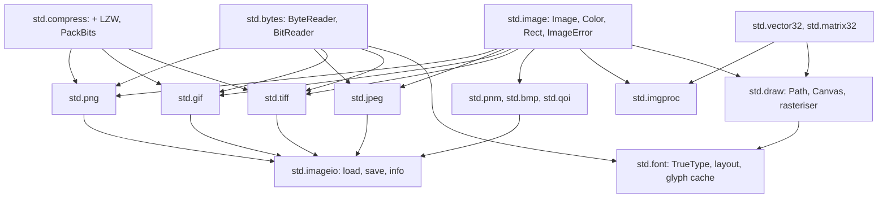

# Images, vision and fonts

The plan for image files (PNG, JPEG, GIF, TIFF and a few simple formats), image processing and computer vision (a "poor man's OpenCV"), 2D vector drawing, and TrueType font rendering, all in Myla. The GUI ([[MYLA-63]]) will need all of it. Before then, it lets programs make charts and thumbnails, check screenshots in tests, look at images in a terminal, and run vision algorithms over files. The umbrella task is [[MYLA-956]], which holds the decisions this page asks for. The work is planned as tasks [[MYLA-957]] to [[MYLA-971]] in `tasks/Standard library/6 Images, vision and fonts/`.

[TOC]

## Status (2026-11-25)

Built, merged and in review: every module below, by parallel lanes in three waves ([[MYLA-956]]). Each module has its page under [[Language/Standard-library]]; the numbers there were measured natively against Pillow and OpenCV.

| Module | Task | In short |
| --- | --- | --- |
| std.image | [[MYLA-959]] | `Image<S>`, layouts, conversions (Pillow's luma exactly), geometry, `quantize`, `ansi` |
| std.bytes, std.compress | [[MYLA-957]], [[MYLA-958]] | byte and bit readers and writers; LZW (GIF, TIFF), PackBits |
| std.pnm, std.bmp, std.qoi | [[MYLA-960]] | read and write; QOI byte for byte as the reference encoder |
| std.png | [[MYLA-961]] | every PNG of PngSuite as Pillow reads it, the broken ones refused; encoder within 1 % of Pillow's size |
| std.jpeg | [[MYLA-962]], [[MYLA-963]] | baseline and progressive decoding bit-identical to Pillow (D313); encoding byte for byte as libjpeg writes |
| std.gif, std.tiff | [[MYLA-964]], [[MYLA-965]] | animations composited as Pillow does; baseline TIFF with pages and float samples |
| std.imageio | [[MYLA-966]] | `load`, `save`, `sniff` over all of them |
| std.imgproc | [[MYLA-967]], [[MYLA-970]] | tiers A and B, most of them exact against Pillow or OpenCV |
| std.draw, std.font | [[MYLA-968]], [[MYLA-969]] | coverage rasteriser and canvas; TrueType within 5 levels of FreeType |

Speed: the codecs and filters take 2 to 7 times Pillow's or OpenCV's time (a few, such as median filtering and contours, are faster). The causes found are the compiler's ([[MYLA-947]], [[MYLA-949]], [[MYLA-950]], [[MYLA-951]]), not the modules'.

## Decisions

The owner accepted every recommendation below on 2026-11-24 (D313, [[MYLA-956]]).

1. **std or official packages?** [[Project/Standard-library-roadmap#Left out]] puts "graphics, audio, GUI and databases" in packages, and [[MYLA-245]] hasn't decided yet what std is. MYLA-587 names `std.jpeg` and `std.imgproc` as things std.vector builds toward. **Recommendation: std.** Codecs, image processing and font parsing are portable computation with no system interface, the same kind of code as std.compress and std.json. A module costs only the programs that import it. The display, the windowing and the GUI stay out of std. The cost is size: `selfhost/embedded_std.my` is 4.0 MB today (85,600 lines of `lib/std/`), and these modules would add an estimated 15,000 to 20,000 lines, so the toolchain binaries carry roughly 20 % more library text. If MYLA-245 later moves modules into packages, these are the first candidates, and nothing in their API depends on where they live.
2. **One generic image type or twins?** **Recommendation: generic `Image<S: Sample>`**, with `S` one of `uint8`, `uint16` and `float32`, plus the aliases `Image8`, `Image16` and `ImageF`. D201 generated twins for the vectors because `Vec3<float>` would have to be spelled everywhere. Images are fewer types, generic code (crop, flip, resize, convolution) is the bulk of the library, and the aliases keep the spelling short. A prototype type-checks and runs this shape interpreted and natively ([[#What was measured]]).
3. **Pixel storage.** **Recommendation: one interleaved row-major `[S]`** with no row padding (`data[(y * width + x) * channels + c]`), and the channel layout a runtime field (`Gray`, `GrayAlpha`, `Rgb`, `Rgba`). A list of pixel structs was 2.3 times slower natively. A layout field also keeps one type for 1 to 4 channels, as stb_image and OpenCV's `Mat` do.
4. **One error type for all codecs.** `?` doesn't convert errors, so `imageio.load` dispatching to five decoders would need a `match` per call if each codec had its own. **Recommendation:** a bare enum `ImageError` in std.image (D168: its variants carry different data), shared by every codec, std.imageio and std.imgproc.
5. **Methods or functions.** **Recommendation:** methods for what belongs to the image itself (`img.crop(r)`, `img.convert(Layout.Gray)`, `img[(x, y, c)]`). Free functions for algorithms, image first, so they chain with `|>` (`img |> imgproc.gray() |> imgproc.gaussian_blur(1.4f32) |> imgproc.canny(50.0f32, 150.0f32)`). Drawing mutates, and parameters can't (no `var` parameters), so it goes through a `Canvas` value with `var self` methods.
6. **Test oracle and fixtures.** The Python tests use no third-party packages, by design (`pyproject.toml`). **Recommendation:** vendor freely licensed conformance files under `tests/burn/data/` (as the toml-test suite is): PngSuite, a handful of JPEG, GIF and TIFF samples, and one small font under the OFL. Generate the expected pixels once with Pillow (`--vendor`, like test_toml's), and commit them as PAM files or hashes. CI then needs nothing installed. Pillow is the reference for regenerating only.
7. **JPEG exactness.** **Recommendation:** match libjpeg's default decode bit for bit: the integer "islow" IDCT and its fancy (triangle) upsampling. Then a decoded JPEG is the same on every target and equal to what Pillow gives, so a test compares exactly instead of within a tolerance. stb_image's faster IDCT differs from libjpeg by ±1 here and there, which is the fallback if exactness costs too much speed.
8. **Font fixtures and a default font.** std can't ship a large font (size, and licences). **Recommendation:** a small built-in bitmap font of our own design (ASCII, about 6×10, a few KB) so a program can draw text with no file at all. TrueType fonts come from files. The tests use a subset of an OFL font, vendored with its licence.

## Ground rules

- **Pure Myla, every target.** No FFI and no primitive. The same results interpreted and natively on x86-64, aarch64, Windows and wasm32. Floats are bit-identical across runners (std.math's fdlibm ports, D199), so image processing in `float32` gives the same pixels everywhere too.
- **Untrusted input never ends the program.** In Myla an index out of range is a runtime error that ends the program; there is nothing to catch. So every decoder checks every offset and length against the input and returns `Err`. Each decoder task has a fuzz test that mutates and truncates its corpus. Its pass condition is "`Ok` or `Err`, never a runtime error", run plain and `--checked`.
- **Limits before allocation.** Every decoder takes `max_pixels: int64 = image.MAX_PIXELS` (2^28 by default, about 268 million pixels) and refuses a header that asks for more with `TooLarge`, before it allocates. This is std.compress's `max_output` pattern ([[MYLA-423]]). Sizes are computed in `int64`, because `width * height * channels` overflows `int32` at 23,170² RGBA (the H11 lesson of [[MYLA-796]]). A list holds at most 2^31 − 1 elements, so a decode that needs more is `TooLarge` too.
- **Whole buffers first.** Decoders take a `[uint8]` and encoders return one, as std.compress's functions do. Streaming (`Read`/`Write`) comes later, where it pays: GIF and TIFF frames, and PNG encoding.
- **Small images in `#test` cases.** The interpreter blurs about 12,000 pixels a second ([[#What was measured]]), so module cases use images up to about 16×16. Real-sized images run in the burn tests, natively.

## What was measured

All of this was measured on 2026-11-24 over `cc6539e`, on a shared x86-64 machine. Native code was built with `myla build`, so bounds checks were on.

| Work | Native, 1024×1024 | Interpreted, 256×256 |
| --- | --- | --- |
| RGBA to gray, interleaved `[uint8]` | 3.7 ms (280 Mpx/s) | 399 ms |
| RGBA to gray, `[Rgba8]` of structs | 8.7 ms | 248 ms |
| 3×3 box blur, gray, nine reads a pixel | 38.7 ms | 5.57 s |

- Natively, an interleaved `[uint8]` wins clearly. Interpreted, the order is reversed (the interpreter keeps a value per element either way), but interpreted speed only bounds the size of the test images. A naive 3×3 blur, at about 40 ms per megapixel, shows that algorithms have to be written with care: separable passes, running sums, and no per-pixel `clamp` inside the image.
- A prototype of the core (`Image<S: Sample>`, the `Sample` trait with functions without `self`, `impl Index<(int, int, int), S>` and `IndexSet` for `img[(x, y, c)]`, `typealias Image8 = Image<uint8>`, a default parameter naming another module's constant, and `|>` chains of free functions) runs alike interpreted and natively.
- **One constraint found:** `impl Image<uint8> { … }` is refused ("cannot 'impl' on a concrete generic instantiation"). So 8-bit-only operations are generic over `Sample` (for example `img.color_at(x, y)`, which converts through `S.to_unorm8`) or free functions that take an `Image8`. A module may add methods to `Image<S>` for every `S`, for example std.imgproc or std.draw.

## The modules



Each format is its own module, so a program pays only for the formats it imports (check time grew from 34 to 47 ms when std.vector started importing std.json, [[MYLA-587]]). std.imageio is the one that imports all of them.

### std.image: the core ([[MYLA-959]])

```myla fragment
pub trait Sample {                       // uint8, uint16, float32
    fun max_value() -> Self              // 255, 65535, 1.0
    fun to_f32(self) -> float32          // unscaled
    fun from_f32(v: float32) -> Self     // rounded and clamped for the integers
    fun to_unorm8(self) -> uint8         // scaled to 0..255
}

pub enum Layout { Gray, GrayAlpha, Rgb, Rgba }   // channels(), has_alpha(), is_color()

pub struct Image<S> { width: int, height: int, layout: Layout, data: [S] }
pub typealias Image8 = Image<uint8>
pub typealias Image16 = Image<uint16>
pub typealias ImageF = Image<float32>

#derive(Eq, Hash)
pub struct Color { r: uint8, g: uint8, b: uint8, a: uint8 }   // straight (not premultiplied) alpha, sRGB
#derive(Eq, Hash)
pub struct Rect { x: int, y: int, w: int, h: int }

pub enum ImageError {
    Truncated                // the input ends early
    BadSignature             // not this format
    Unsupported(str)         // a valid feature we don't read: "arithmetic coding", "CCITT G4"
    Corrupt(str)             // what was wrong, with its offset
    Checksum                 // a PNG chunk's CRC or a zlib Adler-32
    TooLarge(int64)          // pixels asked for, past the limit
    Mismatch(str)            // sizes or layouts that don't fit (paste, merge, abs_diff)
    Io(IoError)              // std.imageio's load and save (std.ioerror)
}
```

| Function or method | Result |
| --- | --- |
| `new<S: Sample>(w, h, layout, fill: S) -> Image<S>` | A filled image. A negative size, or more than 2^31 − 1 samples, is a failure (as for `grid.new`, D184) |
| `from_data<S>(w, h, layout, data: [S]) -> Result<Image<S>, ImageError>` | An image around existing samples; `Mismatch` if the length is wrong |
| `img[(x, y, c)]`, `img[(x, y, c)] = v` | A sample, `Index`/`IndexSet`. Out of bounds is a failure, as for a list |
| `img.get(x, y, c) -> Option<S>`, `img.in_bounds(x, y)` | The checked forms |
| `img.color_at(x, y) -> Color`, `img.set_color(x, y, c)` | A pixel as a `Color`, converted from any layout and sample type |
| `img.row(y) -> [S]`, `img.channel(c) -> Image<S>`, `merge<S>(planes: [Image<S>], layout)` | Rows and planes |
| `img.convert(layout) -> Image<S>` | Gray ↔ RGB, with or without alpha. Luma is BT.601 (`0.299 R + 0.587 G + 0.114 B`), as in Pillow and OpenCV. Gaining alpha makes it opaque, losing alpha drops it |
| `img.to_f32() -> ImageF`, `to_u8(f: ImageF) -> Image8`, `to_u16`, `img.map<T: Sample>(f: (S) -> T)` | Sample types: `to_f32` scales to 0..1, back to 8 bits rounds and clamps |
| `img.crop(r) -> Image<S>`, `img.paste(var self, src, x, y)`, `img.fill(var self, v: [S])` | Copies; `paste` clips to the image |
| `img.flip_h()`, `flip_v()`, `rotate90()`, `rotate180()`, `rotate270()`, `transpose()` | Exact geometry |
| `img.premultiplied()`, `img.unpremultiplied()` | Alpha |
| `quantize(img: Image8, colors: int, dither: bool = true) -> Indexed` | Median cut, with Floyd–Steinberg dithering optionally. `Indexed { width, height, palette: [Color], indices: [uint8] }` and `.to_image()`. PNG palettes and GIF use it |
| `ansi(img: Image8, columns: int) -> str` | The image as truecolor half blocks (`▀`, two pixels a cell) for a terminal: scaled down to `columns` wide and printed with `print`. Useful for looking at intermediate results without a viewer |
| `rgb(r, g, b)`, `rgba(r, g, b, a)`, `parse_color(s) -> Option<Color>` (`#rgb`, `#rrggbb`, `#rrggbbaa`), `c.with_alpha(a)`, `c.lerp(d, t)`, `impl Format` (`#ff8800ff`) | Colors |

`ImageInfo { width, height, layout, bit_depth: int, frames: int, format: str }` is what every codec's `info` returns without decoding.

### Simple formats: std.pnm, std.bmp, std.qoi ([[MYLA-960]])

- **std.pnm**: PBM, PGM, PPM (ASCII and binary) and PAM, 8 and 16 bits; read and write. This is the format the tests write expected pixels in: trivial, exact and readable by Pillow.
- **std.bmp**: read 1, 4, 8, 16, 24 and 32 bits, bottom-up and top-down, BI_RGB, RLE4, RLE8 and BI_BITFIELDS; write 24 and 32 bits. Windows' clipboard and icons use BMP.
- **std.qoi**: read and write (the whole spec is a page). Fast lossless output when PNG's size doesn't matter.

Each module has the same shape as the bigger codecs: `info(b)`, `decode(b, max_pixels = image.MAX_PIXELS) -> Result<Image8, ImageError>`, `encode(img) -> [uint8]`.

### std.png ([[MYLA-961]])

```myla fragment
pub fun info(b: [uint8]) -> Result<ImageInfo, ImageError>
pub fun decode(b: [uint8], max_pixels: int64 = image.MAX_PIXELS) -> Result<Image8, ImageError>     // 16-bit rounded to 8
pub fun decode16(b: [uint8], max_pixels: int64 = image.MAX_PIXELS) -> Result<Image16, ImageError>  // 8-bit widened (×257)
pub fun decode_with_meta(b: [uint8], max_pixels: int64 = image.MAX_PIXELS) -> Result<(Image8, PngMeta), ImageError>
pub fun encode(img: Image8, level: int = 6, filter: Filter = Filter.Adaptive) -> [uint8]
pub fun encode16(img: Image16, level: int = 6, filter: Filter = Filter.Adaptive) -> [uint8]
pub fun encode_indexed(ix: image.Indexed, level: int = 6) -> [uint8]
```

- **Decode:** every colour type (gray, RGB, palette, gray + alpha, RGBA), every bit depth (1, 2, 4, 8, 16), `tRNS` as alpha, Adam7 interlacing, the five filters, CRC-32 checked on every chunk (std.checksum), and zlib through std.compress's `inflate` with its `max_output` set from the size the header claims. `PngMeta` keeps `gAMA`, `sRGB`, `iCCP` (the profile's bytes, not applied), `pHYs`, and `tEXt`/`zTXt`/`iTXt`. An unknown ancillary chunk is skipped, and an unknown critical chunk is `Unsupported`.
- **Encode:** filters chosen per row by the minimum sum of absolute differences (libpng's heuristic), or one fixed filter. Compression goes through std.compress's `zlib_compress(level)`. The encoder writes the smallest colour type that is lossless: gray if every pixel is gray, no alpha if all of it is opaque.
- **Later:** APNG (`acTL`/`fcTL`/`fdAT`) through the frame API of std.gif.
- **Measured against:** PngSuite (all of its valid files decode exactly as Pillow decodes them; all of its broken `x*` files are `Err`), and round trips through Pillow.

### std.jpeg ([[MYLA-962]], [[MYLA-963]])

```myla fragment
pub fun info(b: [uint8]) -> Result<ImageInfo, ImageError>
pub fun decode(b: [uint8], max_pixels: int64 = image.MAX_PIXELS) -> Result<Image8, ImageError>   // Gray or Rgb
pub fun decode_with_meta(b: [uint8], max_pixels: int64 = image.MAX_PIXELS) -> Result<(Image8, JpegMeta), ImageError>
pub fun encode(img: Image8, quality: int = 85, subsampling: Subsampling = Subsampling.S420) -> [uint8]
pub fun orientation(b: [uint8]) -> int          // EXIF orientation 1..8, 1 if none
pub fun apply_orientation<S: Sample>(img: Image<S>, o: int) -> Image<S>
```

- **Decode, step 1 (baseline):** Huffman-coded sequential DCT, 8 bits, 1 or 3 components, every sampling factor (4:4:4, 4:2:2, 4:2:0, 4:4:0, 4:1:1), restart markers, the islow IDCT, fancy upsampling, and YCbCr → RGB with libjpeg's fixed-point tables.
- **Decode, step 2 (progressive):** spectral selection and successive approximation. Many photographs on the web are progressive, so a useful decoder can't do without it.
- **Decode, step 3:** Adobe CMYK and YCCK (`APP14`), converted to RGB. `JpegMeta` keeps JFIF density, the raw EXIF block with its orientation read, and the ICC profile's bytes.
- **Out:** arithmetic coding, lossless JPEG, 12-bit and hierarchical modes are `Unsupported`.
- **Encode ([[MYLA-963]]):** baseline, quality 1 to 100 with the IJG scaling of the Annex K tables, 4:4:4, 4:2:2 or 4:2:0, the islow forward DCT, and standard Huffman tables. Optimised tables come later.
- **Measured against:** Pillow's decode of the same files, exactly (decision 7), and the encoder by Pillow decoding its output, at a PSNR within 0.5 dB of Pillow's own encoder at equal quality.

### std.gif ([[MYLA-964]])

```myla fragment
pub struct Frame { image: Image8, x: int, y: int, delay_ms: int, disposal: Disposal }   // the frame's own rectangle
pub struct Animation { width: int, height: int, loops: int, frames: [Frame] }
pub fun decode(b: [uint8], max_pixels: int64 = image.MAX_PIXELS) -> Result<Image8, ImageError>   // the first frame, Rgba
pub fun decode_all(b: [uint8], max_pixels: int64 = image.MAX_PIXELS) -> Result<Animation, ImageError>
pub fun composite(a: Animation) -> [Image8]     // each frame as shown, disposal applied
pub fun encode(img: Image8, dither: bool = true) -> [uint8]
pub fun encode_all(a: Animation, dither: bool = true) -> [uint8]
```

GIF87a and GIF89a: global and local palettes, transparency, interlacing, the graphic control extension (delay and disposal), and the NETSCAPE2.0 loop count. LZW comes from std.compress ([[MYLA-958]]). The encoder quantises with `image.quantize`. `max_pixels` counts all frames together, because an animation of a million 1×1 frames is a bomb too.

### std.tiff ([[MYLA-965]])

```myla fragment
pub fun decode(b: [uint8], page: int = 0, max_pixels: int64 = image.MAX_PIXELS) -> Result<Image8, ImageError>
pub fun decode16(b: [uint8], page: int = 0, max_pixels: int64 = image.MAX_PIXELS) -> Result<Image16, ImageError>
pub fun decode_f32(b: [uint8], page: int = 0, max_pixels: int64 = image.MAX_PIXELS) -> Result<ImageF, ImageError>
pub fun pages(b: [uint8]) -> Result<[ImageInfo], ImageError>
pub fun tags(b: [uint8], page: int = 0) -> Result<[int: TagValue], ImageError>   // every tag of the page, raw
pub fun encode(img: Image8, compression: Compression = Compression.Lzw) -> [uint8]
pub fun encode16(img: Image16, compression: Compression = Compression.Lzw) -> [uint8]
```

- **Decode:** both byte orders, strips and tiles, planar configurations 1 and 2, the compressions none, PackBits, LZW, Deflate (8 and 32946) with predictors 2 (horizontal) and 3 (floating point), bit depths 1, 4, 8 and 16, `float32` samples, photometric interpretations bilevel, gray, RGB, palette, plus extra samples as alpha (associated or not), and several pages through the IFD chain.
- **Out at first:** JPEG in TIFF (old style and new), CCITT G3 and G4, BigTIFF, YCbCr and CMYK. Each is `Unsupported(name)`, so a program can say what it can't read.
- **Encode:** strips of about 8 KB, with no compression, LZW or Deflate, and the predictor for LZW and Deflate.

### std.imageio ([[MYLA-966]])

```myla fragment
pub enum Format { Png, Jpeg, Gif, Tiff, Bmp, Pnm, Qoi }
pub fun sniff(b: [uint8]) -> Option<Format>                      // by the magic bytes
pub fun format_of(path: str) -> Option<Format>                  // by the extension
pub fun info(b: [uint8]) -> Result<ImageInfo, ImageError>
pub fun decode(b: [uint8], max_pixels: int64 = image.MAX_PIXELS) -> Result<Image8, ImageError>
pub fun load(path: str, max_pixels: int64 = image.MAX_PIXELS) -> Result<Image8, ImageError>
pub fun save(path: str, img: Image8, quality: int = 90) -> Result<(), ImageError>   // the format from the extension
pub fun encode(img: Image8, f: Format, quality: int = 90) -> [uint8]
```

`load` applies a JPEG's EXIF orientation, as viewers do. `decode` returns the pixels as stored. A file error is `ImageError.Io(IoError)`. That variant lives in std.image (an enum can't gain variants in another module), which costs std.image an import of std.ioerror and keeps one error type (decision 4).

### std.imgproc ([[MYLA-967]], [[MYLA-970]])

Free functions, image first, so they chain with `|>`. Most of them work on any channel count: per channel, or a whole pixel where the algorithm needs it. Integer images go in, integer images come out, unless the result is signed or fractional (gradients, distances, responses), which come back as `ImageF`.

```myla fragment
import std.image as image
import std.imageio as imageio
import std.imgproc as imgproc

fun main() {
    let photo = imageio.load("in.jpg").expect("an image")
    let edges = photo |> imgproc.gray() |> imgproc.gaussian_blur(1.4f32) |> imgproc.canny(40.0f32, 120.0f32)
    let small = imgproc.resize(photo, 320, 240, imgproc.Filter.Area)
    let blobs = edges |> imgproc.dilate(imgproc.ellipse(5, 5)) |> imgproc.components()
    print(f"{blobs.count} blobs")
    imageio.save("edges.png", edges).expect("saved")
    print(image.ansi(small, 80))
}
```

**Tier A ([[MYLA-967]]):** what most programs reach for.

| Area | Functions |
| --- | --- |
| Colour and point operations | `gray`, `to_rgb`, `to_hsv`/`from_hsv` (`ImageF`), `to_linear`/`to_srgb`, `invert`, `adjust(brightness, contrast)`, `gamma`, `lut(table: [uint8])`, `threshold(t, mode)` (binary, inverse, truncate, to zero), `otsu -> uint8`, `adaptive_threshold(block, c, mean or gaussian)`, `in_range(lo: Color, hi: Color)` (a mask), `histogram(channel) -> [int]`, `equalize`, `normalize(lo, hi)`, `abs_diff(a, b)`, `blend(a, b, alpha)`, `apply_mask(img, mask)` |
| Geometry | `resize(w, h, filter)` with `Filter { Nearest, Bilinear, Bicubic, Area, Lanczos3 }` (`Area` for shrinking, as OpenCV's `INTER_AREA`), `thumbnail(max_w, max_h)`, `rotate(degrees, fill, expand)`, `warp_affine(m: Mat3, w, h, filter, border)`, `warp_perspective(h: Mat3, …)`, `affine_from(src: [Vec2], dst: [Vec2]) -> Mat3` (3 points), `perspective_from(src, dst) -> Mat3` (4 points), `pad(top, right, bottom, left, border)`, `pyr_down`, `pyr_up` |
| Filtering | `convolve(k: Kernel, border)`, `convolve_sep(kx, ky, border)`, `box_blur(r)` (running sums, O(1) a pixel), `gaussian_blur(sigma)` (separable, size from sigma), `median(r)` (Huang's sliding histogram), `sharpen(amount)`, `unsharp_mask(sigma, amount, threshold)`, `sobel(dx, dy, size) -> ImageF`, `scharr`, `laplacian`, `gradients -> (ImageF, ImageF)` (magnitude and angle) |
| Morphology | `erode(se)`, `dilate(se)`, `morph(op, se)` with `Morph { Open, Close, Gradient, TopHat, BlackHat }`, structuring elements `rect(w, h)`, `cross(w, h)`, `ellipse(w, h)` |
| Edges, corners, matching | `canny(low, high)`, `harris(block, k) -> ImageF`, `good_features(max, quality, min_distance) -> [Vec2]` (Shi–Tomasi), `match_template(t, method) -> ImageF` (SSD, normalised cross-correlation, zero-mean NCC), `min_max(f: ImageF) -> Extremes` (values and positions), `integral(img) -> Integral` with `.sum(r: Rect)` |
| Regions | `components(connectivity = 8) -> Components { count, labels: [int32], stats: [Region] }` where `Region { area, bbox: Rect, centroid: Vec2 }` (two passes with std.unionfind), `flood_fill(seed, value, tolerance)`, `distance_transform -> ImageF` (Felzenszwalb's exact Euclidean) |
| Quality | `mse`, `psnr`, `ssim` (the tests use these too) |

`Border { Constant(float32), Replicate, Reflect, Reflect101, Wrap }` is OpenCV's set, `Reflect101` the default as in OpenCV.

**Tier B ([[MYLA-970]]):** computer vision beyond filters.

| Area | Functions |
| --- | --- |
| Contours and shapes | `find_contours(mode) -> [Contour]` (Suzuki–Abe border following, with the hierarchy), `contour_area`, `arc_length`, `bounding_rect`, `min_area_rect` (rotating calipers), `convex_hull`, `approx_poly(epsilon)` (Ramer–Douglas–Peucker), `moments` and Hu's invariants, `point_in_polygon` |
| Lines and circles | `hough_lines(rho, theta, threshold)`, `hough_segments` (probabilistic), `hough_circles` (gradient method) |
| Features | `fast(threshold, nms) -> [Keypoint]`, `orb(n) -> [Feature]` (oriented FAST and rotated BRIEF, 256-bit descriptors in four `uint64`s), `match_features(a, b, cross_check) -> [Match]` (Hamming distance) |
| Geometry estimation | `find_homography(src, dst, threshold) -> Option<(Mat3, [bool])>` (RANSAC and a DLT refit, seeded through std.random so it's reproducible), `find_affine` |
| Motion | `optical_flow(prev, next, points, window, levels) -> [(Vec2, bool)]` (pyramidal Lucas–Kanade) |
| More filters | `bilateral(d, sigma_color, sigma_space)`, fast rectangle morphology (van Herk–Gil-Werman), `watershed(markers)`, CLAHE |

Matrices and points are std.matrix32's `Mat3` and std.vector32's `Vec2` (float32, column-major, D201).

### std.draw: 2D vector drawing ([[MYLA-968]])

A coverage rasteriser that the fonts share: outlines of lines and curves, filled with the exact area each pixel covers (as FreeType's "smooth" renderer and font-rs compute it), by the non-zero or the even-odd rule. On top of it go shapes, strokes and compositing on an RGBA canvas.

```myla fragment
import std.draw as draw
import std.fs as fs
import std.image as image
import std.png as png
from std.draw import Paint

fun main() {
    var c = draw.blank(400, 300, image.rgb(255u8, 255u8, 255u8))
    c.fill(draw.rounded_rect(20.0f32, 20.0f32, 200.0f32, 120.0f32, 12.0f32), Paint.Solid(image.rgb(30u8, 120u8, 220u8)))
    var p = draw.path()
    p.move_to(50.0f32, 250.0f32)
    p.cubic_to(120.0f32, 150.0f32, 280.0f32, 350.0f32, 350.0f32, 250.0f32)
    c.stroke(p, draw.stroke_style(4.0f32), Paint.Solid(image.rgba(200u8, 30u8, 30u8, 200u8)))
    c.text_bitmap("hello", 10, 280, image.rgb(0u8, 0u8, 0u8))   // the built-in bitmap font
    fs.write_bytes("out.png", png.encode(c.image)).expect("written")
}
```

| Part | API |
| --- | --- |
| Paths | `path() -> Path`; `p.move_to`, `line_to`, `quad_to`, `cubic_to`, `arc_to`, `close` (`var self`); `rect`, `rounded_rect`, `circle`, `ellipse`, `polygon(points)`; `p.transformed(m: Mat3)`, `p.bounds()`, `p.flatten(tolerance) -> [[Vec2]]` |
| Canvas | `canvas(img: Image8) -> Canvas` (converted to RGBA), `blank(w, h, bg)`; the fields `image`, `transform: Mat3`, `clip: Rect`; `c.save()`/`c.restore()` (a stack of transform and clip), `translate`, `scale`, `rotate` |
| Filling | `c.fill(path, paint, rule: FillRule = FillRule.NonZero)`, `c.fill_rect`, `c.clear(color)`, `c.fill_mask(m: Mask, paint)` (a coverage mask, which is how text arrives) |
| Stroking | `c.stroke(path, style, paint)` with `Stroke { width, join: Join, cap: Cap, miter_limit, dash: [float32] }`, by turning the stroke into a path and filling that |
| Images | `c.draw_image(src, x, y, opacity)`, `c.draw_image_scaled(src, dst: Rect, filter)` |
| Paints | `Paint { Solid(Color), Linear(Gradient), Radial(Gradient), Pattern(Image8) }`. Gradients and patterns come in a second step |
| Pixel art | `c.set_pixel`, `c.line_aliased` (Bresenham), `c.text_bitmap(s, x, y, color)` with the built-in font (decision 8) |

Compositing is source-over in premultiplied 8-bit arithmetic, each product rounded exactly (`(a * b + 127) / 255`). Antialiasing uses 256 coverage levels per pixel.

### std.font: TrueType and text ([[MYLA-969]])

```myla fragment
pub fun parse(b: [uint8], index: int = 0) -> Result<Font, FontError>   // index: a face of a .ttc collection
// Font's fields: family, style, units_per_em, ascender, descender, line_gap, glyph_count
// f.glyph(c: char) -> int (0 is .notdef), f.advance(g) -> int, f.lsb(g) -> int, f.kerning(a, b) -> int (font units)
// f.outline(g) -> Option<draw.Path> (font units, y up), f.scale(px: float32) -> float32 (pixels per unit)

pub fun layout(f: Font, text: str, px: float32, opts: LayoutOptions = layout_options()) -> TextLayout
// LayoutOptions { max_width: float32 (0: no wrapping), align: Align, line_height: float32 (× the font's), tab: int }
// TextLayout { glyphs: [Placed], width: float32, height: float32, lines: int }; Placed { glyph: int, x: float32, y: float32 }
pub fun measure(f: Font, text: str, px: float32) -> (float32, float32)

pub fun glyph_cache(f: Font) -> GlyphCache
// cache.masks(var self, l: TextLayout, x: float32, y: float32) -> [draw.Mask]
//   glyphs rasterised once per (glyph, size, quarter-pixel offset); c.fill_mask(m, paint) draws them
```

- **Parsing:** the tables `head`, `hhea`, `hmtx`, `maxp`, `cmap` (formats 4 and 12, so the whole of Unicode), `loca` and `glyf` (simple and composite glyphs), `kern` (format 0), `name` and `OS/2`, and TrueType collections. A font is untrusted input like an image: the fuzz rule applies, and composite glyphs nest at most 8 deep.
- **Rendering:** quadratic outlines go through std.draw's rasteriser to an 8-bit coverage mask. Glyphs are placed at a quarter of a pixel horizontally, unhinted, as stb_truetype and most renderers at high resolution do it.
- **Layout:** characters to glyphs through `cmap`, advances, kerning pairs, line breaks at spaces and at `\n` within `max_width`, and left, centre or right alignment. That is enough for Latin, Greek and Cyrillic UI text.
- **Later:** `GPOS` pair kerning, `CFF` outlines (`.otf`), WOFF 1 (zlib, through std.compress), `GSUB` ligatures.
- **Out:** complex shaping (Arabic, Indic: HarfBuzz territory), bidirectional text, hinting, colour and bitmap glyphs, subpixel (LCD) antialiasing, and WOFF 2 (it needs Brotli).

### Groundwork ([[MYLA-957]], [[MYLA-958]])

- **std.bytes ([[MYLA-957]]):** every codec reads big- and little-endian integers and bit streams. `ByteReader { data, pos }` gives `u8`, `u16_be`, `u16_le`, `u32_be`, `u32_le`, `i16_be`, `f32_be` and so on, each an `Option`, plus `skip`, `take(n)` and `seek`. `BitReader` reads MSB-first (JPEG, with its `0xFF00` stuffing as an option; TIFF's LZW) and LSB-first (GIF's LZW, DEFLATE). `ByteWriter` and `BitWriter` are the encoders' side. std.compress keeps its bit reading inside `Inflate` and has a private `BitWriter`; those are the starting point, and std.compress moves onto the shared ones once they exist.
- **std.compress ([[MYLA-958]]):** LZW decode and encode in its two flavours (GIF: LSB-first, a code size that grows, clear and end codes; TIFF: MSB-first with the "early change"), and PackBits (TIFF, also used by some PSD and ICNS files).

### Tests and benchmarks ([[MYLA-971]])

- The corpus in `tests/burn/data/images/` with its licences, and `tests/burn/test_images.py`. Each codec's files are decoded natively, compared with the expected PAM or a hash of it, and the same is checked interpreted for the smallest files. Encoders round-trip through our decoder and through Pillow when it is installed (skipped otherwise).
- **Fuzzing:** for each decoder, the corpus files truncated at every length up to 512 bytes, plus 10,000 seeded random mutations (bit flips, bytes overwritten, chunks repeated), each run natively plain and `--checked`. The pass condition is that each run returns `Ok` or `Err` and doesn't end in a runtime error.
- **Benchmarks** in `benchmarks/images_std.my` (std.bench): PNG and JPEG decode and encode of a 12-megapixel photo, `resize`, `gaussian_blur` and `canny` at 1 MP, and text layout and rasterisation of a paragraph. The numbers go next to Pillow's (libpng, libjpeg-turbo) for the same work, so a later optimisation round has a baseline. No target is set before the first measurement. Pillow's C with SIMD will be several times faster, and the question is how many.

## The plan

The tasks are in `tasks/Standard library/6 Images, vision and fonts/`, decided by D313 ([[MYLA-956]]). Sizes are on the scale of [[Project/Standard-library-roadmap#Reading the table]].

| Step | Tasks, in parallel within a step | Size | Needs |
| --- | --- | --- | --- |
| 0 Decisions | [[MYLA-956]] (the questions above) | 1 | |
| 1 Groundwork | [[MYLA-957]] byte and bit readers, [[MYLA-958]] LZW and PackBits, [[MYLA-971]] corpus and fuzz harness | 2, 2, 3 | MYLA-956 |
| 2 Core | [[MYLA-959]] std.image, then [[MYLA-960]] pnm, bmp, qoi | 3, 2 | MYLA-957 |
| 3 Codecs | [[MYLA-961]] png; [[MYLA-962]] jpeg decode; [[MYLA-964]] gif; [[MYLA-965]] tiff | 4, 5, 3, 4 | MYLA-959, MYLA-958 (gif, tiff), MYLA-971 |
| 4 Uses | [[MYLA-966]] imageio; [[MYLA-963]] jpeg encode; [[MYLA-967]] imgproc tier A; [[MYLA-968]] draw | 1, 3, 5, 4 | the codecs (imageio), MYLA-962 (encode), MYLA-959 |
| 5 Text | [[MYLA-969]] font | 4 | MYLA-968 |
| 6 Vision | [[MYLA-970]] imgproc tier B | 5 | MYLA-967 |

Step 3's four codec lanes share nothing but std.image, so four agents can take them at once, under the lane rules of [[Project/Standard-library-roadmap#Working in parallel]]. std.imgproc tier A and std.draw only need the core, so they can start in step 3 if an agent is free. Each task ends with its wiki page under [[Language/Standard-library]], the skill's `reference/stdlib.md`, and an example in `examples/`.

The first useful milestone is step 2 plus std.png: load a PNG, change it, save it, and print it in the terminal. The second is step 4: photos in, thumbnails and edge maps out, and charts drawn from scratch.

## Risks

- **Speed.** Bounds checks on every index, no SIMD, and a value per sample in the interpreter. The native numbers above suggest that decoding and filtering a photo take a fraction of a second up to a few seconds, which is fine for tools and tests, though not for video. If profiling shows bounds checks dominate, removing them inside `for i in 0..xs.len()` loops is compiler work that helps all of std, not this library alone. That would be a task of its own, measured here first.
- **Interpreted runs.** `myla run` on a real photo takes minutes. The docs say to build first (`myla build`) for real images, and `#test` cases stay tiny.
- **Embedded size.** Measured on 2026-11-25 with waves 1 and 2 merged ([[MYLA-956]]): `selfhost/embedded_std.my` grew 25 % (4.0 to 5.0 MB), `build/myla` 13 % (7.4 to 8.4 MB); checking, building and running a program that doesn't import these modules costs the same as before.
- **Scope creep.** OpenCV is millions of lines. Tier A is the target, tier B is optional, and anything not on this page needs a reason and a task.

## Left out

- Display and windows (Wayland, X11, Win32), GPU APIs and the GUI itself: [[MYLA-63]], [[MYLA-166]].
- Video, camera capture, HEIF, AVIF, WebP and JPEG XL. WebP's lossless mode would be a reasonable later addition, and its lossy mode is a VP8 decoder.
- Colour management (applying ICC profiles). Profiles are kept as bytes, so a later module can apply them.
- Machine-learning models (the `std.ai` that [[MYLA-587]] mentions). They would build on `ImageF`, but they are a plan of their own.
