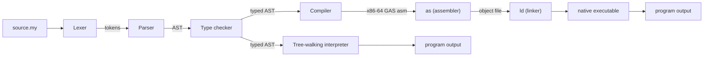

# Myla Architecture — v0.0

This document describes the software architecture of the v0.0 bootstrapping
toolchain (`myla.py`, written in Python). It is a **design sketch**: it defines
the modules, data shapes, and algorithms the later implementation milestones
(v0.0.1 scaffolding, v0.0.2 interpreter, v0.0.3 compiler) will build. No code is
written in this v0.0.0 milestone.

Constraints carried from the README:

- **No third-party dependencies.** Python standard library only; native builds
  use the system `as` and `ld`.
- **Simplicity over safety.** Straightforward, readable passes; no premature
  optimization.

---

## 1. Pipeline overview

Source text flows through a shared front end (lexer + parser), producing an AST.
Two interchangeable back ends consume that AST: a tree-walking interpreter and
an x86-64 compiler.



The front end and the type checker are **shared**: both back ends operate on the
same validated AST, which guarantees the interpreter and the compiler agree on
semantics (a hard requirement of milestones v0.0.2/v0.0.3 and v0.1).

---

## 2. Planned package layout

Created during the v0.0.1 scaffolding milestone (not now). Shown here so the
module boundaries are agreed up front.

```
myla/
├── myla.py                 # CLI entry point (matches README: uv run myla.py <cmd>)
├── pyproject.toml
├── src/
│   └── myla/
│       ├── __init__.py
│       ├── cli.py          # argument parsing, dispatch to run/build/repl
│       ├── tokens.py       # Token + TokenKind definitions
│       ├── lexer.py        # text -> [Token]
│       ├── ast.py          # AST node dataclasses
│       ├── parser.py       # [Token] -> AST (recursive descent)
│       ├── types.py        # type representations + the type checker
│       ├── interpreter.py  # tree-walking evaluator
│       ├── errors.py       # diagnostics (line/col), error types
│       └── compiler/
│           ├── __init__.py
│           └── codegen_x86.py   # typed AST -> x86-64 GAS assembly
├── docs/
│   ├── language-spec.md
│   ├── grammar.md
│   └── architecture.md
├── examples/               # one .my per feature (also used as burn-tests)
└── tests/
    ├── burn/               # .my programs + expected output
    ├── unit/               # per-module python tests
    └── integration/        # end-to-end run/build tests
```

### CLI surface (`cli.py`)

| Command                        | Behavior                                           |
|--------------------------------|----------------------------------------------------|
| `myla run <file.my>`           | lex -> parse -> check -> interpret                 |
| `myla build <file.my> -o <bin>`| lex -> parse -> check -> codegen -> `as` -> `ld`   |
| `myla test <file.my>`          | lex -> parse -> check -> run every `#test` case, report pass/fail |
| `myla repl`                    | interactive line-by-line interpretation            |

---

## 3. Front end

### 3.1 Lexer (`lexer.py`, `tokens.py`)

- Hand-written scanner; single forward pass over the source string.
- Produces a flat list of `Token`s, each carrying: kind, lexeme, literal value
  (for INT/STRING/BOOL), and a `(line, column)` source position.
- Skips whitespace and comments. Emits a final `EOF` token.
- Longest-match rule for multi-char operators (`==`, `->`, `..`, etc.).
- Errors: unterminated string, unterminated block comment, unknown character.

`TokenKind` is an enum covering: literals (`INT`, `STRING`, `BOOL`), `IDENT`,
each keyword, each operator/punctuation token, and `EOF`.

### 3.2 Parser (`parser.py`)

- **Recursive descent** with **precedence-climbing** for binary expressions,
  mirroring the layered expression grammar in `grammar.md`.
- Consumes `[Token]`, produces the AST root (a `Program`).
- Newlines act as statement terminators (the parser is given newline tokens, or
  tracks line numbers, to enforce one-statement-per-line separation).
- Reports the first syntax error with position and a "expected X, found Y"
  message (panic-mode: stop at first error in v0.0; error recovery is a later
  nicety).

### 3.3 Attributes

- The parser collects any leading `#name(...)[...]` attributes into the following
  declaration's `attributes` list (see §§4).
- A small **built-in attribute registry** validates them after parsing: only
  `#main` and `#test` are known in v0.0; any other name is a compile error.
- `#main` resolution: the entry point is the single `#main`-annotated function,
  or else the function named `main`. Zero or multiple entry points is an error.
- `#test(args)[expected]`: the checker verifies `args` matches the function's
  parameters and `expected` matches its return type. The cases are stored for
  the test runner (§6.1). Attributes are NOT a general macro system in v0.0 — the
  registry is a fixed, hard-coded set.

---

## 4. AST (`ast.py`)

Plain Python `@dataclass` nodes, one type per grammar construct. Every node
stores its source position for diagnostics. Taxonomy:

**Top level**
- `Program(decls: list[Decl])`
- Every declaration node carries `attributes: list[Attribute]` (possibly empty).
- `Attribute(name: str, args: list[Expr], outputs: list[Expr] | None)` — e.g.
  `#test(1, 2)[3]` parses to `Attribute("test", [1, 2], [3])`; `#main` parses to
  `Attribute("main", [], None)`.
- `StructDecl(name, fields: list[Field])`, `Field(name, type)`
- `FunDecl(name, params: list[Param], ret_type: TypeRef | None, body: Block)`,
  `Param(name, type)`
- `TypeAliasDecl(name, target: TypeRef)`

**Types**
- `TypeRef(name)` — a primitive (`int8`..`int64`, `uint8`..`uint64`, `bool`,
  `str`), `int` (resolved as an alias of `int32`), a struct name, or a
  user-defined alias name. The type checker resolves aliases to a canonical
  underlying type.

**Statements**
- `Block(statements: list[Stmt])`
- `VarDecl(kind: "let"|"var", name, declared_type: TypeRef | None, init: Expr)`
- `Assign(target: LValue, value: Expr)`
- `If(cond: Expr, then: Block, otherwise: Block | If | None)`
- `While(cond: Expr, body: Block)`
- `For(var_name, start: Expr, end: Expr, body: Block)`
- `Return(value: Expr | None)`
- `ExprStmt(expr: Expr)`

**Expressions**
- `IntLit(value, suffix: TypeRef | None)` (concrete integer type comes from the
  suffix if present, else resolved by the checker from context, else defaults to
  `int` = `int32`), `StrLit(value)`, `BoolLit(value)`
- `Name(ident)`
- `Unary(op, operand)`
- `Binary(op, left, right)` (covers arithmetic/comparison/equality/logical)
- `Call(callee: Name, args: list[Expr])`
- `FieldAccess(target: Expr, field: str)`
- `StructLit(type_name, fields: list[FieldInit])`, `FieldInit(name, value)`

**LValues** (assignment targets): `Name` or a chain of `FieldAccess` rooted at a
`Name`.

Each expression node is annotated with its resolved type by the type checker
(e.g. a `node.resolved_type` field), so back ends never re-derive types.

---

## 5. Type checker (`types.py`)

A pass over the AST that:

1. Builds a global table of struct types, function signatures, and type aliases
   (so order does not matter — see spec §7.1). Aliases (including the built-in
   `int` = `int32`) are resolved to a canonical type here; alias cycles are an
   error.
2. Walks each function body with a stack of lexical scopes, recording each
   binding's type and mutability (`let`/`var`).
3. Annotates every expression with its type and reports mismatches:
   - operator operand types (spec §7.3), including that both integer operands
     share the **same** sized integer type (no implicit mixing/widening),
   - integer literals fit their resolved target type; a literal's type comes
     from its suffix (`255u8`, `123i64`) if present, otherwise from context,
     otherwise defaults to `int` (= `int32`),
   - condition must be `bool`,
   - assignment target must be mutable and type-compatible,
   - call arity/argument types, struct field presence/types,
   - `return` type matches the function's declared return type, and that a
     value-returning function returns on all paths.

Type representation is a small, canonical set: `Int(width, signed)` for the
eight sized integer types, `Bool`, `Str`, and a `Struct(name)` variant resolved
against the struct table. Alias names never appear post-resolution.

---

## 6. Interpreter (`interpreter.py`)

- **Tree-walking** evaluator over the typed AST. Prioritizes clarity.
- **Environment** = a chain of scopes (dict `name -> value`) with a parent
  pointer; function calls push a fresh frame whose parent is the global scope
  (lexical, non-closure — v0.0 has no nested functions).
- **Value representation** maps directly onto Python values:
  - integers -> Python `int`, but **masked to the operand type's width** after
    each arithmetic op (e.g. `& 0xFFFFFFFF` then sign-extend for `int32`) to
    match the compiler's per-width wrapping semantics (spec §7.4). The checker's
    resolved type tells the interpreter which mask to apply.
  - `bool` -> Python `bool`,
  - `str` -> Python `str`,
  - struct -> a small record (dict or dataclass) of field values; copied on
    assignment/passing to honor value semantics.
- **Control flow** uses Python exceptions internally for `return` (and would for
  `break`/`continue` if added later).
- **`print`** is a special-cased builtin writing to stdout.
- **Runtime errors** (division/modulo by zero) raise a `MylaRuntimeError`
  carrying a source position; the CLI prints it and exits non-zero.

This is the reference semantics: the compiler must produce identical observable
output for every example/burn-test.

### 6.1 Test runner (`myla test`)

Built on the interpreter. For each `#test(args)[expected]` case collected during
attribute processing (§3.3), the runner calls the decorated function with `args`,
compares the result to `expected` using the type's equality, and reports
pass/fail with the source position of the attribute. Exit status is non-zero if
any case fails. This makes the `examples/` files double as executable
specifications.

---

## 7. Compiler — x86-64 (`compiler/codegen_x86.py`)

Design sketch for milestone v0.0.3. Emits **GAS / AT&T syntax** assembly for
Linux x86-64, assembled and linked with the system toolchain.

### 7.1 Strategy

- Single straightforward pass over the typed AST emitting assembly text. No
  intermediate IR and no register allocator in v0.0: operands are evaluated onto
  the hardware stack, and locals live in the stack frame. This is slow but
  simple and easy to verify against the interpreter.
- Each `FunDecl` becomes a labeled assembly routine following the **System V
  AMD64 ABI** (args in `rdi, rsi, rdx, rcx, r8, r9`, return in `rax`, callee
  saves `rbp`; 16-byte stack alignment at calls).

### 7.2 Stack frames and locals

- Standard prologue/epilogue: `push %rbp; mov %rsp,%rbp; sub $N,%rsp` … `leave; ret`.
- The type checker's scope info gives each local a fixed byte offset from `%rbp`.
  For simplicity v0.0 gives **every scalar an 8-byte slot** regardless of its
  declared width (an `int8` still occupies 8 bytes on the stack); the value is
  stored/loaded using the width-appropriate move and masked to its type's width
  after arithmetic. A struct occupies the sum of its fields' slots and is
  addressed by base offset.
- Expression evaluation convention: compute into `%rax`, push when a binary op
  needs both operands, pop the left operand into `%rcx`, combine. Operations use
  the register sub-portion matching the operand width (`al`/`ax`/`eax`/`rax`),
  and signed vs. unsigned variants of `div`/`idiv`, shifts, and comparisons are
  selected from the operand's signedness.

### 7.3 Data representation

| Type            | Representation in generated code                                   |
|-----------------|--------------------------------------------------------------------|
| `int8`..`int64` | signed value held in the low `N` bits of an 8-byte slot; sign-extended on load |
| `uint8`..`uint64`| unsigned value in the low `N` bits of an 8-byte slot; zero-extended on load |
| `int`           | same as `int32` (it is an alias)                                   |
| `bool`          | 8-byte `0` or `1`                                                  |
| `str`           | pointer to a length-tagged byte buffer in `.rodata`                |
| struct          | flat block of 8-byte field slots in the stack frame; passed/copied by value |

Each scalar still gets an 8-byte slot (see §7.2); the *width* only affects which
move/extend instructions and which wrap mask are used. String literals are
emitted into the `.rodata` section once and referenced by label.

### 7.4 `print`

Implemented without libc to keep the no-dependency promise:

- integers: a small emitted helper converts the value to decimal ASCII into a
  stack buffer, then issues the `write` syscall (`rax=1`, `rdi=1`) followed by a
  newline. Signed types print a leading `-` when negative; unsigned types never
  do.
- `bool`: writes the literal bytes `true`/`false`.
- `str`: `write` of the literal's bytes using its known length.

A tiny `_start` is emitted that sets up the stack, calls `main`, then issues the
`exit` syscall (`rax=60`) with status `0` (or the runtime trap status on
divide-by-zero).

### 7.5 Assemble and link

```bash
as --64 -o <obj>.o <asm>.s
ld -o <bin> <obj>.o
```

Both are invoked via `subprocess`. Division/modulo by zero is handled by
checking the divisor and jumping to a trap routine that exits non-zero (matching
the interpreter's runtime error).

---

## 8. Diagnostics (`errors.py`)

- A single `Diagnostic` shape: `severity`, `message`, `line`, `column`, and the
  offending source line for a caret underline.
- Error categories mirror the pipeline stages: `LexError`, `ParseError`,
  `TypeError`, `MylaRuntimeError`. All carry a source position.
- v0.0 stops at the first error per stage (panic mode). Multi-error recovery is
  deferred.

Example format:

```
error: cannot assign to immutable binding `x`
  --> example.my:4:5
   |
 4 |     x = 10
   |     ^
```

---

## 9. Recorded decisions (v0.0)

These capture the "why" behind the design so later versions can revisit them
deliberately.

| Decision | Choice | Rationale |
|----------|--------|-----------|
| Typing | Static, checked before execution | Makes the native compiler simple (no runtime type tags) and catches errors early. |
| Mutability | `let` (immutable) / `var` (mutable) | Swift-style, familiar, encourages immutability without borrow-checker complexity. |
| Statement vs expression oriented | Statement-oriented | Simpler parser and codegen for v0.0; expression-oriented blocks can come later. |
| Numeric types | Explicitly sized integers (`int8`..`uint64`), wrapping per width | Fixed widths map onto registers/memory and make self-hosting predictable; avoids Python-style dynamic bignums and overflow-check codegen. |
| `int` | Built-in type alias for `int32` | Ergonomic default while keeping all numeric types explicitly sized. |
| Type aliases | `typealias Name = Type` (transparent, not new-type) | Cheap to implement; needed to express `int` and improves readability. |
| Literal suffixes | `iN`/`uN` on integer literals (e.g. `255u8`) | Disambiguates type without an annotation; default stays `int`. |
| Attributes | Fixed built-in set (`#main`, `#test`) carried on every declaration node | Pulled into v0.0 so the AST/parser bake in attribute metadata early (D10); not a user-macro system yet. |
| Struct semantics | Value (copy) semantics | No heap/GC needed in v0.0; everything lives on the stack. |
| Compiler IR | None (direct AST -> asm) | Easiest path to working native code; an IR/optimizer is a later concern. |
| Backend | x86-64 GAS, `as` + `ld`, no libc | Honors the no-dependency vision; `write`/`exit` syscalls cover all of v0.0's I/O. |
| Error handling | Panic-mode, first error per stage | Minimal effort; good-enough diagnostics with line/column. |

---

## 10. Relationship to later milestones

- **v0.0.1** creates the package layout in §2 and the burn-test harness around
  `examples/`, and bakes attribute metadata (§3.3, §4) into the parser/AST from
  the start (per decision D10).
- **v0.0.2** implements §3–§6 so `myla run` and `myla test` work and all
  burn-tests pass.
- **v0.0.3** implements §7 so `myla build` produces native binaries whose output
  matches the interpreter.
- **v0.1** re-implements this same architecture in Myla itself, beginning the
  self-hosting effort; keeping the front end and semantics shared (this doc)
  is what makes that re-implementation a faithful port.
