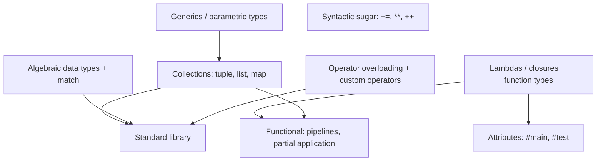

# Myla Future Features — Design Notes

This document collects forward-looking language features that are **not** part of
v0.0 but that we want to design deliberately now, so the v0.0 foundations don't
paint us into a corner. Each section gives:

- **Sketch** — proposed concrete syntax (open for bikeshedding).
- **Semantics** — what it means and the tricky bits.
- **Implications** — what it forces in the lexer/parser/checker/codegen.
- **Recommendation** — my opinion, including features I'd push back on.
- **Target** — the version I'd aim to introduce it in.

Everything here is a proposal. The syntax in the original request was explicitly
"just for visualization", so I've taken the liberty of suggesting alternatives
where I think they're cleaner or avoid ambiguity.

> Status note: many items below have since been **decided** (see the decision
> log D8-D20 in [roadmap.md](roadmap.md)). In particular:
> - Functional design (§5: `|>`, `>>`, `_`) — accepted.
> - Attributes `#main`/`#test` (§4a) — **pulled into v0.0**, now in
>   [language-spec.md](language-spec.md) §8 (not a user-macro system).
> - Memory model = reference counting (§1); generics = monomorphization (§1);
>   collections = deep immutability (§1).
> - Lambdas (§3) capture **by value** first; by-reference planned via a `ref`
>   keyword later.
> - Error handling = `Result`/`Option` + `?` (new, see §10).
> - Imports = explicit, Python-like, no wildcards (§1 stdlib; syntax still open).
> - Operator overloading via traits (§6); custom operators **postponed beyond
>   1.0**.
> - Floats = `float32`/`float64`, `float` aliases `float32`, literal suffixes
>   `f32`/`f64` (still future; not in v0.0).
> - Sized integers + `typealias` + integer literal suffixes (`iN`/`uN`) are in
>   v0.0 already.
>
> Anything still needing your input is in
> [clarification_needed.md](clarification_needed.md).

> Guiding tension: the README's short-term vision is *simplicity, not safety*,
> but the long-term vision (self-hosting a compiler) needs **enums + pattern
> matching**, **collections**, and a **module/stdlib story** more than anything
> else. When prioritizing, features that make the compiler easier to write in
> Myla itself should win.

---

## 0. Suggested sequencing

A rough dependency ordering. Boxes are feature clusters; arrows mean "wants the
thing it points to first".



My recommended rollout:

| Version | Theme | Features |
|---------|-------|----------|
| v0.0 | bootstrap core | current spec: `fun`, explicitly sized integers + `int` alias, `typealias` |
| v0.0.x | testing ergonomics | `#main`, `#test(...)[...]` attributes (worth pulling in early) |
| v0.2 | data modeling | tuples, algebraic data types (`enum`) + `match`, basic generics |
| v0.3 | collections + stdlib | `[T]` lists, `[K: V]` maps, growable stdlib |
| v0.4 | first-class functions | lambdas, closures, function types, pipelines |
| v0.5 | ergonomics | operator overloading, custom operators, compound-assign sugar |

Rationale for the order: ADTs/tuples/generics unblock writing the compiler's own
AST in Myla; collections + stdlib follow naturally; functional and operator
features are quality-of-life on top.

---

## 1. Standard library of default datatypes

### Sketch

Built-in generic collection types with literal syntax:

```my
let pair: (int, str)      = (1, "one")        // tuple
let xs:   [int]           = [1, 2, 3]         // list
let ages: [str: int]      = ["ann": 30]       // map / hashmap
```

### Semantics

- **Tuple** `(T, U, ...)`: fixed-size, heterogeneous, value semantics. Already
  needed for multiple return (§2).
- **List** `[T]`: growable, homogeneous, heap-allocated, reference-ish or
  copy-on-write — TBD (see implications).
- **Map** `[K: V]`: hash map; `K` must be hashable/equatable.

These need to live in a standard library (`std`) once we have modules. Until
then they can be compiler built-ins.

### Implications

- **Generics**: `[T]` and `[K: V]` are parametric. We need at least monomorphized
  generics (Rust-style: stamp out a concrete copy per instantiation) to compile
  them to native code without boxing. Monomorphization keeps codegen simple and
  fits "no runtime type tags".
- **Heap + memory management**: lists/maps grow, so we leave the all-on-stack
  model of v0.0. Decision needed: manual `free`, reference counting, or a simple
  arena/GC. Recommendation: start with **reference counting** (simple,
  predictable, no tracing GC), revisit later.
- **Stdlib distribution**: needs a module/import system (`import std.list`),
  which itself is a future feature.

### Recommendation

Introduce **tuples first** (cheap, value types, enable multi-return), then a
minimal **generics** mechanism, then `list`/`map`. Defer the GC question by
making the first list/map implementations reference-counted.

### Target

Tuples: v0.2. Generics: v0.2. List/map + stdlib: v0.3.

---

## 2. Easy tuple returns

### Sketch

```my
fun pick_neighbors(a: int) -> (int, int) {
    return a - 1, a + 1            // sugar for `return (a - 1, a + 1)`
}

let (lo, hi) = pick_neighbors(5)  // destructuring binding
```

### Semantics

- `return a, b` is sugar for returning a tuple `(a, b)`.
- Destructuring `let (lo, hi) = ...` binds positionally.
- A `_` placeholder ignores a component: `let (_, hi) = ...`.

### Implications

- Parser: in `return`, parse a comma-separated expression list and wrap as a
  tuple when there's more than one.
- Checker: tuple arity/type must match the declared return type.
- Codegen: tuples returned by value follow the System V ABI rules (small tuples
  in registers `rax`/`rdx`, larger via a hidden pointer arg). Destructuring is
  just field extraction.

### Recommendation

Yes — this is low-cost once tuples exist and reads very well. Tie it to tuple
support in v0.2.

### Target

v0.2 (with tuples).

---

## 3. Lambdas and closures

### Sketch

C#/TypeScript-flavored, matching the request:

```my
let add  = (a: int, b: int) => a + b          // expression body
let greet = (name: str) => {                   // block body
    let msg = "hi " + name
    return msg
}
```

Function **types** are written `(int, int) -> int`:

```my
fun apply(f: (int) -> int, x: int) -> int {
    return f(x)
}
```

### Semantics

- A lambda is an anonymous function value.
- A **closure** captures variables from the enclosing scope. Capture mode needs
  a decision: capture-by-value (copy) is simplest and matches our value
  semantics; capture-by-reference needs heap-promotion of captured locals.

### Implications

- Parser ambiguity: `(a: int) => ...` vs. a parenthesized expression. The `:` in
  the parameter list and the `=>` token disambiguate, but the parser needs
  lookahead (or a speculative parse) at `(`.
- Codegen: a closure is a pair `(function pointer, captured environment)`. If we
  allow by-reference capture, captured variables must move to the heap
  (reference-counted), which interacts with §1's memory model.
- First-class functions imply function types in the type system.

### Recommendation

Support lambdas with **by-value capture only** at first (no heap promotion, no
escape analysis). That covers the common cases (map/filter callbacks) and keeps
codegen tractable. Add by-reference capture later via an explicit `ref` keyword
(sketch: `f(ref a)` passes/captures `a` by reference vs. `f(a)` by value).
*(Decided, D15.)*

### Target

v0.4 (depends on function types; pairs naturally with §5 pipelines).

---

## 4. Attributes / macros / decorators

This is two different things wearing one hat; I'd split them.

### 4a. Attributes (declarative, built-in) — DECIDED, now in v0.0

> **DECIDED (D10).** `#main` and `#test` are part of v0.0 as a fixed built-in
> attribute set; they are specified in [language-spec.md](language-spec.md) §8
> and the parser/AST carry attribute metadata from the start. This section is
> kept as rationale.

```my
#main
fun my_entrypoint(args: [str]) {
    print(", ".join(args))
}

#test(1, 2)[3]
#test(4, 2)[6]
fun add(a: int, b: int) -> int {
    return a + b
}
```

**Semantics**

- `#name(args)` (optionally with a trailing `[...]`) is metadata attached to the
  declaration that follows it. Multiple attributes stack.
- `#main` marks the entry point, removing the "must be named `main`" convention.
- `#test(inputs)[expected]` declares a test case: call the decorated function
  with `inputs`, assert the result equals `expected`. Multiple `#test` lines =
  multiple cases. The test runner (`myla test`) collects and runs them.

**Implications**

- Lexer: add `#` and an attribute token; the `[...]` outputs section is just a
  bracketed expression list.
- Parser: parse zero or more attributes before a declaration into an
  `attributes: list[Attribute]` field on the AST node.
- A small **built-in attribute registry** interprets known attributes; unknown
  attributes are a compile error (for now). This is NOT general macro expansion —
  it's a fixed, hard-coded set, which is much simpler and safe.
- `#test` needs the interpreter and an equality check on the result type. It
  composes beautifully with the existing `examples/` burn-tests.

**Recommendation**

Pull `#main` and `#test` in **early** (v0.0.x), implemented as built-in
attributes, not macros. They're cheap, they massively help development, and the
request flagged `#test` as "needed as early as possible". I'd only support a
fixed allow-list initially: `#main`, `#test`, maybe `#inline`/`#extern` later.

**Target:** v0.0.x.

### 4b. Macros / metaprogramming (user-defined) — later

True user-defined macros (the README's "extensible using metaprogramming") are a
much bigger commitment: hygienic expansion, a quoting mechanism, and a stable AST
API. Because Myla self-hosts, the cleanest design is **AST macros written in
Myla** that run at compile time and receive/return AST nodes (think Rust
proc-macros or Lisp macros). That requires the AST type to be expressible in
Myla — i.e. it depends on ADTs (§7) and a stable compiler API.

**Recommendation:** design attributes (4a) so their syntax is a strict subset of
the eventual macro syntax, then layer user macros on top once the self-hosted
compiler exists. Don't build the general macro system before self-hosting.

**Target:** v1.x (post self-hosting).

---

## 5. Functional concepts: pipelines, partial application, composition

> **DECIDED (accepted by project owner).** Myla will use explicit pipeline
> (`|>`), composition (`>>`), and `_`-placeholder partial application. The
> juxtaposition-composition style and implicit auto-currying are rejected. This
> section is retained as the design rationale; see [roadmap.md](roadmap.md) for
> status.

The request's `examples/functional.my` explores application/composition by
**juxtaposition** (`add1 add2`, `pickNeighbors add print (5)`). I want to push
back on that specific syntax and propose explicit operators instead.

### The problem with juxtaposition

`f g` meaning "compose" collides with the most fundamental syntax we already
have: a call is `f(x)`, and adjacency is everywhere. In `pickNeighbors add print (5)`
it's genuinely ambiguous whether we're composing, currying, or calling, and it
makes the grammar context-sensitive. Haskell gets away with juxtaposition only
because *everything* is curried and application is the single core operation; our
language is not built that way.

### Sketch (recommended alternative)

Use explicit, well-known operators:

```my
// Pipeline (F# / Elixir |>): "feed the left value into the right function"
let result = 5 |> pick_neighbors |> sum |> print

// Composition (>>): build a new function without naming an argument
let process = read_csv
    >> filter((row) => row[0] == "hello")
    >> map((row) => row[1])
    >> join("\n")
    >> print
process("path/to/file.csv")

// Partial application: explicit and readable
let add1 = add(1, _)         // placeholder `_` leaves a hole
print(add1(3))               // 4
```

### Semantics

- `x |> f` == `f(x)`; `x |> f(a)` == `f(x, a)` (left value becomes first arg).
- `f >> g` == `(x) => g(f(x))`; left-to-right composition.
- `add(1, _)` produces a closure with the `_` positions left as parameters
  (explicit partial application — no implicit auto-currying).

### Implications

- `|>` and `>>` are just binary operators with low precedence; easy to parse and
  to desugar into calls/lambdas.
- Partial application via `_` placeholder desugars to a lambda, so it depends on
  lambdas/closures (§3).
- Auto-currying (the `add(1)` returns a function form from the sketch) is
  possible but I'd avoid it: it makes arity errors silent (a typo'd missing
  argument becomes a partial application instead of an error). Explicit `_` keeps
  errors loud, honoring "simple, not magic".

### Recommendation — ACCEPTED

Adopt `|>` and `>>` plus `_`-placeholder partial application. **Skip
juxtaposition-composition and implicit auto-currying.** This delivers the same
expressiveness as the sketch with an unambiguous grammar. (I've left
`examples/functional.my` as your original visualization; the pipeline/composition
sketch above is the agreed rewrite of it.)

### Target

v0.4 (needs lambdas §3 and collections §1).

---

## 6. Operator overloading and custom operators

### Sketch

Tie overloading to **traits** (the README already lists "Structs and Traits"):

```my
trait Add {
    fun add(self, other: Self) -> Self
}

struct Vec2 { x: int, y: int }

impl Add for Vec2 {
    fun add(self, other: Vec2) -> Vec2 {
        return Vec2 { x: self.x + other.x, y: self.y + other.y }
    }
}

let v = Vec2 { x: 1, y: 2 } + Vec2 { x: 3, y: 4 }   // uses Add::add
```

Custom operators (Swift-style declaration of fixity + precedence):

```my
infix operator <+> precedence 40 associativity left

impl ... {
    fun <+>(self, other: Self) -> Self { ... }
}
```

### Semantics

- Built-in operators (`+`, `==`, ...) desugar to trait-method calls; overloading
  = implementing the corresponding trait for your type.
- Custom operators register a symbol with a precedence/associativity so the
  **Pratt/precedence-climbing parser** can place them.

### Implications

- Needs **traits** and the trait-resolution machinery first.
- Custom operators make the operator table dynamic: the parser must read operator
  declarations before parsing expressions that use them (a two-pass parse, or
  operator decls restricted to top level and gathered first).
- Type checker resolves operator usage to the right `impl`.

### Recommendation — DECIDED (D18)

Do **operator overloading via traits** (high value, e.g. for `Vec`/bignum/AST
types). **Fully custom operators are postponed beyond 1.0** — a great addition,
but let's get things working first; if/when added, restrict to a fixed set of
allowed symbol characters and require an explicit precedence declaration.

### Target

Overloading: v0.5 (after traits). Custom operators: **post-1.0**.

---

## 7. Algebraic data types ("enums on steroids") + pattern matching

Strong agreement — this is the highest-leverage feature for self-hosting, because
the compiler's own AST is naturally a sum type. Swift/Rust enums + `match` are
the model.

### Sketch

```my
enum Shape {
    Circle(int)                 // radius
    Rectangle(int, int)         // width, height
    Point                       // no payload
}

// Recursive ADT — exactly what an AST needs:
enum Expr {
    Num(int)
    Add(Expr, Expr)
    Mul(Expr, Expr)
}

fun eval(e: Expr) -> int {
    match e {
        Num(n)    => n,
        Add(l, r) => eval(l) + eval(r),
        Mul(l, r) => eval(l) * eval(r),
    }
}
```

### Semantics

- An `enum` is a tagged union: a discriminant plus per-variant payload.
- `match` does structural pattern matching with **exhaustiveness checking** (the
  checker errors if a variant is unhandled — a huge correctness win for compiler
  code). Support `_` wildcard and binding sub-patterns.
- Recursive variants (`Add(Expr, Expr)`) require indirection (the variant holds a
  pointer), interacting with the memory model (§1).

### Implications

- Lexer/parser: `enum`, `match`, `=>` arms, nested patterns.
- Checker: exhaustiveness + binding types per arm; this is the meatiest analysis
  we'll have added so far.
- Codegen: layout = tag + max-payload union; `match` lowers to a tag switch with
  field extraction; recursive variants need heap allocation (reference counted,
  per §1).
- Generics (§1) make enums far more useful (`enum Option<T> { Some(T), None }`,
  `enum Result<T, E> { Ok(T), Err(E) }`), which we'll want for stdlib error
  handling.

### Recommendation

Prioritize this right after tuples. Even a non-generic version is enough to start
rewriting the compiler's AST in Myla. Add `Option`/`Result` as the first generic
enums once generics land. Make exhaustiveness checking on from day one.

### Target

v0.2 (non-generic), generic variants alongside generics in v0.2/v0.3.

---

## 8. Syntactic sugar

### Sketch

```my
x += 1        // compound assignment: += -= *= /= %=
y **= 2       // ** power operator
i++           // postfix increment
++i           // prefix increment
```

### Semantics & per-item recommendation

| Sugar | Desugars to | Recommendation |
|-------|-------------|----------------|
| `a += b` (and `-= *= /= %=`) | `a = a + b` | **Yes.** Cheap, universally expected, no semantic surprises. v0.5. |
| `a ** b` (power) | a power intrinsic | **Yes**, but decide overflow + whether it's int-only. Right-associative, binds tighter than `*`. v0.5. |
| `**=` | `a = a ** b` | Yes, once `**` exists. |
| `i++` / `++i` (in/decrement) | `i = i + 1` | **Dropped (D9).** Prefix/postfix value semantics are a classic footgun. Once custom operators exist (post-1.0), a user may deliberately define `++` for their own type. |

### Implications

- Compound assignment and `**` are pure parser desugaring + a codegen intrinsic
  for power; trivial.
- `++`/`--` as **expressions** reintroduce the expression-with-side-effects
  category we kept out of v0.0; as statement-only they're marginal sugar over
  `+= 1`. Either way the cost/benefit is poor.

### Recommendation

Add `+= -= *= /= %=`, `**`, and `**=`. **Decline `++`/`--`** unless you feel
strongly — `+= 1` is clearer and avoids the prefix/postfix trap.

### Target

v0.5 (or sprinkle compound-assign in earlier; it's harmless).

---

## 9. Open questions to resolve before implementing the above

> These (and a few smaller ones) are tracked with status in
> [clarification_needed.md](clarification_needed.md) — that file is the canonical
> place for decisions awaiting your input.

1. **Memory model**: reference counting first. *(Decided, D12.)*
2. **Generics strategy**: monomorphization. *(Decided, D13.)*
3. **Mutability of collections**: deep immutability — `let` is immutable in
   binding *and* contents; mutation needs `var`. *(Decided, D14.)*
4. **Capture semantics for closures**: by-value first; by-reference later via
   `ref`. *(Decided, D15.)*
5. **Module/import syntax**: explicit, Python-like, no wildcards; dot-relative
   search bases, full-path binding + `as`, `pub` exports, collisions are errors.
   *(Decided, D17 + D22; see §10. Only minor impl-time details remain.)*
6. **Error handling**: `Result`/`Option` + `?` propagation operator. *(Decided,
   D16 — see §10.)*

None of these block v0.0; they're flagged so the v0.0 implementation avoids
decisions that would make them harder later (e.g. keep the AST and type
representation easy to extend with new node kinds and types).

---

## 10. Newly decided directions (sketches)

Brief sketches of choices made recently that weren't detailed above. Full status
in [roadmap.md](roadmap.md).

### Floats (D19) — future, not v0.0

Mirror the sized-integer model: `float32` and `float64` (IEEE-754), with `float`
a built-in alias for `float32`. Literal suffixes `f32`/`f64` disambiguate:

```my
let a = 3.14159f64
let b = 6f32          // 6.0 as float32
let c: float = 1.5    // float = float32
```

### Error handling: `Result`/`Option` + `?` (D16)

Generic ADTs (no exceptions). The `?` operator propagates the error variant:

```my
enum Result<T, E> { Ok(T), Err(E) }
enum Option<T>    { Some(T), None }

fun parse(s: str) -> Result<int, str> { /* ... */ }

fun double(s: str) -> Result<int, str> {
    let n = parse(s)?      // if Err(e), return Err(e) from `double`
    return Ok(n * 2)
}
```

Depends on ADTs (§7) and generics. Pairs with `Option` for absence.

### Imports: explicit, Python-like (D17, D22)

No wildcards. Sources and search base are chosen by the **leading-dot count**:

| Prefix | Search base |
|--------|-------------|
| (none) | builtins (e.g. `std`) or the project root |
| `.`    | the current file's directory |
| `..`   | the parent directory |
| `...`  | the grandparent directory (and so on, one level per extra dot) |

You can import at any granularity: a package (directory), a module (file), or an
individual item (function, constant, struct, trait, ...).

**Binding rules:**

- `import a.b.c` binds the **full path** `a.b.c` (it does *not* magically bind
  the last segment `c` — that was flagged as a footgun).
- Use `as` to rebind to a shorter name: `import a.b.c as c`.
- `from <path> import name` selectively binds `name` (and supports `as` too).

```my
import std.collections.list          // referenced as std.collections.list
import std.collections.list as list  // rebound to `list`
let l = list { 1, 2, 3 }

from .utils import helper            // current dir
helper()

from ..shared import Token           // parent dir
```

**Visibility:** items are **private by default**; `pub` marks what a module
exports.

```my
pub fun helper() { /* ... */ }       // importable from other modules
fun internal() { /* ... */ }         // file-local
```

**Collisions:** importing two things under the same name is a **compile-time
error** — there is no automatic resolution; disambiguate with `as`.

Remaining fine details (package vs. module resolution corner cases, `pub use`
re-exports, the exact `format`/interpolation surface) are deferred to when the
stdlib/module work begins (v0.3).

### Strings (D21)

v0.0 `str` is **length-prefixed, immutable, UTF-8** (a pointer + length, not
NUL-terminated), supporting only string literals and `print`. The richer string
toolkit lands with the stdlib (v0.3) and is designed to avoid rework:

- a growable **`StringBuilder`** for efficient construction (no accidental
  O(n^2) from repeated concatenation — important for the self-hosted compiler's
  token/asm/diagnostic output);
- **slices as views** (cheap, no copy) and **byte-indexing**, with codepoint
  iteration via library helpers (keeps Unicode complexity out of the core);
- a **`format`** facility (and later string interpolation as sugar) for
  well-formatted error messages.

Length-prefixed + immutable is chosen so length is O(1), embedded NULs are
allowed, slices can alias existing buffers later, and sharing is safe under
reference counting (D12) and deep immutability (D14).
