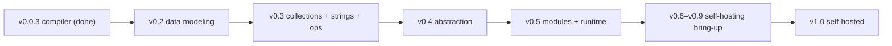

# Myla Roadmap & Status

The living source of truth for **what is built, what is in progress, what is
planned**, and **which decisions we have locked in**. Update this file as work
progresses.

Related docs: [language-spec.md](language-spec.md) · [grammar.md](grammar.md) ·
[architecture.md](architecture.md) · [future-features.md](future-features.md) ·
[self-hosting.md](self-hosting.md) ·
[v0.2 data modeling](v0.2-data-modeling.md) ·
[v0.3 collections & ops](v0.3-collections-and-ops.md) ·
open questions in [clarification_needed.md](clarification_needed.md).

_Last updated: 2026-06-28 (**v0.2 complete**; **v0.3 complete** — all five phases landed: bitwise/shift operators `& | ^ ~ << >>`, numeric casts `x as T`, `0x`/`0b`/`0o` integer literals with `_` separators, `break`/`continue`, module-level `const`, the `assert`/`panic`/`unreachable` intrinsics, **lists `[T]`**, **maps `[K: V]`** (copy-on-write + reference counting, open-addressing hash table, monomorphization), and the **string toolkit** (char literals, byte indexing `s[i] -> uint8`, `len(str)`, `str + str` concat, `format`, and a refcounted CoW `StringBuilder`), all end-to-end with interpreter/native parity. Next: v0.4 — methods/`impl`/traits + lambdas)._

---

## Status legend

| Symbol | Meaning |
|--------|---------|
| Done | Fully implemented and documented |
| In progress (NN%) | Started; approximate completion in percent |
| Planned | Agreed/scheduled, not started |
| Proposed | Idea documented, not yet decided |
| Decided | Design decision locked (may not be implemented yet) |

> "Progress %" is a rough engineering estimate, not a precise metric. For a
> design-phase milestone it reflects how much of the design is settled; for an
> implementation milestone it reflects code + tests + docs.

---

## Where we are now

**Current milestone: v0.0.3 — native compiler.** The full v0.0 front end
(lexer, parser, type checker), the tree-walking interpreter, **and the x86-64
compiler** are implemented and tested: `myla run`, `myla test`, and
**`myla build`** all work end-to-end, and every example program produces
identical output under the interpreter and the compiled native binary.

Implementation progress:
- Package layout under `src/myla/` with `myla.py` entry point and a
  `unittest`-based harness under `tests/` (no third-party deps).
- `errors.py` (positioned diagnostics with caret rendering), `tokens.py`
  (`TokenKind`, `Token`, keyword table), and `lexer.py` (full v0.0 lexical
  grammar: identifiers/keywords, sized-type keywords, integer literals with
  `iN`/`uN` suffixes, strings with escapes, all operators incl. `#`/`[`/`]`,
  line and block comments, newline handling, line/column tracking).
- `ast.py` (one dataclass per construct, positions excluded from equality) and
  `parser.py` (recursive descent + precedence climbing: declarations with
  attributes, statements, full expression precedence, struct-literal gating in
  control-flow headers, `else`/`else if`, lvalue validation).
- `types.py` — type representations (sized ints, `bool`, `str`, structs) and the
  type checker: global struct/function/alias tables (order independent), `int`
  alias + `typealias` resolution with cycle detection, flexible integer-literal
  typing + width fitting, no implicit int mixing, lvalue/mutability checks,
  `#main`/`#test` validation, and single-entry-point resolution. Annotates each
  expression with a `resolved_type`.
- `interpreter.py` — tree-walking evaluator: per-width integer wrapping,
  truncating division/modulo (toward zero), struct **value semantics** (copy on
  bind/assign/arg/return/construct), `print`, and a `#test` runner.
- `compiler/codegen_x86.py` — single-pass x86-64 GAS/AT&T code generator (no
  libc): stack-based calling convention, 8-byte canonical scalar slots with
  width-aware wrapping, signed/unsigned arithmetic + comparisons, truncating
  division with a divide-by-zero trap, structs by value (pointer-passed params,
  sret returns, `rep movsq` copies), short-circuit `&&`/`||`, and emitted
  `write`/`exit` syscall helpers for `print` (int/uint/bool/str) + string
  equality. `compiler/__init__.py` drives `as`/`ld` to produce a native ELF.
- `cli.py` with working `tokenize`/`parse` debug commands and end-to-end
  `run`/`test`/`build` (`--keep-asm` to inspect output); `repl` remains a stub.
- 151 passing tests: lexer/parser/type-checker/interpreter/codegen units
  (`tests/unit/`), parse-every-example integration (`tests/integration/`), and
  **burn tests** that run every example under the interpreter *and* the native
  binary, asserting identical stdout plus codegen corner cases (`tests/burn/`).

**Next up: the post-v0.0 feature build-out that leads to self-hosting.** The
[self-hosting plan](self-hosting.md) works backwards from the existing toolchain
to show that re-implementing Myla in Myla **depends on** the v0.2–v0.5 features
(enums/match, generics, collections, strings, bitwise/casts, methods, modules,
a freestanding I/O runtime). Self-hosting is therefore the **destination (v1.0)**,
not the immediate next step — superseding the old "v0.1 = self-host" framing
(locked, D23). Newly-scoped prerequisites (bitwise ops, numeric
casts, `break`/`continue`, methods/`impl`, `const`, char/byte lexing, I/O) are in
[future-features.md](future-features.md) §11–§18.

---

## Milestone status

| Milestone | Description | Status |
|-----------|-------------|--------|
| v0.0.0 | Architecture & design (spec, grammar, architecture, examples) | Done |
| v0.0.1 | Scaffolding: Python package layout + unit/integration/burn test harness | Done |
| v0.0.2 | Front end + tree-walking interpreter; `myla run`/`test`; burn-tests pass | Done |
| v0.0.3 | Working x86-64 compiler; `myla build`; output matches interpreter | Done |
| (in v0.0.2) | `#main` / `#test` attributes + `myla test` runner | Done (pulled into v0.0 per D10) |
| v0.2 | Data modeling: `enum`+`match`, tuples, generics, `Option`/`Result` | **Done** — tuples, enums/`match`, recursive enums (heap-boxed), reference counting, **generics** (monomorphized): functions (v0.2.4a) + structs/enums (v0.2.4b), and the **`Option`/`Result` prelude + `?` (v0.2.4c)** complete (interpreter+compiler+tests) (see [v0.2-data-modeling.md](v0.2-data-modeling.md)) |
| v0.3 | Collections, strings & ops: lists/maps/sets, string toolkit, refcounting, bitwise, casts, `break`/`continue`, `const`, `assert` | **Done** (Tier B+C) — v0.3.1–v0.3.5 all landed: bitwise/shift, `x as T`, `0x`/`0b`/`0o` literals, `break`/`continue`, `const`, `assert`/`panic`/`unreachable`, lists `[T]`, maps `[K: V]`, and the string toolkit (char literals, byte indexing, `len(str)`, `+` concat, `format`, `StringBuilder`). Sets deferred (D39). |
| v0.4 | Abstraction: methods/`impl`/traits, lambdas/closures, pipelines | Planned (Tier D) |
| v0.5 | Modules & runtime: imports + stdlib, char/byte model, freestanding I/O | Planned (Tier E) |
| v0.6–v0.9 | Self-hosting bring-up: port the toolchain to Myla, differentially tested | Planned (Tier F) |
| v1.0 | Self-hosted: Myla compiles Myla (three-stage fixed point) | Planned (destination) |
| post-1.0 | Custom operators, compound-assign/`**` sugar, user-defined macros | Proposed |

> See [self-hosting.md](self-hosting.md) for the dependency analysis behind this
> ordering and the differential-testing strategy. Numbering is locked (D23).

### v0.0.0 remaining work
- Done: language spec, formal grammar, architecture doc, per-feature examples,
  future-features design, roadmap + clarification tracking.
- Open: resolve the design questions in
  [clarification_needed.md](clarification_needed.md) that affect post-v0.0 work
  (none block starting v0.0.1).

---

## Feature status matrix

### v0.0 core language (target: v0.0.2 interpreter / v0.0.3 compiler)

| Feature | Designed | Implemented | Target |
|---------|----------|-------------|--------|
| `fun` function declarations | Done | Done (interp+native) | v0.0.2 |
| `let` / `var` bindings + mutability | Done | Done (interp+native) | v0.0.2 |
| Explicitly sized integers (`int8`..`uint64`) | Done | Done (interp+native) | v0.0.2 |
| Integer literal type suffixes (`255u8`, `123i64`) | Done | Done (interp+native) | v0.0.2 |
| `int` as alias of `int32` | Done | Done (interp+native) | v0.0.2 |
| `typealias` declarations | Done | Done (interp+native) | v0.0.2 |
| `#main` / `#test(...)[...]` attributes | Done | Done (interp+native) | v0.0.2 |
| `bool`, `str` (length-prefixed, immutable, literals + `print`) | Done | Done (interp+native) | v0.0.2 |
| Arithmetic / comparison / logical operators | Done | Done (interp+native) | v0.0.2 |
| `if` / `else if` / `else` | Done | Done (interp+native) | v0.0.2 |
| `while` | Done | Done (interp+native) | v0.0.2 |
| `for ... in` ranges | Done | Done (interp+native) | v0.0.2 |
| `struct` decl / construction / field access | Done | Done (interp+native) | v0.0.2 |
| `print` builtin | Done | Done (interp+native) | v0.0.2 |
| `return` (incl. exhaustiveness) | Done | Done (interp+native) | v0.0.2 |
| Native codegen (x86-64, GAS, `as`/`ld`) | Done | Done (compiler) | v0.0.3 |
| REPL (`myla repl`) | Partially | Planned | later |
| Test runner (`myla test` via `#test`) | Done (design) | Done (interpreter) | v0.0.2 |

### Post-v0.0 features

Targets follow the [self-hosting](self-hosting.md) dependency ordering (Tier A–E
→ §3). "§N" points at [future-features.md](future-features.md).

| Feature | Status | Target | Notes |
|---------|--------|--------|-------|
| Algebraic data types (`enum`) + `match` | Done (v0.2) | v0.2 | Enums + full `match` done (expr value D30; payloads D32; wildcard/binding/literal/enum/tuple/struct/nested/or-patterns + guards D33; exhaustiveness + redundancy). **Recursive enums heap-boxed (v0.2.3)**: self-referential payload edges become 8-byte heap pointers; pure struct/tuple cycles still rejected. **Reference counting (v0.2.3b)**: refcounted heap cells with a free list, retain-on-share / drop-at-scope-exit, freed at zero — build/discard loops run in bounded memory. Interpreter + native parity. |
| Tuples + multiple return (`return a, b`) | Done (v0.2) | v0.2 | Arity ≥ 1, `(x,)` 1-tuple, no unit type (D35); indexing, destructuring, value semantics — interpreter + native parity |
| Generics via monomorphization | Done (v0.2) | v0.2 | Strategy locked (D13); inferred at call sites (D34). **Functions (v0.2.4a) + structs/enums (v0.2.4b) done**: `fun id<T>`, `struct Box<T>`, `enum List<T>` (incl. recursive + RC), call-site/value inference, monomorphized per concrete instantiation (functions *and* layouts) before codegen; interpreter runs them by erasure. |
| Error handling: `Result`/`Option` + `?` | Done (v0.2.4c) | v0.2 | (D16); same-carrier `?` (D36). `Option`/`Result` injected by the prelude (variants constructible unqualified: `Some`/`None`/`Ok`/`Err`); `?` desugars to a `match` once its carrier is known (success → value, failure → `return`). Monomorphized like any generic enum; interpreter + native parity. |
| Collections: `[T]` list | Done (v0.3.3) | v0.3.3 | Literals (`[]` typed by context), `len`/`xs[i]`/`xs[i]=v`/`push`/`pop`/`for…in`; value semantics with copy-on-write under RC; bounds-checked (traps); monomorphized per element type (D14/D38/D39); Tier B |
| Collections: `[K: V]` map | Done (v0.3.4) | v0.3.4 | Literals (`[k: v]`/`[:]` typed by context), primitive keys (D37), `len`/`m[k]`/`m[k]=v`/`get`/`contains`/`remove`/`keys`/`for k in m`; value semantics with copy-on-write under RC; open-addressing hash table (FNV-1a + linear probing, rebuild deletion); `m[k]` read traps on absent key; monomorphized per `(K,V)` (D14/D38/D39); Tier B |
| Collections: sets | Deferred | v0.4+ | Sets deferred (D39) — a set can be a thin wrapper over a map later; revisit on concrete need |
| Memory model: reference counting | Decided | v0.3 | (D12); Tier B |
| `str`: builder + byte-indexing + `format` + concat | Done (v0.3.5) | v0.3.5 | v0.0 `str` is length-prefixed immutable (D21). Char literals (`'a'`/`'\n'`, default `uint8`), byte indexing `s[i] -> uint8` (traps OOB), `len(str)`, `str + str` concat, `format(fmt, …)` (literal fmt, compile-checked holes); refcounted CoW `StringBuilder` (`append`/`append_byte`/`len`/`build`). Concat/`format` results are non-refcounted heap (arena-resident, by design); slices/views and the Unicode `char` type deferred to v0.5. Tier B |
| Bitwise & shift operators `& \| ^ ~ << >>` | Done (v0.3.1) | v0.3.1 | Integer-only; bitwise tighter than comparison (`&`>`^`>`\|`), shifts below; signed `>>` arithmetic; const out-of-range shift is an error, runtime amounts masked to width. `<<`/`>>` parsed as adjacent `<`/`>` (D24); Tier C |
| Explicit numeric casts (`x as T`) | Done (v0.3.1) | v0.3.1 | numeric→numeric only, wrap/extend via shared width logic; no implicit mixing (D4; D26); Tier C |
| `break` / `continue` | Done (v0.3.1) | v0.3.1 | In `while`/`for`; rejected outside a loop; native backend drops loop-body heap owners on early exit; Tier C |
| Numeric literal bases `0x`/`0b`/`0o` (+ `_` separators) | Done (v0.3.1) | v0.3.1 | Ordinary integer literals; reuse the `iN`/`uN` suffixes (D43); Tier C |
| Module-level `const` | Done (v0.3.2) | v0.3.2 | `const NAME: T = <constexpr>`, explicit type; checker folds the value (literals/const-refs/arith/bitwise/cast/logical), rejects cycles + non-const initializers + const div-by-zero; interpreter uses a global env, native inlines the value (D28); Tier C |
| `assert` / `panic` / `unreachable` | Done (v0.3.2) | v0.3.2 | `assert(cond[, msg])`, `panic(msg)`, `unreachable()`; `panic`/`unreachable` diverge (treated like `return`); native `__panic` writes to stderr + `exit(1)`, interpreter raises a runtime error; reserved builtins; Tier C |
| Methods + `impl` (static dispatch) | Decided | v0.4 | §14; `var self` for mutation (D27); Tier D |
| Traits (incl. operator overloading) | Decided (overloading) | v0.4 | (D18); Tier D |
| Lambdas / closures + function types | Decided (design) | v0.4 | By-value capture first; `ref` later (D15); Tier D |
| Functional pipelines `|>` / composition / `_` partial app | Decided | v0.4 | (D8); `>>` compose by-type (D24); Tier D |
| Modules / imports (explicit, Python-like) | Decided | v0.5 | Resolution rules set (D17, D22); Tier E |
| Standard library (`std`) | Planned | v0.5 | Needs modules; Tier E |
| `char` type (Unicode scalar) + UTF-8 lexing | Decided | v0.5 | §17; dedicated `char` (D25); Tier E |
| Freestanding I/O runtime (file/`argv`/stderr/exit) | Decided | v0.5 | §18; no-libc syscalls, defer `exec` (D29); Tier E |
| Floats (`float32`/`float64`, `float` alias, `fN` suffixes) | Decided (design) | TBD | Excluded from v0.0 (D19) |
| Custom operators | Postponed | post-1.0 | Beyond 1.0 (D18) |
| Compound assignment `+= -= *= /= %=`, `**`, `**=` | Proposed | post-1.0 | Pure sugar; not needed for self-hosting |
| `++` / `--` | Dropped | — | Possible user-defined custom operator post-1.0 (D9) |
| User-defined macros / metaprogramming | Proposed | post-1.0 | After self-hosting |

---

## Decision log (locked decisions)

Newest first. These are settled; revisiting requires a deliberate new decision.

| # | Date | Decision | Rationale |
|---|------|----------|-----------|
| D44 | 2026-06-27 | Out-of-range shift amounts: a **constant** amount `>= width` is a compile error; a **runtime** amount is **masked to the operand width** (`n & (width-1)`) rather than trapping (refines the v0.3 "runtime trap" sketch). `<<`/`>>` are parsed as two column-adjacent `<`/`>` tokens, not lexed as single tokens, so nested generic closers (`Option<List<int>>`) keep working. | Masking keeps the interpreter and native backend trivially in parity and matches the hardware shift instructions; the common (constant) mistake is still caught at compile time |
| D43 | 2026-06-27 | Add `0x`/`0b`/`0o` integer literals (with `_` separators + type suffixes) in v0.3. (W6) | Bitmasks and byte/char tables read far better in hex; pairs with the new bitwise ops |
| D42 | 2026-06-27 | v0.3 strings are **byte-oriented**: `s[i] -> uint8`, char literals `'a'`/`'\n'` are their byte code (ASCII only); the dedicated Unicode **`char`** type stays in v0.5. (W5) | What a byte-level lexer needs; keeps Unicode complexity out of v0.3 |
| D41 | 2026-06-27 | `str` `+` concatenation is **allowed** (produces a new immutable `str`); `StringBuilder` is provided for hot loops to avoid O(n²). (W4) | Ergonomic for the compiler's many small concatenations; builder covers the loop case |
| D40 | 2026-06-27 | Mutating collection ops are **in-place on a mutable (`var`) lvalue**: `xs[i] = v`, `push(xs, x)`, `pop`, `insert`/`remove`/`m[k] = v` (built-in intrinsics, since methods arrive in v0.4). (W3) | Extends the lvalue assignment we already have for struct fields; ergonomic |
| D39 | 2026-06-27 | v0.3 ships **list `[T]` + map `[K: V]`**; **sets are deferred** (a set can be a thin map later). (W2) | Lists/maps are what the self-hosted lexer/parser/checker need; sets aren't yet |
| D38 | 2026-06-27 | Lists & maps have **value semantics with copy-on-write** under RC: a copy shares the cell (refcount bump) and any write through a mutable lvalue clones cells with refcount > 1 first; deep immutability (D14) holds. (W1) | Consistent with struct/enum/tuple value semantics, but avoids O(n) copies when threading collections through the compiler |
| D37 | 2026-06-27 | Structural equality is deferred: `==`/`!=` stay **primitives-only** (int/bool/str/char) in v0.2; structs/enums/tuples are compared via `match`. A derivable `Eq` / structural `==` arrives with traits (v0.4). (V8) | Avoids committing equality semantics before traits exist |
| D36 | 2026-06-27 | `?` requires the enclosing function to return the **same carrier** as the operand (Result→Result, Option→Option); no cross-carrier / error-type coercion in v0.2 — traits may generalize it later. (V7) | Simple and explicit; cleaner once traits land |
| D35 | 2026-06-27 | Tuples have **arity ≥ 1**; the 1-tuple is written `(x,)` (type `(T,)`), the trailing comma disambiguating from grouping. **No unit `()` type** yet (void stays "no return type"). (V6) | 1-tuples may be needed; a unit type can come later |
| D34 | 2026-06-27 | Generic type arguments are explicit only in **type positions** (`Option<int>`); at call sites they are **inferred** (no `f<int>(x)` expression syntax, to dodge the `<` ambiguity); annotate the binding if inference is insufficient. (V5) | Avoids turbofish ambiguity; keeps expressions clean |
| D33 | 2026-06-27 | v0.2 `match` pattern set: wildcard `_`, binding, literal (int/bool/str/char), enum variant, tuple, struct, nested, **or-patterns `\|`**, and **guards `if`**; redundant arms are an error. `@`-bindings and range patterns deferred. (V4) | Covers AST-walking needs; room to grow |
| D32 | 2026-06-27 | Enum variant payloads are **positional only** in v0.2 (`Add(Expr, Expr)`); struct-style named-field variants come later. (V3) | Smaller first cut; wrap a struct if names are needed |
| D31 | 2026-06-27 | Variant qualification: construct as **`Enum.Variant(...)`**; `match` patterns may use bare / `.Variant` (scrutinee type is known); the **prelude** exports `Option`/`Result` variants unqualified. (V2) | Explicit construction, ergonomic patterns + common types |
| D30 | 2026-06-27 | **`match` is an expression** (arms are an expression or a block-with-value; also usable as a statement when discarded) — the first value-producing block construct, relaxing the statement-orientation of D1. (V1) | Pattern matching that yields a value is essential for AST-walking code |
| D29 | 2026-06-27 | Freestanding (no-libc) runtime: `std.fs`/`std.io`/`std.process` are thin syscall wrappers (`open`/`read`/`write`/`close`/`exit`, `argv` from `_start`). Process-spawning (driving `as`/`ld` via `fork`/`execve`) is **deferred until after a self-hosted code generator works** — the compiler emits asm and a shell wrapper links it first. (C7) | Honors D2; keeps the hard part (`exec`) off the critical path |
| D28 | 2026-06-27 | Module-level `const NAME: T = <const expr>` only (compile-time constant, file-scoped); **no** top-level mutable/runtime bindings. (C6) | Gives keyword/precedence tables a home without global init-order issues |
| D27 | 2026-06-27 | Mutating methods take a **`var self`** receiver (mirrors `let`/`var`); `recv.method(args)` desugars to `Method(recv, args)` with static dispatch. (C5) | Consistent with the binding-mutability spelling |
| D26 | 2026-06-27 | Explicit numeric conversions via **`x as T`**; narrowing wraps (mod 2^width), widening sign/zero-extends by source signedness, equal-width sign reinterpret is a no-op; shifting by ≥ width is an error. (C4) | Visible, intentional conversions given no implicit mixing (D4) |
| D25 | 2026-06-27 | Add a dedicated **`char`** type (Unicode scalar value) with char literals (`'a'`, `'\n'`); the lexer / string iteration is UTF-8 codepoint-aware; raw byte access stays available via a bytes view. (C3) | UTF-8 correctness in the self-hosted lexer |
| D24 | 2026-06-27 | **`>>` serves both** right-shift and function composition, disambiguated **by operand type** at type-check time (integer operands → shift; function operands → compose); `<<` is left-shift. (C2, refines D8) | Avoids inventing a token; operand context makes intent unambiguous |
| D23 | 2026-06-27 | Self-hosting is the **destination (v1.0)**, reached through feature milestones v0.2–v0.5 + bring-up v0.6–v0.9; retires the old "v0.1 = self-host" framing. (C1) | Self-hosting depends on the post-v0.0 features (see self-hosting.md §2) |
| D22 | 2026-06-27 | Import resolution: leading-dot count selects the search base (no dot = builtins like `std` or project root; `.` = current file's directory; `..` = parent; `...` = grandparent; etc.). Any granularity importable (package/dir, module/file, function, const, struct, trait, ...). `import a.b.c` binds the **full path** `a.b.c`; use `import a.b.c as c` to rebind. `pub` marks exports (private by default). Name collisions are **errors** — resolve with aliases, no automatic resolution. | Explicit and predictable; avoids the footgun of magically binding the last path segment |
| D21 | 2026-06-27 | `str` in v0.0 is **length-prefixed, immutable, UTF-8** (pointer+length), supporting only literals + `print`. `StringBuilder`, string interpolation, views/slices, byte-indexing, and `format` come later (v0.3) | Keeps the bootstrap minimal while guaranteeing a performant, ergonomic string story before self-hosting |
| D20 | 2026-06-27 | Type names use full `intN`/`uintN`/`floatN`; literal suffixes use short `iN`/`uN`/`fN` (e.g. `255u8`, `123i64`, `3f32`) | Readable type names, terse literal disambiguation |
| D19 | 2026-06-27 | Floats are `float32`/`float64`; `float` is an alias for `float32`; literal suffixes `f32`/`f64` (e.g. `1.04f64`, `6f32`) | Mirrors the sized-integer model |
| D18 | 2026-06-27 | Operator overloading via traits to start; fully custom operators postponed to beyond 1.0 | Get things working first; custom operators are a large parser commitment |
| D17 | 2026-06-27 | Python-like imports, explicit only (no wildcards), from builtins or project files | Familiar, explicit (resolution rules later refined in D22) |
| D16 | 2026-06-27 | Error handling via `Result`/`Option` enums + `?` propagation operator (no exceptions) | Fits the ADT direction; explicit error flow |
| D15 | 2026-06-27 | Closures capture by value first; by-reference planned later via a `ref` keyword (e.g. `func(ref a)`) | Simple codegen now, clear path to by-ref |
| D14 | 2026-06-27 | Collections use deep immutability: `let` is immutable in binding and contents; mutation needs `var` | Predictable; safe sharing under reference counting |
| D13 | 2026-06-27 | Generics implemented via monomorphization | Simple native codegen, no boxing, no runtime type tags |
| D12 | 2026-06-27 | Memory model: reference counting first (once we leave all-on-stack) | Simple and predictable; revisit if needed |
| D11 | 2026-06-27 | Integer literals default to `int` (= `int32`); optional type suffixes disambiguate (`255u8`, `123i64`); float suffixes later | Ergonomic default with explicit override |
| D10 | 2026-06-27 | Pull `#main` / `#test(...)[...]` attributes into v0.0 (v0.0.0/0.0.1) so the parser/AST carry attribute metadata from the start; fixed built-in attribute set (not user macros) | Flagged as needed early; cheap if designed in, costly to retrofit |
| D9 | 2026-06-27 | Drop `++`/`--` operators from the core; once custom operators exist (post-1.0), a user may define `++` deliberately | Avoids the prefix/postfix footgun while leaving the door open |
| D8 | 2026-06-27 | Functional style uses `|>` (pipeline), `>>` (composition), `_` partial application; juxtaposition-composition and implicit auto-currying are rejected | Unambiguous grammar, keeps arity errors loud |
| D7 | 2026-06-27 | Primitives are explicitly sized integers (`int8`..`int64`, `uint8`..`uint64`); no dynamic/bignum integers | Fixed widths map to registers/memory; predictable self-hosting |
| D6 | 2026-06-27 | `int` is a built-in transparent type alias for `int32` | Ergonomic default while staying explicitly sized |
| D5 | 2026-06-27 | Support user `typealias Name = Type` (transparent, not new-type) in v0.0 | Cheap; needed to express `int`; improves readability |
| D4 | 2026-06-27 | Integer overflow wraps per operand width; no implicit mixing/widening between integer types | Simple codegen; explicit conversions keep semantics clear |
| D3 | 2026-06-26 | Function keyword is `fun` (not `fn`) | Owner preference |
| D2 | 2026-06-26 | Native backend targets x86-64, emits GAS assembly, links via `as`/`ld`, no libc | Honors no-dependency vision; syscalls cover v0.0 I/O |
| D1 | 2026-06-26 | v0.0 is statically typed, statement-oriented, value-semantics structs, tree-walking interpreter + direct-to-asm compiler | Simplicity; faithful interpreter/compiler parity for self-hosting |

Open decisions (not yet locked) live in
[clarification_needed.md](clarification_needed.md).

---

## How to update this file

- When you start a milestone/feature, flip it to **In progress** and add a `%`.
- When something ships (code + tests + docs), flip it to **Done**.
- When a design choice is settled, add a row to the **Decision log** and remove
  the corresponding entry from `clarification_needed.md`.
