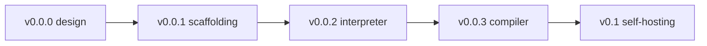

# Myla Roadmap & Status

The living source of truth for **what is built, what is in progress, what is
planned**, and **which decisions we have locked in**. Update this file as work
progresses.

Related docs: [language-spec.md](language-spec.md) · [grammar.md](grammar.md) ·
[architecture.md](architecture.md) · [future-features.md](future-features.md) ·
open questions in [clarification_needed.md](clarification_needed.md).

_Last updated: 2026-06-27._

---

## Status legend

| Symbol | Meaning |
|--------|---------|
| Done | Fully implemented and documented |
| In progress (NN%) | Started; approximate completion in percent |
| Planned | Agreed/scheduled, not started |
| Proposed | Idea documented, not yet decided |
| Decided | Design decision locked (may not be implemented yet) |

> "Progress %" is a rough engineering estimate, not a precise metric. For a
> design-phase milestone it reflects how much of the design is settled; for an
> implementation milestone it reflects code + tests + docs.

---

## Where we are now

**Current milestone: v0.0.0 — architecture & design.** No toolchain code exists
yet; the deliverables so far are the design documents and example programs.

---

## Milestone status

| Milestone | Description | Status |
|-----------|-------------|--------|
| v0.0.0 | Architecture & design (spec, grammar, architecture, examples) | In progress (90%) |
| v0.0.1 | Scaffolding: Python package layout + burn/unit/integration test harness | Planned |
| v0.0.2 | Working tree-walking interpreter; `myla run`; all burn-tests pass | Planned |
| v0.0.3 | Working x86-64 compiler; `myla build`; output matches interpreter | Planned |
| (in v0.0.1/0.0.2) | `#main` / `#test` attributes + `myla test` runner | Planned (pulled into v0.0 per D10) |
| v0.1 | Re-implement v0.0 in Myla; self-host interpreter then compiler | Planned |
| v0.2+ | Data modeling, collections, first-class functions, ergonomics | Proposed (see future-features.md) |

### v0.0.0 remaining work
- Done: language spec, formal grammar, architecture doc, per-feature examples,
  future-features design, roadmap + clarification tracking.
- Open: resolve the design questions in
  [clarification_needed.md](clarification_needed.md) that affect post-v0.0 work
  (none block starting v0.0.1).

---

## Feature status matrix

### v0.0 core language (target: v0.0.2 interpreter / v0.0.3 compiler)

| Feature | Designed | Implemented | Target |
|---------|----------|-------------|--------|
| `fun` function declarations | Done | Planned | v0.0.2 |
| `let` / `var` bindings + mutability | Done | Planned | v0.0.2 |
| Explicitly sized integers (`int8`..`uint64`) | Done | Planned | v0.0.2 |
| Integer literal type suffixes (`255u8`, `123i64`) | Done | Planned | v0.0.2 |
| `int` as alias of `int32` | Done | Planned | v0.0.2 |
| `typealias` declarations | Done | Planned | v0.0.2 |
| `#main` / `#test(...)[...]` attributes | Done | Planned | v0.0.1 |
| `bool`, `str` (length-prefixed, immutable, literals + `print`) | Done | Planned | v0.0.2 |
| Arithmetic / comparison / logical operators | Done | Planned | v0.0.2 |
| `if` / `else if` / `else` | Done | Planned | v0.0.2 |
| `while` | Done | Planned | v0.0.2 |
| `for ... in` ranges | Done | Planned | v0.0.2 |
| `struct` decl / construction / field access | Done | Planned | v0.0.2 |
| `print` builtin | Done | Planned | v0.0.2 |
| `return` (incl. exhaustiveness) | Done | Planned | v0.0.2 |
| Native codegen (x86-64, GAS, `as`/`ld`) | Done (design) | Planned | v0.0.3 |
| REPL (`myla repl`) | Partially | Planned | v0.0.2 |
| Test runner (`myla test` via `#test`) | Done (design) | Planned | v0.0.2 |

### Post-v0.0 features

| Feature | Status | Target | Notes |
|---------|--------|--------|-------|
| Functional pipelines `|>`, `>>`, `_` partial application | Decided | v0.4 | Juxtaposition/auto-currying rejected (D8) |
| Algebraic data types (`enum`) + `match` | Decided (design) | v0.2 | Highest-leverage for self-hosting |
| Tuples + multiple return (`return a, b`) | Decided (design) | v0.2 | |
| Generics via monomorphization | Decided | v0.2/v0.3 | Strategy locked (D13) |
| Collections: `[T]` list, `[K: V]` map | Decided (design) | v0.3 | Deep immutability (D14) |
| Memory model: reference counting | Decided | v0.3 | (D12) |
| Standard library | Planned | v0.3+ | Needs modules/imports |
| Lambdas / closures + function types | Decided (design) | v0.4 | By-value capture first; `ref` later (D15) |
| Error handling: `Result`/`Option` + `?` | Decided | v0.2+ | (D16) |
| Modules / imports (explicit, Python-like) | Decided | v0.3 | Resolution rules set (D17, D22); fine details at impl time |
| Operator overloading (via traits) | Decided | v0.5 | Needs traits (D18) |
| Custom operators | Postponed | post-1.0 | Beyond 1.0 (D18) |
| Floats (`float32`/`float64`, `float` alias, `fN` suffixes) | Decided (design) | TBD | Excluded from v0.0 (D19) |
| Compound assignment `+= -= *= /= %=`, `**`, `**=` | Proposed | v0.5 | Recommended |
| `++` / `--` | Dropped | — | Possible user-defined custom operator post-1.0 (D9) |
| User-defined macros / metaprogramming | Proposed | v1.x | After self-hosting |
| Traits | Proposed | v0.5 | README long-term vision |
| `str`: builder + views + byte-indexing + `format` | Decided (design) | v0.3 | v0.0 `str` is length-prefixed immutable (D21) |

---

## Decision log (locked decisions)

Newest first. These are settled; revisiting requires a deliberate new decision.

| # | Date | Decision | Rationale |
|---|------|----------|-----------|
| D22 | 2026-06-27 | Import resolution: leading-dot count selects the search base (no dot = builtins like `std` or project root; `.` = current file's directory; `..` = parent; `...` = grandparent; etc.). Any granularity importable (package/dir, module/file, function, const, struct, trait, ...). `import a.b.c` binds the **full path** `a.b.c`; use `import a.b.c as c` to rebind. `pub` marks exports (private by default). Name collisions are **errors** — resolve with aliases, no automatic resolution. | Explicit and predictable; avoids the footgun of magically binding the last path segment |
| D21 | 2026-06-27 | `str` in v0.0 is **length-prefixed, immutable, UTF-8** (pointer+length), supporting only literals + `print`. `StringBuilder`, string interpolation, views/slices, byte-indexing, and `format` come later (v0.3) | Keeps the bootstrap minimal while guaranteeing a performant, ergonomic string story before self-hosting |
| D20 | 2026-06-27 | Type names use full `intN`/`uintN`/`floatN`; literal suffixes use short `iN`/`uN`/`fN` (e.g. `255u8`, `123i64`, `3f32`) | Readable type names, terse literal disambiguation |
| D19 | 2026-06-27 | Floats are `float32`/`float64`; `float` is an alias for `float32`; literal suffixes `f32`/`f64` (e.g. `1.04f64`, `6f32`) | Mirrors the sized-integer model |
| D18 | 2026-06-27 | Operator overloading via traits to start; fully custom operators postponed to beyond 1.0 | Get things working first; custom operators are a large parser commitment |
| D17 | 2026-06-27 | Python-like imports, explicit only (no wildcards), from builtins or project files | Familiar, explicit (resolution rules later refined in D22) |
| D16 | 2026-06-27 | Error handling via `Result`/`Option` enums + `?` propagation operator (no exceptions) | Fits the ADT direction; explicit error flow |
| D15 | 2026-06-27 | Closures capture by value first; by-reference planned later via a `ref` keyword (e.g. `func(ref a)`) | Simple codegen now, clear path to by-ref |
| D14 | 2026-06-27 | Collections use deep immutability: `let` is immutable in binding and contents; mutation needs `var` | Predictable; safe sharing under reference counting |
| D13 | 2026-06-27 | Generics implemented via monomorphization | Simple native codegen, no boxing, no runtime type tags |
| D12 | 2026-06-27 | Memory model: reference counting first (once we leave all-on-stack) | Simple and predictable; revisit if needed |
| D11 | 2026-06-27 | Integer literals default to `int` (= `int32`); optional type suffixes disambiguate (`255u8`, `123i64`); float suffixes later | Ergonomic default with explicit override |
| D10 | 2026-06-27 | Pull `#main` / `#test(...)[...]` attributes into v0.0 (v0.0.0/0.0.1) so the parser/AST carry attribute metadata from the start; fixed built-in attribute set (not user macros) | Flagged as needed early; cheap if designed in, costly to retrofit |
| D9 | 2026-06-27 | Drop `++`/`--` operators from the core; once custom operators exist (post-1.0), a user may define `++` deliberately | Avoids the prefix/postfix footgun while leaving the door open |
| D8 | 2026-06-27 | Functional style uses `|>` (pipeline), `>>` (composition), `_` partial application; juxtaposition-composition and implicit auto-currying are rejected | Unambiguous grammar, keeps arity errors loud |
| D7 | 2026-06-27 | Primitives are explicitly sized integers (`int8`..`int64`, `uint8`..`uint64`); no dynamic/bignum integers | Fixed widths map to registers/memory; predictable self-hosting |
| D6 | 2026-06-27 | `int` is a built-in transparent type alias for `int32` | Ergonomic default while staying explicitly sized |
| D5 | 2026-06-27 | Support user `typealias Name = Type` (transparent, not new-type) in v0.0 | Cheap; needed to express `int`; improves readability |
| D4 | 2026-06-27 | Integer overflow wraps per operand width; no implicit mixing/widening between integer types | Simple codegen; explicit conversions keep semantics clear |
| D3 | 2026-06-26 | Function keyword is `fun` (not `fn`) | Owner preference |
| D2 | 2026-06-26 | Native backend targets x86-64, emits GAS assembly, links via `as`/`ld`, no libc | Honors no-dependency vision; syscalls cover v0.0 I/O |
| D1 | 2026-06-26 | v0.0 is statically typed, statement-oriented, value-semantics structs, tree-walking interpreter + direct-to-asm compiler | Simplicity; faithful interpreter/compiler parity for self-hosting |

Open decisions (not yet locked) live in
[clarification_needed.md](clarification_needed.md).

---

## How to update this file

- When you start a milestone/feature, flip it to **In progress** and add a `%`.
- When something ships (code + tests + docs), flip it to **Done**.
- When a design choice is settled, add a row to the **Decision log** and remove
  the corresponding entry from `clarification_needed.md`.
